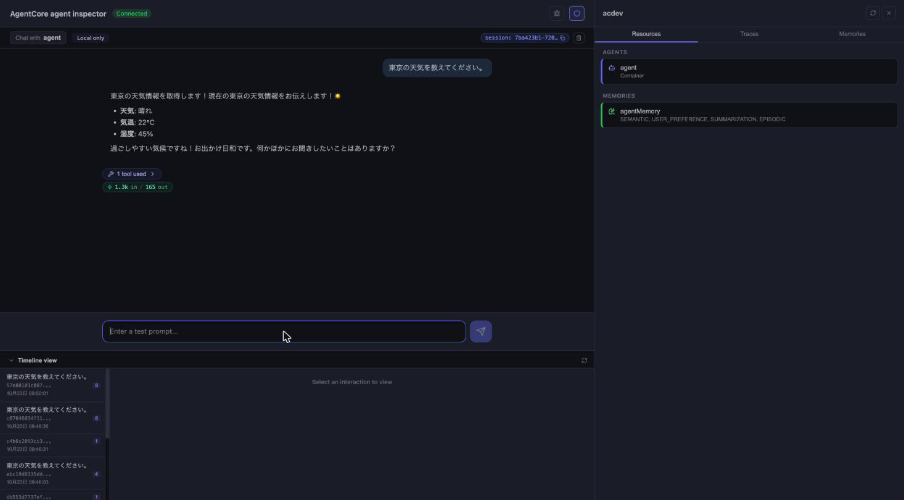

# AgentCore CLI 1.0.0で第1章の手順を進める

第1章ではAgentCoreのエージェントをRuntimeへデプロイするAgentCore CLI（`@aws/agentcore`）として、0.28.1を案内しました。2026年10月22日に1.0.0が公開され、`agentcore create`の画面と`agentcore invoke`の書き方が変わっています。

本書どおりに進めるなら0.28.1のままで大丈夫です。最新版で進めたい場合は、この補足で読み替えてください。

## 本書のバージョンで進める

第1章のコード1-13のとおりにバージョンを指定してインストールします。同梱の`weatherDemo`も0.28.1で作った状態のまま本書の手順で使えます。

```bash
npm install -g @aws/agentcore@0.28.1
agentcore --version
```

## 最新版で進める

最新版に入れ替えます。

```bash
npm install -g @aws/agentcore@latest
agentcore --version
```

本書と同じ内容のエージェントを1.0.0で作り、デプロイして呼び出すところまで試してみます。

### createのウィザード

`agentcore create`のウィザードは12項目から5項目になりました。表1-6の選択は次のように読み替えます。

| 本書の項目（表1-6） | 1.0.0での選択 |
|---|---|
| Project name | name（英字始まりの英数字、最大23文字）。`weatherDemo` |
| What would you like to build? | type。本書のAgentは`code-based`、Harnessは`config-based` |
| Agent name | 聞かれない。エージェントの名前は`agent`になる |
| Select agent type / Language / Build / Protocol / Framework | template。本書の選択（Python、Container、HTTP、Strands）は`agent-python-strands-container` |
| Model | model provider（`bedrock`）と、モデルID |
| Memory | 聞かれない。雛形にMemoryの設定が入っている |
| Advanced | ウィザードにはない |
| Confirm | review |

モデルIDのデフォルトは`global.anthropic.claude-sonnet-5-5`なので、本書と同じモデルを使いたいときは`us.anthropic.claude-sonnet-4-6`に書き換えます。

ウィザードを使わずに、次のように作ることもできます。

```bash
agentcore create --name weatherDemo --template agent-python-strands-container
```

### 生成されるプロジェクト

生成されるプロジェクトは、本書と同じ2層の構成です。

```text
weatherDemo/
├── agentcore/   # agentcore.jsonとデプロイ用のCDK
└── app/agent/   # エージェントのコード
```

エージェントのコードの置き場が`app/WeatherAgent/`から`app/agent/`に変わりました。雛形の`app/agent/main.py`にはシステムプロンプトと、2つの数を足す`add_numbers`関数が入っています。コード1-17のとおりに、次の部分を置き換えます。

```diff
-DEFAULT_SYSTEM_PROMPT = "You are a helpful assistant. Use tools when appropriate."
+DEFAULT_SYSTEM_PROMPT = """
+あなたは天気情報アシスタントです。
+"""

-@tool
-def add_numbers(a: int, b: int) -> int:
-    """Return the sum of two numbers"""
-    return a + b
-
-tools.append(add_numbers)
+@tool
+def get_current_weather(city: str) -> str:
+    """指定された都市の現在の天気を取得します。"""
+    weather_data = {
+        "東京": "晴れ、気温22℃、湿度45%",
+        "大阪": "曇り、気温20℃、湿度60%",
+        "札幌": "雪、気温-2℃、湿度70%",
+    }
+    return weather_data.get(city, f"{city}の天気情報は見つかりませんでした")
+
+tools.append(get_current_weather)
```

モデルは`app/agent/model/load.py`の`model_id`を書き換えます。

```diff
-    return BedrockModel(model_id="global.anthropic.claude-sonnet-5-5")
+    return BedrockModel(model_id="us.anthropic.claude-sonnet-4-6")
```

`agentcore deploy`は、本書と同じ書き方で実行できます。

### invokeの書き方

`agentcore invoke`は、質問を位置引数で渡せなくなりました。呼び出す先を`--runtime`で、質問を`--payload`で指定します。

```bash
agentcore invoke --runtime agent --payload '{"prompt":"東京の天気を教えてください。"}'
```

出力には、回答が細切れのイベントとして次のように出力されます。

```text
data: {"event": {"contentBlockDelta": {"delta": {"text": "東京の"}, "contentBlockIndex": 0}}}

data: {"event": {"contentBlockDelta": {"delta": {"text": "天気は晴れです"}, "contentBlockIndex": 0}}}

data: {"event": {"messageStop": {"stopReason": "end_turn"}}}
```

`jq`を使うと、`text`だけを取り出して回答として読めます。

```bash
agentcore invoke --runtime agent --payload '{"prompt":"東京の天気を教えてください。"}' \
  | grep '^data: ' | sed 's/^data: //' \
  | jq -rj '.event.contentBlockDelta.delta.text // empty'
```

### agentcore dev

使い方は本書と同じですが、`agentcore dev`だけではブラウザが開かなくなりました。デフォルトはターミナルへの出力だけなので、本書のようにAgent Inspectorを開くときは`--mode browser`を付けます。

```bash
agentcore dev --mode browser
```



## 同梱のweatherDemoを1.0.0で使う

同梱の`weatherDemo`も1.0.0でデプロイして呼び出せました。呼び出すときは、ランタイムの名前の`WeatherAgent`を指定します。

```bash
agentcore invoke --runtime WeatherAgent --payload '{"prompt":"東京の天気を教えてください。"}'
```

## 試すときの注意

プロジェクトの名前はそのままCloudFormationのスタックの名前（`AgentCore-<名前>-default`）になります。同じアカウントに同名のプロジェクトがあるとデプロイで上書きされるため、別の版で試すときは別の名前にしてください。

試し終わったら、プロジェクトのリソースをすべて外してから、デプロイして削除します。`agentcore deploy`に`--yes`を付けるのは、リソースがなくなったプロジェクトのスタックを消す確認のためで、`app/`のコードは削除されません。

```bash
agentcore remove all --yes
agentcore deploy --yes
```

[オンライン補足の一覧に戻る](../README.md)
