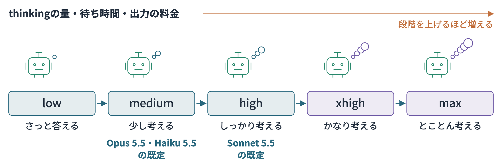
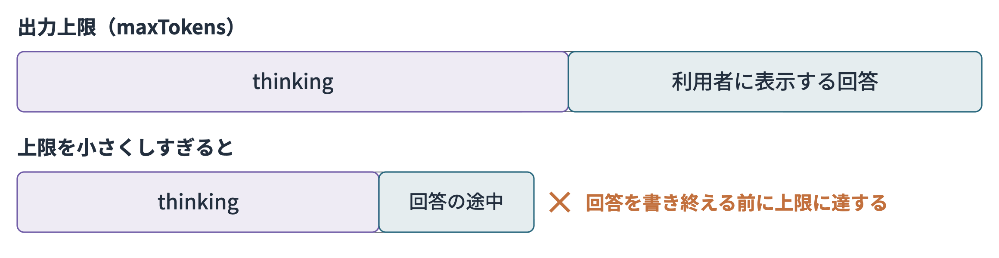

# 本編のコードで最新モデルを使う

新しいモデルが登場すると、本編で作ったアプリでも動かしてみたくなりますよね。本編で利用しているClaude Sonnet 4.6は執筆時点のものなので、少し前のモデルになります。

執筆後にはBedrockでもClaudeの[Sonnet 5.5](https://aws.amazon.com/blogs/machine-learning/introducing-claude-sonnet-5-5-on-aws/)や[Opus 5.5](https://www.anthropic.com/claude-opus-5-5)、OpenAIの[GPT-6 Sol／GPT-6 Luna](https://openai.com/index/introducing-gpt-6-sol-and-luna/)、[GPT-6.1 Sol](https://aws.amazon.com/blogs/machine-learning/bring-near-astra-intelligence-to-everyday-work-with-gpt-6-1-sol-on-amazon-bedrock/)が使えるようになりました。2026年10月7日には、Claudeの軽量モデル[Haiku 5.5](https://docs.aws.amazon.com/bedrock/latest/userguide/model-card-anthropic-claude-haiku-5-5.html)も加わっています。

この補足では、本編のコードでこれらの最新モデルを動かす手順を紹介します。モデルIDの変更とあわせて、設定や推論先についても押さえておきたいポイントをまとめました。

## 使えるモデルとID

Converse APIに指定するモデルIDは次のとおりです。米国内で推論するプレフィックス`us.`のほか、Opus 5.5とHaiku 5.5では日本向けの`jp.`も用意されています。Sonnet 5.5は、東京・大阪からだと`global.`でしか呼び出せないので注意してください。

| モデル                                                                                                            | Converseに指定するID                      |
| -------------------------------------------------------------------------------------------------------------- | ------------------------------------ |
| [Sonnet 5.5](https://docs.aws.amazon.com/bedrock/latest/userguide/model-card-anthropic-claude-sonnet-5-5.html) | `us.anthropic.claude-sonnet-5-5`     |
| Sonnet 5.5（東京・大阪から）                                                                                            | `global.anthropic.claude-sonnet-5-5` |
| [Opus 5.5](https://docs.aws.amazon.com/bedrock/latest/userguide/model-card-anthropic-claude-opus-5-5.html)     | `us.anthropic.claude-opus-5-5`       |
| Opus 5.5（日本向け）                                                                                                 | `jp.anthropic.claude-opus-5-5`       |
| [Haiku 5.5](https://docs.aws.amazon.com/bedrock/latest/userguide/model-card-anthropic-claude-haiku-5-5.html) | `us.anthropic.claude-haiku-5-5` |
| Haiku 5.5（日本向け） | `jp.anthropic.claude-haiku-5-5` |
| [GPT-6.1 Sol](https://docs.aws.amazon.com/bedrock/latest/userguide/model-card-openai-gpt-6-1-sol.html)         | `us.openai.gpt-6.1-sol`              |
| GPT-6 Sol                                                                                                      | `us.openai.gpt-6-sol`                |
| GPT-6 Luna                                                                                                     | `us.openai.gpt-6-luna`               |

## 第1章のコードで呼び出す

第1章で扱った`basic_converse.py`は、Sonnet 4.6へ質問を送信して回答とトークン使用量を表示するシンプルなものでした。今回の`latest_models_converse.py`では、モデルの切り替えや終了理由の出力、会話の継続処理を追加しています。AWSの認証情報を設定したターミナルで実行してみましょう。

```bash
cd sample-code/01
uv sync --frozen
uv run --frozen python latest_models_converse.py \
  --region us-east-1 \
  --model-id us.anthropic.claude-sonnet-5-5 --output sonnet55.json
```

スクリプト側で用意している質問は「Amazon Bedrockとは何ですか？3文で簡潔に説明してください。」です。実行すると、回答テキストに続いて終了理由・トークン使用量・所要時間が表示され、同じ内容が指定したJSONファイルにも保存されます。先ほどの表にあるモデルIDへ差し替えて試すこともでき、正常に回答を終えたことを示す`end_turn`が確認できます。任意の質問を試したい場合は`--question '質問文'`を渡してください。

やりとりをそのまま引き継いで追加の質問をする場合は、`--follow-up`オプションを付けます。

```bash
uv run --frozen python latest_models_converse.py \
  --region us-east-1 --model-id us.anthropic.claude-opus-5-5 \
  --follow-up 'いまの説明を一文にまとめてください。'
```

呼び出しの動作が確認できたところで、実装面では何が違うのか、コードの差分も見ていきましょう。

## 回答を取り出すコードも変える

モデル呼び出しの実装を見てみましょう。temperatureやthinkingの量はモデルの既定値を使い、出力上限を指定しています。

```python
response = client.converse(
    modelId=model_id,
    messages=messages,
    inferenceConfig={"maxTokens": 4096},
)
message = response["output"]["message"]
answer = "\n".join(
    block["text"] for block in message["content"] if "text" in block
)
print(answer)
print("終了理由:", response["stopReason"])
print("使用量:", response["usage"])

# 会話を続ける際は、表示用テキストではなく元の応答を保持する。
messages.append(message)
```

実際のOpus 5.5の応答を見ると、先頭にthinkingブロック（`reasoningContent`）が返り、その後に回答テキストが並んでいました。`content[0]["text"]`のように先頭を決め打ちで参照してしまうと、thinkingブロックには`text`キーがないためエラーになります。画面表示用にはテキストブロックを取り出し、会話を続けるコンテキストにはthinkingブロックも含めた元のメッセージをそのまま引き継ぐようにしています。

## 以前の設定で変えるところ

Sonnet 4.6ではthinkingの設定を省略するとthinkingが無効な状態で動きますが、Sonnet 5.5やOpus 5.5では省略してもadaptive thinkingが有効になります。モデルIDを変えただけで消費トークン数や応答の待ち時間が変わる場合は、この挙動の違いが原因の一つです。

以前のモデル向けに使っていた以下の設定は、Sonnet 5.5とOpus 5.5へそのまま送るとエラーになります。Haiku 5.5は少し扱いが異なるため、表のあとにまとめました。

| 既存コードの指定                                             | 変更するところ                                             |
| ---------------------------------------------------- | --------------------------------------------------- |
| `thinking.type: enabled` と `budget_tokens` でthinkingのトークン数を決める | `budget_tokens` の指定を外し、adaptive thinkingを使う |
| `temperature: 0.2` の指定                                         | temperatureの指定を外す。フレームワークから追加されていないかも見る                      |
| thinkingを無効にする `thinking.type: disabled`                   | 削除する。thinkingを最も軽くするなら `thinking.type: between_tools` を使う |
| 必ずツールを呼ばせる `toolChoice: {"any": {}}`                 | 自動選択へ変える。必要なツールが呼ばれたかはアプリ側で確認する                     |

Haiku 5.5へ同じ設定を送った場合、`temperature`と`budget_tokens`はSonnet 5.5やOpus 5.5と同様にエラーになります。一方、`thinking.type: disabled`でthinkingを無効化でき、`toolChoice: {"any": {}}`も引き続き利用可能です。thinkingを無効にした場合のeffortは`high`まで指定でき、`xhigh`を指定すると「thinkingを無効にしたときは使えない」というエラーが返ります。

### effortでthinkingの量を決める

新しいモデルでは、回答前のthinkingの量を`effort`で調整します。
Sonnet 4.6にはなかった設定項目なので、ここで確認しておきましょう。

段階は`low`・`medium`・`high`・`xhigh`・`max`の5段階です。段階を上げるにつれてthinkingで消費するトークンが増加し、そのぶん待ち時間と出力料金が増えます。既定値はSonnet 5.5が`high`、Opus 5.5とHaiku 5.5が`medium`です。Haiku 5.5はeffortを指定できる初めてのHaikuモデルですね。なお、同じ段階名でもモデルごとにthinkingの量は異なります。[Sonnet 5.5のモデルカード](https://docs.aws.amazon.com/bedrock/latest/userguide/model-card-anthropic-claude-sonnet-5-5.html)・[Opus 5.5の変更点](https://platform.claude.com/docs/en/models/opus-5-5/whats-new-opus-5-5)・[Haiku 5.5のモデルカード](https://docs.aws.amazon.com/bedrock/latest/userguide/model-card-anthropic-claude-haiku-5-5.html)



Converse APIでは`additionalModelRequestFields`の中で指定します。

```python
response = client.converse(
    modelId="us.anthropic.claude-sonnet-5-5",
    messages=messages,
    inferenceConfig={"maxTokens": 16000},
    additionalModelRequestFields={
        "thinking": {"type": "adaptive"},
        "output_config": {"effort": "low"},
    },
)
```

段階ごとの挙動を見るため、「社内のVPN接続が週に数回切れると相談されました。原因の切り分け手順を3段階で、各段階1文で答えてください。」というプロンプトを各段階で実行してみました。出力トークン数にはthinkingの分も含まれます。

| effort   | Sonnet 5.5 | Opus 5.5 | Haiku 5.5 |
| -------- | ---------: | -------: | --------: |
| `low`    | 354（4.7秒） | 319（8.0秒） | 301（2.8秒） |
| `medium` | 333（3.9秒） | 341（6.7秒） | 274（2.7秒） |
| `high`   | 402（4.5秒） | 634（9.3秒） | 489（3.9秒） |
| `xhigh`  | 710（6.5秒） | 602（10.2秒） | 923（5.9秒） |
| `max`    | 1,074（8.6秒） | 1,927（24.7秒） | 5,086（22.9秒） |

数値は出力トークン数で、かっこ内は所要時間です。

上の段階へ引き上げるほど、出力トークン数と所要時間が増える傾向が見て取れます。Opus 5.5の`max`は`low`と比べて約6倍のトークンと約3倍の時間を使いました。Haiku 5.5は`high`までは4秒以内で応答したものの、`max`に設定すると`low`の約17倍のトークンを消費し、20秒を超えました。軽量なモデルであっても、`max`を指定すると待ち時間が大幅に延びる点には留意しておきたいところです。

どの段階を選ぶかについては、[Sonnet 5.5の変更点](https://platform.claude.com/docs/en/models/sonnet-5-5/whats-new-sonnet-5-5)に指針が示されています。基本的には`high`から試し、ツール呼び出しを繰り返すタスクには`medium`、チャットなど応答速度を優先したい場面では`medium`や`low`から試すことが推奨されています。実際のワークロードに合わせて回答の精度とレイテンシを測定しながら調整していくのが確実です。

また、出力上限（maxTokens）にはユーザーへ返す回答テキストだけでなく、thinkingで消費するトークンも合算されます。回答自体が短文であっても上限を低く設定しすぎると、思考や回答の途中で上限に達して停止してしまうため余裕を持たせて設定しましょう。



### Sonnet 5.5・Opus 5.5で会話を続ける場合

エージェントへ組み込む際は、会話履歴の受け渡し方にも注意を払う必要があります。Sonnet 5.5とOpus 5.5では、thinkingブロックより前にあるシステム指示やツール定義、会話の履歴が後続のリクエストで変更されていないかを検証する仕組みが入っています。途中でこれらが書き換わっていると、thinkingブロックをそのまま返送したリクエストがエラーになります。Sonnet 5やOpus 5には存在しなかった仕様です。Sonnet 5.5では、新しめのアカウントにおいて既定でこの検証が有効になっています。[会話履歴と署名の扱い](https://platform.claude.com/docs/en/build-with-claude/preserved-thinking)

そのため、対話の途中で履歴を要約したりツール定義を動的に差し替えたりする実装では、thinkingブロックの扱いを再検討する必要があります。シンプルな会話フローであれば、受け取ったモデル応答を崩さずに保持したまま、新しいユーザー発話やツール実行結果を末尾に追加していく構成が適しています。

さらに、ツール呼び出しの合間に挟まれる進捗メッセージも、Sonnet 5.5とOpus 5.5ではthinkingブロック側で出力されるようになりました。標準ではテキスト部分が空になるため、テキストイベントを監視して処理状況を表示しているUIでは画面の更新が止まる可能性があります。アプリケーション側でツールの実行状態を捉えて画面に反映するか、[移行ガイドの進捗表示](https://platform.claude.com/docs/en/models/opus-5-5/migration-guide#text-between-tool-calls)に沿って表示ロジックを更新してください。

## 推論先と料金

東京リージョンに接続する場合でも、グローバル推論のプロファイルを使うと処理が日本国外で行われる可能性があります。データを日本国内で完結させたい案件では、`jp.`で始まる日本向けの推論プロファイルを提供しているモデルを選びましょう。

| モデル                                                                                                                | 日本向けの推論プロファイル        |
| ------------------------------------------------------------------------------------------------------------------ | -------------------- |
| [Sonnet 4.6](https://docs.aws.amazon.com/bedrock/latest/userguide/model-card-anthropic-claude-sonnet-4-6.html)（本編） | あり                   |
| Sonnet 5.5                                                                                                         | なし。東京・大阪からはグローバル推論のみ |
| Opus 5.5                                                                                                           | あり                   |
| Haiku 5.5 | あり。東京と大阪へ振り分け |

Sonnet 5.5では、東京から`jp.anthropic.claude-sonnet-5-5`を指定してもIDが無効というエラーになって呼び出せません。最新世代で国内推論が必須の場合はOpus 5.5やHaiku 5.5を選び、Sonnetクラスが必要ならSonnet 4.6の`jp.`プロファイルを使います。旧世代では[Haiku 4.5](https://docs.aws.amazon.com/bedrock/latest/userguide/model-card-anthropic-claude-haiku-4-5.html)・[Sonnet 4.5](https://docs.aws.amazon.com/bedrock/latest/userguide/model-card-anthropic-claude-sonnet-4-5.html)・[Opus 4.7](https://docs.aws.amazon.com/bedrock/latest/userguide/model-card-anthropic-claude-opus-4-7.html)・[4.8](https://docs.aws.amazon.com/bedrock/latest/userguide/model-card-anthropic-claude-opus-4-8.html)も日本向けプロファイルに対応しています。

Opus 5.5の日本向けプロファイルは東京と大阪にトラフィックが振り分けられます。実行時は次のようにリージョンと`jp.`のモデルIDを組み合わせて指定します。

```bash
uv run --frozen python latest_models_converse.py \
  --region ap-northeast-1 --model-id jp.anthropic.claude-opus-5-5
```

料金は推論プロファイルごとに異なるので、最新情報は[Bedrock料金](https://aws.amazon.com/bedrock/pricing/)のページを確認してください。AWSのPrice List APIと各モデルカードに記載されている標準単価は次のとおりです。単位は100万トークンあたりの米ドルで、GPT系は入力が27万2千トークン以下の場合の数値を載せています。`us.`や`jp.`といった地域内推論プロファイルは、グローバル推論と比べて1割高い設定になっています。

| モデル            | グローバル推論（入力／出力） | 地域内の推論（入力／出力）             |
| -------------- | -------------- | ------------------------- |
| Sonnet 4.6（本編） | $3.00／$15.00   | $3.30／$16.50              |
| Sonnet 5.5     | $2.00／$10.00   | $2.20／$11.00（`us.`・`eu.`） |
| Opus 5.5       | $4.00／$20.00   | $4.40／$22.00              |
| Haiku 5.5      | $0.10／$0.50    | $0.11／$0.55              |
| Haiku 5.5（入力が10万トークン超） | $0.50／$2.50 | $0.55／$2.75 |
| GPT-6.1 Sol    | $2.00／$10.00   | $2.20／$11.00（`us.`）       |
| GPT-6 Sol      | $2.00／$10.00   | $2.20／$11.00（`us.`）       |
| GPT-6 Luna     | $0.10／$0.50    | $0.11／$0.55（`us.`）        |

Sonnet 5.5はSonnet 4.6と比べても単価が安くなっていますね。またHaiku 5.5は入力・出力ともにSonnet 5.5の20分の1の価格設定で、モデルカードでも大量処理や低レイテンシが求められる用途向けと位置づけられています。まずは問い合わせの自動分類といった前処理タスクあたりから試してみると良さそうです。

ただしHaiku 5.5は入力が10万トークンを超えると、そのリクエスト全体が通常の5倍の単価になります。Sonnet 4.6以降のほかのClaudeには、このように入力の長さで単価が変わる仕組みはありません。[長い入力の料金](https://platform.claude.com/docs/en/about-claude/pricing#long-context-pricing)

| 1回のリクエスト（地域内の推論） | Sonnet 4.6 | Haiku 5.5 |
|---|---:|---:|
| 入力2,000・出力1,000トークン | $0.0231 | $0.00077（約30分の1） |
| 入力15万・出力1,000トークン | $0.5115 | $0.0853（約6分の1） |

短い問い合わせなら約30分の1ですが、長い資料をまとめて渡す処理では差が約6分の1まで縮みます。RAGで検索結果を多く渡したり、会話履歴を長く積み上げたりする場合は、入力の長さも見ておきましょう。新しいモデルが出て移行の手間が少なそうなら、どんどん試していきたいところです。

## Knowledge Basesと組み合わせて使う

Knowledge Basesと組み合わせる場合は、ClaudeとGPTで扱い方が少し変わってきます。

### ClaudeはKnowledge Basesの回答生成にそのまま使える

Sonnet 5.5・Opus 5.5・Haiku 5.5は、Knowledge Basesの`RetrieveAndGenerate`で回答を生成するモデルとして指定できます。第3章で作成したアプリでも、`MODEL_ID`を差し替えるだけで回答と引用元がしっかり返ってきました。

ただし、修正前の第3章のハンドラーでは、`MODEL_ID`をSonnet 5以降のClaudeへ切り替えた際に次のエラーが出ました。Haiku 5.5を使う場合も、プロンプトを渡さずに`RetrieveAndGenerate`を呼び出すと通常検索と同じエラーになります。

| モード  | エラーの内容                                                                                                          |
| ---- | --------------------------------------------------------------------------------------------------------------- |
| 通常検索 | `Custom prompt templates must be provided for both Orchestration and Generation when using the selected model.` |
| 資料横断 | ``temperature` is deprecated for this model.`                                                                   |

対応として、`model-settings.ts`と`handler.ts`の3か所に手を入れています。

1. Knowledge Basesへ渡すプロンプトの設定です。新しいモデルでは、検索クエリを組み立てる指示（`orchestrationConfiguration`）と回答を組み立てる指示（`generationConfiguration`）の両方が求められます。`knowledgeBasePrompts()`側で、前者には会話履歴と質問、後者には検索結果を渡すようにしました。引用を返すための`$output_format_instructions$`も含めています。[Knowledge Baseのプロンプト設定](https://docs.aws.amazon.com/bedrock/latest/userguide/kb-test-config.html)
2. Converseの推論設定です。新しいモデル向けの処理として`converseConfig()`からtemperatureの設定を外し、出力上限はthinkingの領域も考慮して4096に広げました。本編で使ったSonnet 4.6には、これまで通りtemperatureと出力上限を渡します。
3. 応答の読み取り処理です。thinkingブロックが先頭に入ってきても問題なく処理できるよう、テキストブロックを順につなげて取り出します。

どのモデルに新しい設定を適用するかは、`model-settings.ts`の配列で管理しています。モデルIDの末尾文字列で判定しているため、`us.`や`global.`プレフィックス付きのIDでも推論プロファイルのARNでも共通して判定されます。

```typescript
const reasoningModels = [
  "anthropic.claude-sonnet-5",
  "anthropic.claude-sonnet-5-5",
  "anthropic.claude-opus-5",
  "anthropic.claude-opus-5-5",
  "anthropic.claude-haiku-5-5",
  "openai.gpt-6-sol",
  "openai.gpt-6.1-sol",
  "openai.gpt-6-luna",
]
```

### Haiku 5.5とSonnet 4.6の回答を比べる

短い入力ならSonnet 4.6の約30分の1の単価で済むとなると、本編の回答生成をHaiku 5.5へ置き換えて実用に耐えるかが気になりますよね。そこで第5章で用意した24件の評価ケースを使い、同一のKnowledge Base・同一のプロンプト条件で両モデルに回答させてみました。Knowledge Baseは、第2章の`setup-s3vectors.sh`で作るS3 Vectors版です。採点も第5章に合わせ、Excelの採点基準を用いたLLM-as-a-JudgeとRAGASの双方で実施し、採点モデルにはいずれもSonnet 4.6を採用しています。

```bash
cd sample-code/05
uv run --frozen python compare_answer_models.py --knowledge-base-id <KB_ID>
```

S3 Vectors版で2回実行した平均値は以下の通りです。

| 採点方法 | 指標 | Sonnet 4.6 | Haiku 5.5 |
|---|---|---:|---:|
| Excelの採点基準 | 正確性 | 0.67 | 0.56 |
| Excelの採点基準 | 網羅性 | 0.51 | 0.45 |
| Excelの採点基準 | 根拠性 | 0.49 | 0.54 |
| RAGAS | 期待要点の網羅性 | 0.40 | 0.40 |
| RAGAS | 根拠との整合性 | 0.86 | 0.99 |
| | 1件あたりの所要時間 | 5.4秒 | 6.2秒 |

今回の24件には社内資料に記載のない質問もあえて含んでいるため、全体のスコアは控えめです。Haiku 5.5は正確性が少し下がった一方で、根拠との整合性は高めの数値が出ました。全観点で満点だったケースは両モデルとも2回とも5件で一致しています。回答差を細かく見ていくと、どちらも「資料に記載がないため不明」と案内しているのにスコアが分かれた例もあり、ケースごとの差にはジャッジ側の評価の揺れも影響していそうです。

本編と同じOpenSearch Serverless版のKnowledge Baseでも1回比べました。正確性はSonnet 4.6が0.65、Haiku 5.5が0.54で、網羅性は0.54と0.42、根拠性は0.48と0.54です。満点の件数は5件と3件で、S3 Vectors版と同じ傾向でした。

この24件を見る限り、Sonnet 4.6に近い水準の回答が得られました。しかも今回のような短い入力なら単価は約30分の1と安いです。回答の質がほぼ変わらないなら、コストの面でもHaiku 5.5を選ぶ理由は十分にあります。所要時間に関してはHaiku 5.5のほうが1秒ほど長く、軽量なモデルだからといって応答速度まで常に速いとは限らない点には注意が必要です。検証環境で正確性を確認し、要件を満たせそうならHaiku 5.5への切り替えを前向きに検討してみると良さそうです。

ただし、個人のアカウントや利用料の少ないアカウントでは、新しいモデルに利用制限がかかっていることがよくあります。解除するにはサポートへの問い合わせしかありませんが、利用料などが内部の基準に達していないと解除されません。同じような問い合わせが多いのか、数か月たっても返答がない場合もあるようです。GPTなど、ほかの新しいモデルでも同じことが起こりえます。まずは自分のアカウントで呼び出せるかを確かめ、使えるなら試してみる、くらいに考えておきましょう。

### GPTは検索と回答生成を分けて使う

GPT-6 Sol・LunaやGPT-6.1 Solは、Knowledge Basesの回答生成モデルには直接指定できません。モデルカードの対応機能一覧にKnowledge Basesが含まれておらず、`RetrieveAndGenerate`で呼び出すと、リクエストに含めていなくても「temperatureに対応していない」というエラーが返ってきます。

GPTを活用したい場合は第2章で扱った構成と同様に、Knowledge Basesの`Retrieve`で検索処理を実行し、取得したコンテキストをもとにConverseでGPTに回答を生成させます。第2章の`retrieve_and_converse.py`は新モデル向けにtemperatureを省く修正を入れてあるため、GPT-6.1 Solを指定しても検索から回答生成までスムーズに動作します。

```bash
cd sample-code/02
uv run --frozen python retrieve_and_converse.py \
  --knowledge-base-id YOUR_KNOWLEDGE_BASE_ID \
  --model-id us.openai.gpt-6.1-sol \
  --question 'Enterpriseプランの監査ログの保存期間と、エクスポート方法を教えてください。'
```

本文のコード2-9を手元で実装している場合は、`inferenceConfig`から`temperature`を削除して実行してください。設定を残したままだとConverseの呼び出し時にエラーが発生します。

第3章で実装した資料横断モードであれば、処理ごとに別々のモデルを割り当てられます。`MODEL_ID`に質問分析と最終統合を担当させ、`ROUTE_MODEL_ARN`にKnowledge Basesでの中間回答作成を担当させる形です。`MODEL_ID`にGPT、`ROUTE_MODEL_ARN`にSonnet 4.6を設定すれば、GPTを司令塔にしたオーケストレーションが実現します。

```bash
cd sample-code/03/amplify-ui
export KNOWLEDGE_BASE_ID=YOUR_KNOWLEDGE_BASE_ID
export BEDROCK_REGION=us-east-1
export MODEL_ID=$(aws bedrock get-inference-profile \
  --region us-east-1 --inference-profile-identifier us.openai.gpt-6.1-sol \
  --query inferenceProfileArn --output text)
export ROUTE_MODEL_ARN=$(aws bedrock get-inference-profile \
  --region us-east-1 --inference-profile-identifier us.anthropic.claude-sonnet-4-6 \
  --query inferenceProfileArn --output text)
pnpm trace:rag --orchestration --output gpt61-sol-rag.json
```

通常検索モードでは`MODEL_ID`がKnowledge Basesの回答生成にも使われるため、GPTは指定できない点に留意してください。

魅力的な新モデルが登場した際はぜひ積極的に試していきたいところです。モデルごとにパラメータ仕様の差分が細かく存在するため、そうした違いを押さえつつ、スムーズにシステムへ取り入れていきましょう！
