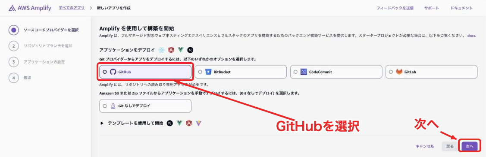
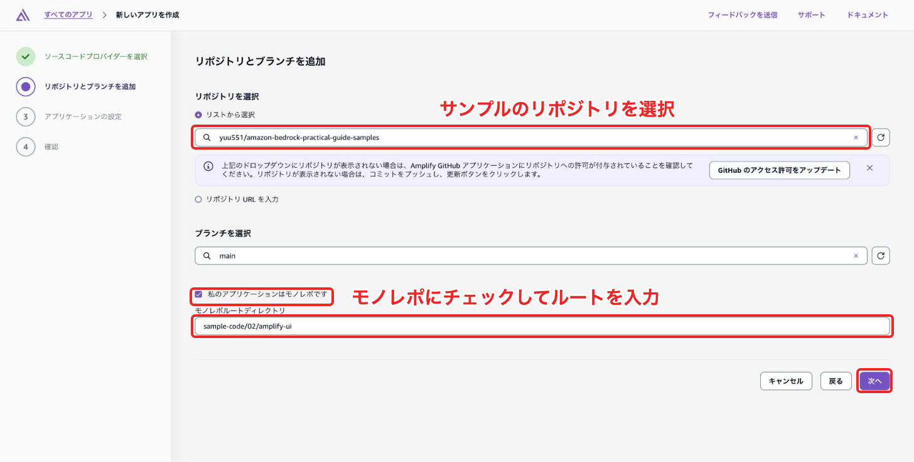
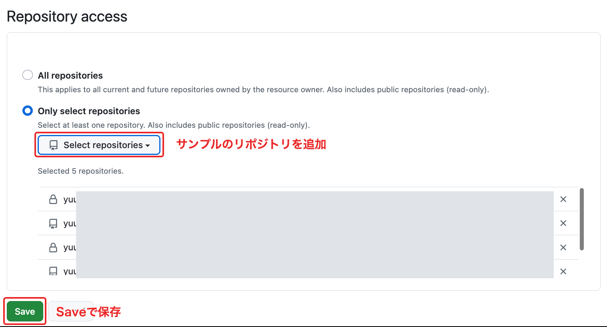
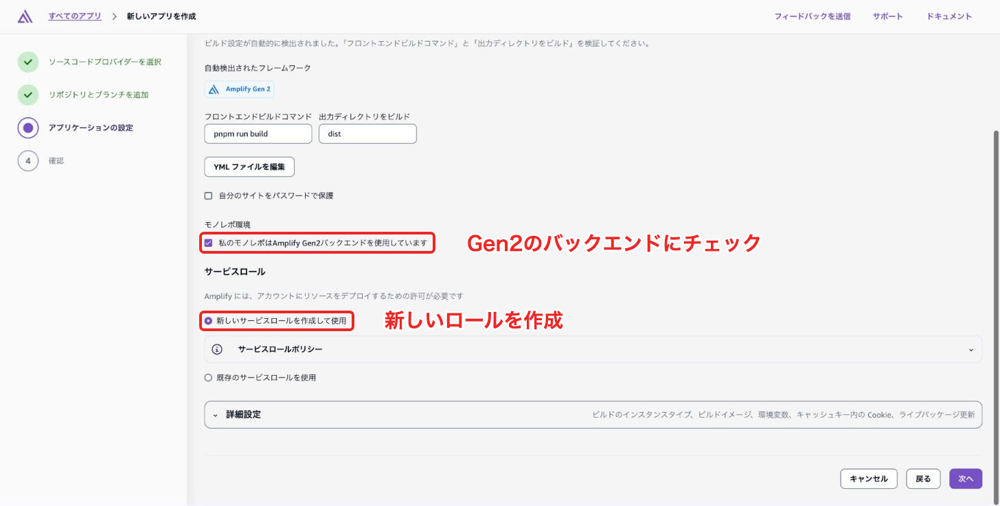
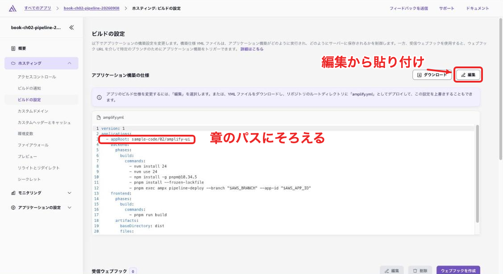
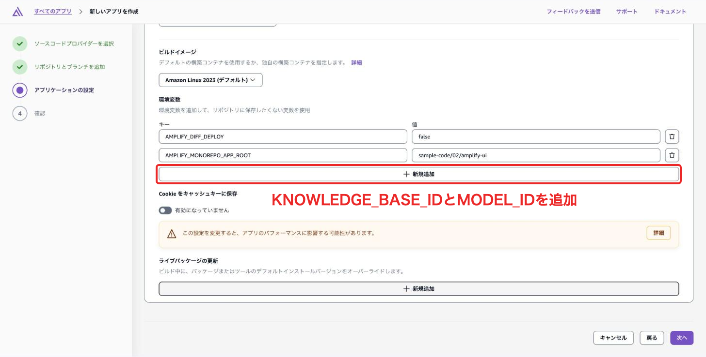
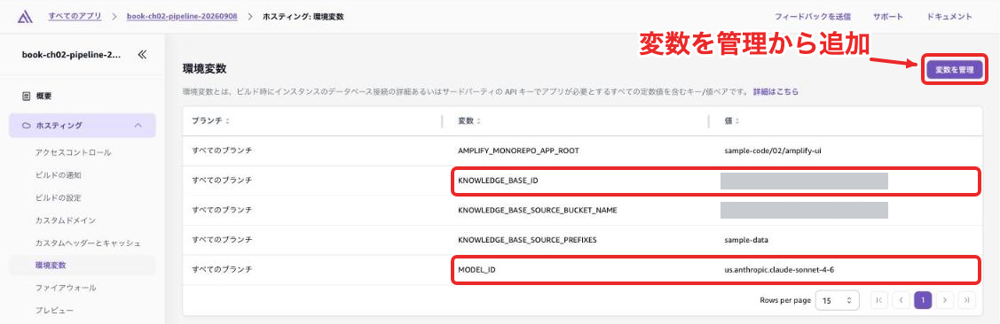
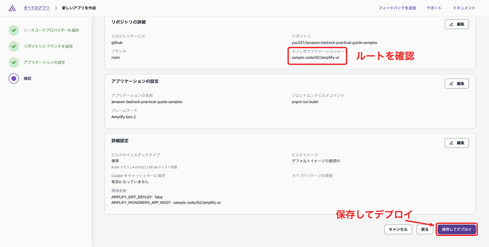
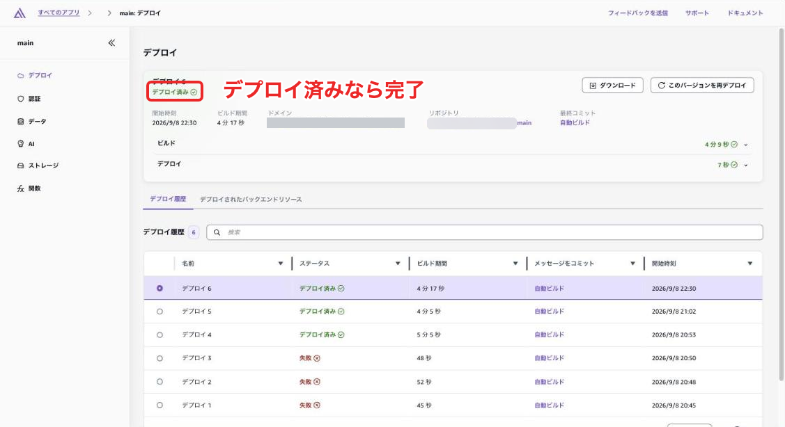

# Amplifyコンソールからアプリを公開する

本編で作ったアプリをほかの人にも試してもらいたくなったらAmplifyで公開してみましょう。GitHubリポジトリを接続すると画面とバックエンドをまとめてデプロイできます。

以下の設定でデプロイし、Webで公開した画面からログイン・質問・引用元の表示まで試せます。第2章を例に接続・ビルドの共通手順を説明し、第3・4・6章で追加する設定を後半にまとめています。


| 章   | アプリのルート                     | Knowledge Base             |
| --- | --------------------------- | -------------------------- |
| 第2章 | `sample-code/02/amplify-ui` | 第2章で作成したものを指定              |
| 第3章 | `sample-code/03/amplify-ui` | 検索方式に対応する既存のものを指定          |
| 第4章 | `sample-code/04/amplify-ui` | 既存のものを指定し、AgentCoreを新規作成   |
| 第6章 | `sample-code/06/amplify-ui` | Guardrail・推論プロファイルとともに新規作成 |


## sandboxとの違い

本編の `ampx sandbox` は開発用のバックエンドを作るのですが、今回はGitHubのブランチに対応するバックエンドを作り、画面もAmplify Hostingへ配置します。開発環境とは別のCognitoユーザープールとLambdaができるため、公開した画面でユーザーを登録する必要があります。

[Amplifyの開発環境とブランチ環境](https://docs.amplify.aws/react/start/quickstart/)

第2・3・4章のKnowledge BaseはAmplifyのコードで作成していないので、環境変数で既存のIDを渡します。  
同じIDを指定すれば開発環境と公開環境から同じ資料を検索することができます。

次の図のとおり、回答を生成する処理は第2・3章ではLambda、第4・6章ではAgentCore Runtimeで実行します。


## GitHubリポジトリを接続する

サンプルリポジトリを自分のGitHubアカウントへフォークするなどして更新できるリポジトリを用意します。

1. Knowledge Baseと同じAWSアカウント・リージョンでAmplifyコンソールを開きます。本編どおりなら米国東部（バージニア北部）、`us-east-1` です。
2. 「新しいアプリを作成」を選び、GitHubを選んで「次へ」を押します。



3. GitHubの接続画面で対象リポジトリへのアクセスを許可し、一覧からデプロイするリポジトリとブランチを選択します。ここでは `main` を使います。
4. 「私のアプリケーションはモノレポです」にチェックを入れ、ルートに `sample-code/02/amplify-ui` を入力して「次へ」を押します。



一覧にリポジトリが出ない場合は、「GitHub のアクセス許可をアップデート」からGitHub側のAmplifyの設定を開きます。「Only select repositories」に対象のリポジトリを追加し、「Save」で保存してください。ブラウザがAmplifyコンソールのポップアップをブロックしていると、許可の画面が開かず一覧も読み込まれませんので、その場合はアドレスバーからポップアップを許可します。



このリポジトリには複数の章のアプリが入っています。ルートを指定すると、第2章の `package.json` と `amplify/` がビルド対象になります。コンソールが設定する `AMPLIFY_MONOREPO_APP_ROOT` も同じパスになっていることを確認してください。

[モノレポの設定](https://docs.aws.amazon.com/amplify/latest/userguide/monorepo-configuration.html)

## ビルド設定を入れる

次の「アプリケーションの設定」では、「モノレポ環境」の「私のモノレポはAmplify Gen2バックエンドを使用しています」にチェックを入れます。チェックするとサービスロールの欄が表示されます。



続いて「YML ファイルを編集」を選び、ビルド設定を次の内容にします。これはコンソールへ保存する設定です。リポジトリのルートに `amplify.yml` がある場合はそのファイルの設定が優先されるため、そちらを編集します。

```yaml
version: 1
applications:
  - appRoot: sample-code/02/amplify-ui
    backend:
      phases:
        build:
          commands:
            - nvm install 24
            - nvm use 24
            - npm install -g pnpm@10.34.5
            - pnpm install --frozen-lockfile
            - pnpm exec ampx pipeline-deploy --branch "$AWS_BRANCH" --app-id "$AWS_APP_ID"
    frontend:
      phases:
        build:
          commands:
            - pnpm run build
      artifacts:
        baseDirectory: dist
        files:
          - '**/*'
```

`ampx pipeline-deploy` がブランチ用のバックエンドをデプロイし、その接続情報を `amplify_outputs.json` へ出力します。その後にViteで画面をビルドすると、公開先のCognitoとLambdaに接続する画面が `dist` に生成されます。sandbox用の設定ファイルをコピーする必要はありません。

[パイプラインのデプロイコマンド](https://docs.amplify.aws/react/deploy-and-host/fullstack-branching/custom-pipelines/)

サービスロールはAmplifyがバックエンドを作成するために使います。先ほどの欄で「新しいサービスロールを作成して使用」を選ぶか、Amplify Gen 2のデプロイ権限を持つ既存のロールを選びます。設定手順は[Amplifyのサービスロール](https://docs.aws.amazon.com/amplify/latest/userguide/amplify-service-role.html)を参照してください。

作成後にビルド設定を変える場合は、「ホスティング」→「ビルドの設定」の「編集」から変更します。



## Knowledge Baseとモデルを指定する

第2・3・4章では保存してデプロイする前に、環境変数へ次の値を追加します。同じ画面の「詳細設定」を開き、環境変数の「新規追加」から入力してください。`AMPLIFY_MONOREPO_APP_ROOT` はモノレポのルートから自動で入ります。第6章は後述の専用設定を使います。




| 変数名                 | 設定する値                            |
| ------------------- | -------------------------------- |
| `KNOWLEDGE_BASE_ID` | 第2章で作成し、同期を終えたKnowledge BaseのID  |
| `MODEL_ID`          | 本編のアプリで動作を確認したモデルIDまたは推論プロファイルID |


たとえば本編と同じ推論プロファイルを使う場合、`MODEL_ID` は `us.anthropic.claude-sonnet-4-6` です。既存アプリで変更する場合は、「ホスティング」→「環境変数」の「変数を管理」から設定します。



これらはビルド時に `amplify/backend.ts` が読み取り、回答を生成するLambdaやAgentCore Runtimeへ渡します。Codespacesやローカルのシェルで設定した値は引き継がれません。設定を変えた場合は再デプロイしてください。

[コンソールで環境変数を設定する](https://docs.aws.amazon.com/amplify/latest/userguide/setting-env-vars.html)

出典のS3ファイルを画面から開く場合は、 `KNOWLEDGE_BASE_SOURCE_BUCKET_NAME` に資料のバケット名、`KNOWLEDGE_BASE_SOURCE_PREFIXES` に許可するプレフィックスを指定します。第2章のアップロード例なら `sample-data` です。複数ある場合はカンマで区切ります。回答処理の実行ロールには、指定されたS3の範囲への読み取り権限が付与されます。

設定後は再デプロイし、画面を再読み込みして新しく質問し、引用番号や「資料を開く」から元資料へ遷移できるか確認してみましょう。

## 第3章では検索方式とデータの取り込みを確認する

アプリのルート、`AMPLIFY_MONOREPO_APP_ROOT`、ビルド設定の `appRoot` を `sample-code/03/amplify-ui` にそろえます。モデルと引用元S3の指定は第2章と同じです。

ハイブリッド検索には対応するベクトルストアが必要でOpenSearchを使用しましょう。

リランキングを試す場合は `RERANK_MODEL_ARN` と必要な権限も設定します。第3章のセットアップ手順で使う検索方式の前提を確認してください。

## 第4・6章ではAgentCoreの名前を分ける

第4章では `sample-code/04/amplify-ui`、第6章では `sample-code/06/amplify-ui` をアプリのルートに指定します。ビルド設定は共通ですが、バックエンドの作成時にAgentCore用コンテナのARM64ビルドも実行されます。

開発用sandboxと同じ名前のリソースを作ると衝突するため、次の値を環境ごとに分けます。例は新しい環境に置き換えて使ってください。


| 変数名                     | 第4章の例                                 | 第6章の例                                 |
| ----------------------- | ------------------------------------- | ------------------------------------- |
| `AGENT_RUNTIME_NAME`    | `support_agent_ch04_hosted`           | `support_agent_ch06_hosted`           |
| `AGENT_GATEWAY_NAME`    | `support-gateway-ch04-hosted`         | `support-gateway-ch06-hosted`         |
| `AGENT_MEMORY_NAME`     | `SupportMemoryCh04Hosted`             | `SupportMemoryCh06Hosted`             |
| `ATLASSIAN_SECRET_NAME` | `support-agent/ch04-hosted/atlassian` | `support-agent/ch06-hosted/atlassian` |


Runtime名は先頭を英字、2文字目以降を英数字またはアンダースコアで指定します。

ConfluenceやJiraを使う場合は、次の環境変数も追加します。


| 変数名                    | 設定する値                                            |
| ---------------------- | ------------------------------------------------ |
| `ATLASSIAN_BASE_URL`   | `https://your-site.atlassian.net` など、利用するサイトのURL |
| `CONFLUENCE_SPACE_KEY` | 検索対象スペースのキー                                      |
| `JIRA_PROJECT_KEY`     | 検証用プロジェクトのキー                                     |
| `JIRA_ISSUE_TYPE`      | プロジェクトで使用できる課題タイプ。例は `Task`                      |


デプロイ後にSecrets Managerコンソールで `ATLASSIAN_SECRET_NAME` に指定した名前のシークレットを開き、「シークレットの値を取得」から値を編集し、`email` と `apiToken` のキーに認証情報を保存します。APIトークンはGitHubやAmplifyの環境変数へ書き込まず、Secrets Managerへ保管します。

## 第6章ではGuardrailとKnowledge Baseも作成する

第6章ではバックエンドがKnowledge Base・資料バケット・Guardrail・アプリケーション推論プロファイルをまとめて作成します。前節のAgentCore用設定に加えて、次の値を指定します。


| 変数名                | 設定例                                                                                       |
| ------------------ | ----------------------------------------------------------------------------------------- |
| `ENV_NAME`         | `prod`。同じアカウント・リージョンの既存環境と重複させない                                                          |
| `MODEL_SOURCE_ARN` | `arn:aws:bedrock:us-east-1:123456789012:inference-profile/us.anthropic.claude-sonnet-4-6` |
| `KB_VECTOR_STORE`  | `S3_VECTORS`                                                                              |


`MODEL_SOURCE_ARN` のアカウントIDは自分の値へ置き換えます。ここで指定したプロファイルをもとに、環境専用の推論プロファイルを作成します。`MODEL_ID` は省略でき、Runtimeは作成された推論プロファイルを使います。

サンプル資料のアップロードとKnowledge Baseの同期もデプロイ時に実行します。引用元のバケットとプレフィックスはコードで渡されるため、第2章用の `KNOWLEDGE_BASE_SOURCE_BUCKET_NAME` と `KNOWLEDGE_BASE_SOURCE_PREFIXES` は設定不要です。デプロイ後はKnowledge Baseの同期結果も確認してください。

## 公開した画面で確かめる

確認画面でリポジトリ・ブランチ・モノレポのルートを確かめ、「保存してデプロイ」を選びます。



バックエンドのデプロイ・画面のビルド・Hostingへの配置が完了するのを待ちます。対象ブランチのデプロイ履歴で「デプロイ済み」になれば完了です。エラーが出た場合はビルドログで失敗したコマンドを確認します。



デプロイが完了したら表示された公開URLを開きます。Cognitoのアカウントを登録してログインし、本編で試した質問を送ってください。回答が順に表示されること、資料に対応する出典が表示されること、S3の出典リンクを設定した場合はそのファイルを開けることを確認します。

このサンプルにはサインアップ画面があるため、確認中のURLはAmplify HostingのBasic認証などで保護し、公開時はユーザー登録を誰に許可するか決めてください。HostingのBasic認証を設定した場合も、アプリ内ではCognitoへログインします。

ブランチの自動ビルドを有効にしていれば、そのブランチへ変更をPushすると再デプロイされます。画面だけでなく `amplify/` の変更も反映対象になります。[ブランチごとのデプロイ](https://docs.amplify.aws/react/deploy-and-host/fullstack-branching/branch-deployments/)

## 第5章の評価には画面URLではなくAPIの接続先を使う

第5章の評価スクリプトへ `amplifyapp.com` の画面URLを渡しても、RAG APIは呼び出せません。第3章の公開バックエンドを評価する場合は、その環境の `amplify_outputs.json` にある `custom.ragFunctionUrl` を使います。

接続情報は第3章の `amplify-ui` ディレクトリで次のコマンドを実行して取得できます。`YOUR_APP_ID` はAmplifyコンソールの対象アプリIDへ置き換えます。別ディレクトリへ出力して、sandbox用のファイルを上書きしないようにします。

```bash
pnpm exec ampx generate outputs --app-id YOUR_APP_ID --branch main --out-dir ./hosting-outputs
```

エンドポイントを取得したら、第5章の評価手順に従って評価を実行してください。

## 試し終わった環境を削除する

検証が終わって不要になった場合は、Amplifyコンソールから対象アプリを削除し、対応するバックエンドのCloudFormationスタックも削除されたことを確認します。削除時に保持されたリソースや失敗したスタックがあれば、その内容を確認して片付けましょう。

[オンライン補足の一覧に戻る](../README.md)