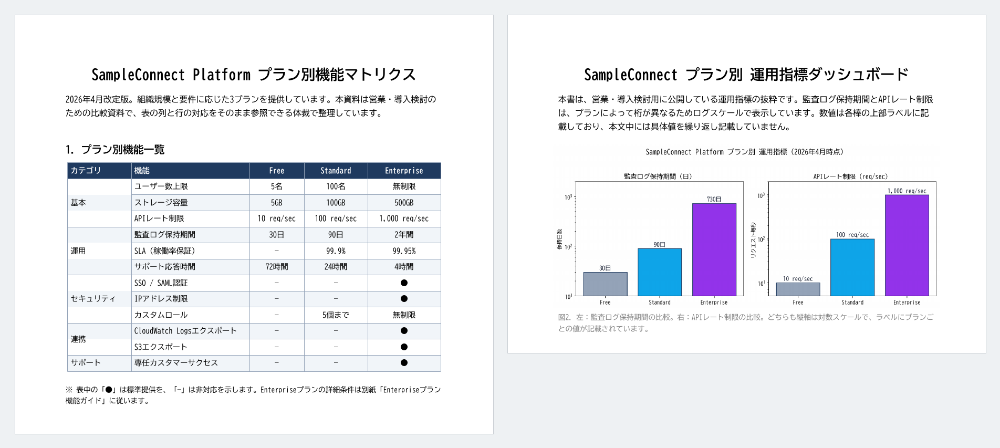
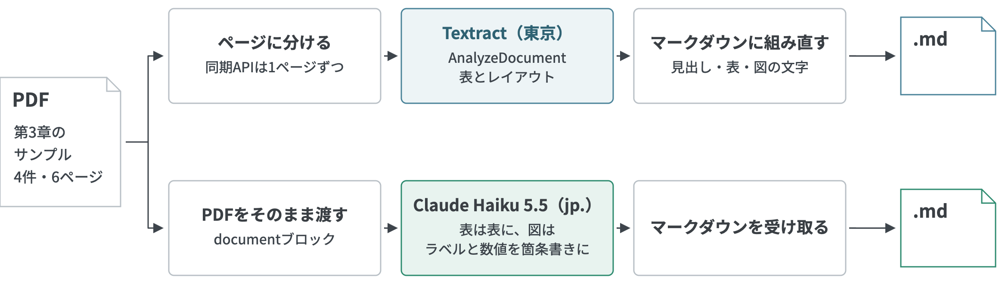

# 日本語に対応したAmazon TextractでPDFを読み取る

2026年11月2日にAmazon Textractの文字検出モデルが更新され、日本語を含む40以上の言語に対応しました！
同じ日に東京リージョンでも使えるようになっています。

[AWSの発表（日本語を含む40以上の言語に対応）](https://aws.amazon.com/about-aws/whats-new/2026/11/textract-text-detection-model/)
[AWSの発表（東京リージョンで利用開始）](https://aws.amazon.com/jp/about-aws/whats-new/2026/11/textract-tokyo-zurich/)

第3章では図表を含むPDFを基盤モデルパーサーで、[生成AIでPDFを解析して取り込む](生成AIでPDFを解析して取り込む.md)ではConverse APIで読み取りました。
日本語のPDFをTextractでどこまで読めるのか本のサンプルPDFで試し、同じPDFをClaude Haiku 5.5で変換した結果とも比べてみました。

## 日本語に対応した範囲

新しいモデルはテキスト検出（DetectDocumentText）と文書分析（AnalyzeDocument）で使われ、APIを変えなくても自動で切り替わります。多言語の表の抽出も結合セルや傾いた表に強くなったとされています。

日本語に対応したのは印刷された文字の検出です。[FAQ](https://aws.amazon.com/textract/faqs/)によると手書きは英語のみで、フォーム（キーと値の組）とQueriesも日本語の対象外です。また東京リージョンでは、請求書・身分証・ローン書類向けのAPIとCustom Queriesは提供されていません。

## 読ませたPDF

第3章の[sample-pdfs](../../sample-code/03/sample-pdfs/)にある4件（計6ページ）を使いました。料金表は「●」と「—」で機能の有無を示し、グラフは数値を棒の上のラベルにだけ書いています。



残りの2件は構成図と表を含むアーキテクチャ資料と、3ページの障害報告書です。

## 2つの読み方

Textractは座標つきの文字や表のセルを返すので、それをマークダウンに組み直します。ClaudeにはPDFをそのまま渡し、マークダウンで返してもらいます。



Textract側のスクリプトは[textract_document_parse.py](../../sample-code/03/textract_document_parse.py)で、次の順に処理します。

1. PDFをページごとに分ける（同期APIは1ページずつ受け付けるため）
2. 表（TABLES）とレイアウト（LAYOUT）を指定してAnalyzeDocumentに送る
3. 見出しは見出しに、表はマークダウンの表に、図の中の文字は箇条書きにする
4. 日本語の前後に入る空白を詰める

Textractは句読点のあとや日本語と英数字の間に空白を入れて返すため（「本資料では、 Sample Connect の…」）、4つ目の処理で詰めています。

<details>
<summary>変換の処理を見る</summary>

Textractの`LAYOUT_*`のブロックは読む順に返るので、種類ごとに見出し・表・箇条書きへ振り分けています。表は`LAYOUT_TABLE`と位置が最も重なる`TABLE`を探し、`table_markdown()`でセルを行と列の番号どおりに並べ直します。

```python
# sample-code/03/textract_document_parse.py（抜粋）
def tidy(text: str) -> str:
    """日本語の前後に入る空白を詰める。英数字どうしの空白は残す。"""
    return SPACE_AROUND_CJK.sub("", text).strip()


def layout_markdown(response: dict[str, Any]) -> str:
    blocks = {b["Id"]: b for b in response["Blocks"]}
    tables = [b for b in response["Blocks"] if b["BlockType"] == "TABLE"]
    parts = []
    for block in response["Blocks"]:  # LAYOUT_* は読む順に並んで返る
        kind = block["BlockType"]
        if not kind.startswith("LAYOUT_") or kind in SKIP_LAYOUT:
            continue
        text = tidy(" ".join(line_text(block, blocks)))
        if kind == "LAYOUT_TITLE":
            parts.append(f"# {text}")
        elif kind == "LAYOUT_SECTION_HEADER":
            parts.append(f"## {text}")
        elif kind == "LAYOUT_TABLE":
            box = block["Geometry"]["BoundingBox"]
            best = max(tables, key=lambda t: overlap(box, t["Geometry"]["BoundingBox"]), default=None)
            parts.append(table_markdown(best, blocks) if best else text)
        elif kind == "LAYOUT_FIGURE":
            labels = [tidy(t) for t in line_text(block, blocks)]
            if labels:
                parts.append("図中の文字:\n" + "\n".join(f"- {t}" for t in labels))
        elif text:
            parts.append(text)
    return "\n\n".join(p for p in parts if p)
```

</details>

```bash
cd sample-code/03
uv sync --frozen
uv run python textract_document_parse.py \
  --input-dir sample-pdfs \
  --output-dir output/textract-markdown
```

| オプション | 用途 | デフォルト |
|---|---|---|
| `--input-dir` | 変換するPDFのあるディレクトリ | `sample-pdfs` |
| `--output-dir` | マークダウンの出力先 | `output/textract-markdown` |
| `--mode` | `layout`は表とレイアウトも分析し、`text`は文字だけを検出する | `layout` |
| `--region` | Textractを呼ぶリージョン | `ap-northeast-1` |
| `--force` | 出力済みのファイルも変換し直す | オフ |

実行するIAMユーザーやロールには`textract:AnalyzeDocument`（`--mode text`なら`textract:DetectDocumentText`）の権限が必要です。

Claude側は既存の[llm_document_parse.py](../../sample-code/03/llm_document_parse.py)にモデルIDを渡して実行します。

```bash
AWS_REGION=ap-northeast-1 uv run python llm_document_parse.py \
  --input-dir sample-pdfs \
  --output-dir output/parsed-markdown-haiku-5-5 \
  --model-id jp.anthropic.claude-haiku-5-5
```

## 読み込んだ結果は

それぞれの出力結果は[results/document-parse-comparison](../../sample-code/03/results/document-parse-comparison/)に配置しています。

### Textract

日本語の文字はほぼ正しく読めていて、料金表の2つ目の表も列がずれずにマークダウンの表になりました。

```markdown
| プラン | 月額(税別) | 最低契約期間 | 支払い方法 |
|---|---|---|---|
| Free | 0円 | なし | クレジットカード不要 |
| Standard | 48,000円 | 1ヶ月 | クレジットカード/請求書 |
| Enterprise | 個別見積もり | 12ヶ月 | 請求書/銀行振込 |
```

第3章の既定のパーサーでは取れなかったグラフの「730日」も読めています。

```markdown
図中の文字:
- 監査ログ保持期間(日)
- 10³
- 730日
- 90日
- 10²
- 30日
- 10¹
- Standard
- Enterprise
- Free
```

ただ値とプランの組は取れていません・・・
「730日」がEnterpriseの値であることは図の中の文字の並びからは分かりませんでした。

料金表の1つ目の表では「●」のセルがすべて空欄になりました。

```markdown
|  | SSO / SAML認証 | - | - |  |
| セキュリティ | IPアドレス制限 | - | - |  |
```

原本ではEnterprise列に「●」が入っています。
Textractの生のレスポンスでもこれらのセルは空で、変換で落としたのではなく検出できていませんでした。
記号で有無を示す表は変換後に確かめたいところです。

誤認識もいくつかありました。

| 原本 | Textractの出力 |
|---|---|
| Knowledge Basesに渡り | Knowledge Basesこ渡り |
| エラーレートが1.2%から18.4%まで急増 | エラーレートが1. 2%から1 4%まで急増 |
| SigV4署名エラー | igV4署名エラー |
| Titan Embed v2 | Eitan Embed v2 |
| 監査ログ | 監査口グ |
| 「●」は標準提供 | 「○」は標準提供 |

障害報告書の「18.4%」は数字そのものが変わっています。同じページを200dpiの画像にして送ったときは「18. 4%」と読めていたので、入力の形でも結果が変わるようです。

文字の検出だけの`--mode text`（DetectDocumentText）でも誤認識は同じで、表はセルが1行ずつ縦に並ぶだけになりました。紙面の行ごとに改行も入るので「導入検討の」と「ための」のように文の途中でも行が分かれます。

### Claude Haiku 5.5

Haiku 5.5はTextractで崩れた箇所も原本どおりに読めました。料金表の「●」も残っています。

```markdown
| セキュリティ | SSO / SAML認証 | — | — | ● |
| セキュリティ | IPアドレス制限 | — | — | ● |
```

グラフも値とプランを組で返し、縦軸が対数スケールであることも合っています。

```markdown
  - 縦軸：保持日数（対数スケール、10¹〜10³）
  - Free：30日
  - Standard：90日
  - Enterprise：730日
```

障害報告書の「18.4%」や構成図の9つの矢印のラベルと向きも原本どおりで読み違いなどは特にありませんでした。

## 時間と費用

4件（計6ページ）を東京リージョンで変換した結果です。

| 読み方 | 4件の所要時間 | 6ページの費用 | 1ページあたり |
|---|---:|---:|---:|
| Textract（表とレイアウト） | 10.34秒 | $0.09 | $0.015 |
| Textract（文字の検出のみ） | 9.49秒 | $0.009 | $0.0015 |
| Claude Haiku 4.5（jp.） | 46.68秒 | 約$0.043 | 約$0.0071 |
| Claude Haiku 5.5（jp.） | 25.81秒 | 約$0.0053 | 約$0.0009 |

Textractの費用は東京の単価で、表の分析が1ページ$0.015（表と使うレイアウトは追加料金なし）・文字の検出だけなら$0.0015です。スピードはTextractが速く、Haiku 5.5の2倍以上・Haiku 4.5の4倍以上でした。

Claudeはスクリプトが記録したトークン数と東京の`jp.`推論プロファイルの単価で計算しました。Haiku 5.5の4件は入力14,780トークン・出力6,598トークンで、単価は入力$0.11・出力$0.55（100万トークンあたり）とHaiku 4.5の10分の1です。

なおHaiku 5.5は1リクエストのプロンプトが10万トークンを超えるとそのリクエスト全体が5倍の単価になります（[Anthropicの料金ページ](https://platform.claude.com/docs/en/about-claude/pricing#long-context-pricing)）。今回のPDFは1ページあたり約2,300〜2,600トークンだったので、40ページ前後で超える計算です。
ページ数の多いPDFは分割して送ることも考えると良いでしょう。

## 本文だけの文書とスキャンでも試す

図表を含まない文書ならTextractでも十分では？と思い、3ページの障害報告書と第3章のトピックの文章から作った15ページのPDFでも比べてみました。どちらも元のPDFから、150dpiの画像にして1.5度傾けぼかしとノイズを入れたスキャン風のPDFも作っています。

一致率は元のPDFの文字レイヤーを正解とし、空白と記号を除いた正解の文字をどれだけ拾えたかの割合です。そのため出力に余分な文字が増えても下がりません。Textractは`--mode text`で読ませました。

この読み取り結果は[results/textract-text-only](../../sample-code/03/results/textract-text-only/)に配置しています。

| 文書 | Textract | Claude Haiku 5.5 |
|---|---|---|
| 障害報告書3ページ（元のPDF） | 99.7%・3.1秒 | 100%・10.9秒 |
| 障害報告書3ページ（スキャン風） | 99.5%・4.8秒 | 99.6%・18.4秒 |
| 15ページ（元のPDF） | 98.5%・17.5秒 | 99.7%・45.3秒 |
| 15ページ（スキャン風） | 92.6%・18.8秒 | 99.1%・81.2秒 |

間違え方も先ほどとは異なり、今回のTextractは「に→こ」「SigV4→igV4」「SLO→SL0」のように形の似た文字への置き換わりが多く、15ページのスキャン風では20文字以上の行が丸ごと抜けた箇所が15か所ありました。矢印の「→」も32個中30個が消えています。

Haiku 5.5はスキャン風で「類似事象→類似事故」「緊急対応→緩和」「直ちに→直近に」と別の言葉に置き換わり、「まず〜します。次に〜」を番号付きの箇条書きに書き換えた箇所もありました。どれも自然な日本語として読めるので、原本と見比べないと気づきにくいです。

なお障害報告書の元のPDFはHaiku 5.5で一致率100%でしたが、文字レイヤーのあるPDFならpypdfなどで抜き出すだけでも原本どおりの文字が取れます。本文だけの文書でTextractが活きるのはスキャンや画像だと考えています。

スピードは4件の変換を3回ずつ繰り返しても、Textractは7〜11秒で毎回ほぼ同じでした。Haiku 5.5は24.3秒・26.7秒・59.2秒と回によって2倍以上ぶれています。

並列にするとHaiku 5.5は4件同時で10.7秒まで縮みましたが、Textractは今回の東京リージョンとアカウントの条件では速くなりませんでした。8ページを同時に送ると2ページが1秒あたりの呼び出し数の上限に当たり、`ProvisionedThroughputExceededException`でエラーになりました（[Textractのエラーの扱い](https://docs.aws.amazon.com/textract/latest/dg/handling-errors.html)）。

大量に読むなら再試行・呼び出しの間隔の調整・クォータの引き上げのほか、S3を経由する非同期APIも手です。

日本語フォントを埋め込んでいないPDFだとTextractは英数字しか読めず、Haiku 5.5は問題なく読めました。Textractの結果がうまくいかない時はフォントの埋め込みも確かめてみてください。

## どう使い分けるか

今回の4件ではHaiku 5.5のほうが安く読み取りも正確でした。
あくまで個人的にですが、同じように図表が多いPDFをマークダウンにして精度よく取り込むならまずHaiku 5.5で試すのが手軽なように感じています。ただ、Textractの利点としてはマネージドサービスで難しいこと抜きにドキュメントのOCRができるのがポイントなので図表の少ない文書ならまずTextractで十分かどうかを判断し、物足りなければ生成AIを活用したOCRを検討するでも全然良いと思います。

図表を含まないスキャンや画像の文書を速く読みたいならTextractも選択肢になりますし、処理時間はHaiku 5.5の半分以下で安定していて言い回しも書き換えませんが、行が丸ごと抜けることが今回のケースではあったので読み込みたいドキュメントがどこまで取り込まれるかはチェックしておきたいですね。

今回の検証結果を観点ごとにまとめると次のとおりです。

| 観点 | Textract | Claude Haiku 5.5 |
|---|---|---|
| 図表や記号を含む文書 | ●が消え、グラフの値とプランの組も取れないケースがあった | 原本どおりに読めた |
| 図表を含まない文書 | 形の似た文字への置き換わりがあり、スキャンでは行が抜けることもある | 一致率は高いが自然な別の言葉に書き換えることがある |
| スピード（4件） | 10秒前後で毎回ほぼ同じ。今回の条件では並列にしても速くならなかった | 24〜59秒とぶれる。並列にすると速くなる |
| 1ページの費用 | $0.0015（文字の検出のみ）〜$0.015（表とレイアウト） | 約$0.0009 |
| 費用の決まり方 | ページ数だけで決まる | ページ画像と出力の長さで変わる |
| 読み取った位置 | 行やセルごとに信頼度と座標を返す | 今回のスクリプトでは返さない、プロンプトやスクリプトの作り次第 |

Textractは行やセルごとに信頼度と座標を返すので、原本のどこから取った文字かを画面で示したいときや信頼度の低い行だけを人が確かめたいときに向いている印象で、信頼度が低い箇所は高品質な生成AIのモデルとバトンタッチしてチェックするといった使い方もありそうです。

Textractは入力した文書をサービスの改善に使うことがあります。機密の文書を改善に使用されたくなければ、先にAWS Organizationsで[AIサービスのオプトアウト](https://docs.aws.amazon.com/organizations/latest/userguide/orgs_manage_policies_ai-opt-out.html)を設定しておきましょう。

今回の結果はHaiku 5.5が優勢に終わりましたが、実際に取り込みたいドキュメントでまずは試して比較して、費用と品質、使い勝手のバランスをみることをお勧めします！

[オンライン補足の一覧に戻る](../README.md)
