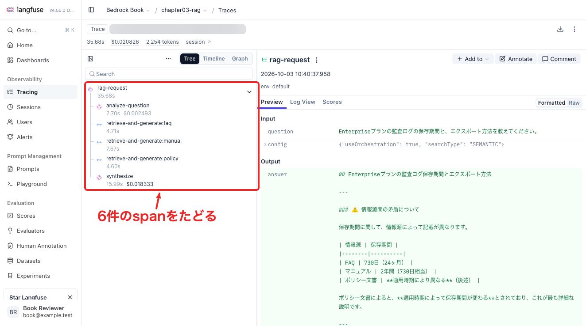
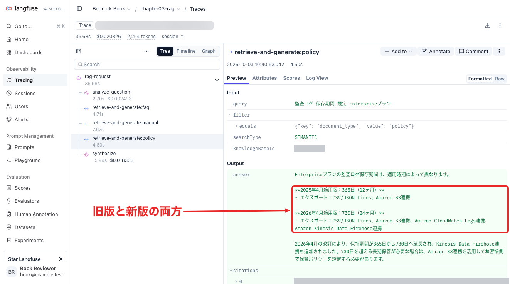
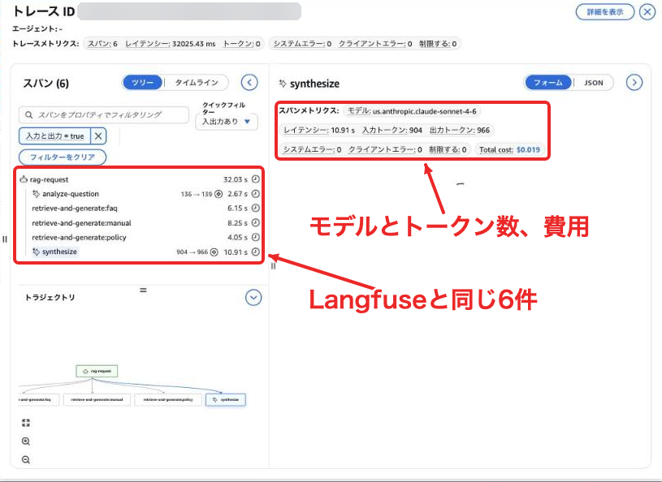
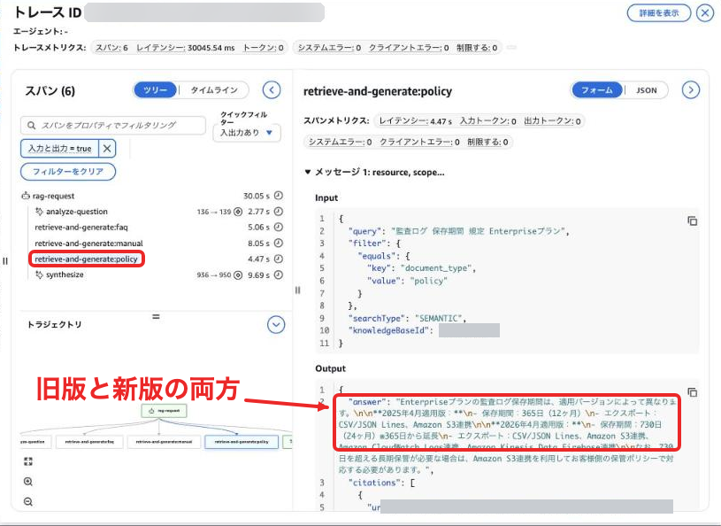

# 第3章のRAGアプリで回答の過程を可視化する

第4章のようにAgentCore Runtimeで動かすAIエージェントなら、AgentCore Observabilityで処理の流れを見られます。一方、第3章のRAGアプリはLambdaで動いているので、途中の処理は自分で記録する必要があります。

回答の点数が低かったとき、検索する資料を選び間違えたのか、古い規程を拾ったのか、正しい情報を受け取った後に回答を変えてしまったのかは、最終回答だけを見ていると判断できないためです。

この補足では第3章のアプリに途中の処理を記録するコードを加え、LangfuseとAgentCore Observabilityへ送ります。

## 資料を横断検索した際の挙動

まず、第3章の「資料を横断（オーケストレーション）」に、次の質問を送りました。

> Enterpriseプランの監査ログの保存期間と、エクスポート方法を教えてください。

このモードは質問を分析して検索先を選び、文書の種類ごとに検索してから回答を統合します。Langfuseに保存された処理を並べると、次の6件でした。問い合わせ全体の記録を**トレース**、その中の各処理の記録を**span**と呼びます。

```text
rag-request                         問い合わせ全体
├─ analyze-question                 検索先と検索用の質問を決める
├─ retrieve-and-generate:faq         FAQから回答と引用元を取得
├─ retrieve-and-generate:manual      マニュアルから回答と引用元を取得
├─ retrieve-and-generate:policy      規程から回答と引用元を取得
└─ synthesize                       各回答を統合
```

FAQとマニュアルからは「730日」、規程からは「2025年版は365日、2026年版は730日」という回答が返りました。最終回答はこれを情報源間の矛盾として扱い、利用者に契約バージョンの確認を求めていました。

ところが規程の引用元を読むと、2026年版には「本版は2026年4月1日以降の利用月に適用され、前版を置き換えます」とありますが、この質問で知りたかったのは現在の保存期間です。旧版と新版の違いを、そのまま契約による違いとして案内する回答にはまだ改善の余地があります。

トレースをたどると、規程の検索で両方の版を拾い、その中間回答が統合処理へ渡っていたことが分かりました。ここまで見えれば、資料の適用日を検索条件に入れる案や、どの版を優先するかを回答生成時に明示する案を考えられます。

## 第3章のコードにログ計測を加える

対象は`sample-code/03/amplify-ui`にあるTypeScript製のアプリです。Lambdaの`handler.ts`がBedrockを呼び出し、生成された文章と引用元を画面へ順次返しています。新しく加えた`instrumentation.ts`で、記録の開始・終了と送信先の初期化を行っています。

送信先は環境変数`RAG_TRACE_DESTINATION`で選びます。`langfuse`ならLangfuseへ、`agentcore`ならADOTを通してAWSへ送り、CloudWatchの生成AIオブザーバビリティで読みます。


計測箇所は既存の関数に合わせました。

| アプリの処理 | 記録する内容 |
|---|---|
| 通常の検索・回答生成 | 質問、検索設定、回答、引用元 |
| 質問の分析 | 検索先の候補、選ばれた検索先、書き換えた質問 |
| 文書種別ごとの検索・回答生成 | 検索用の質問、文書種別のフィルタ、中間回答、引用元 |
| 最終回答の統合 | 各検索先から集めた回答、最終回答 |

処理を囲むために用意したのが`withObservation()`です。たとえば、最終回答を作る部分は次の形になっています。説明のため、モデルへの入力設定などは省略しています。

```typescript
return withObservation("synthesize", { question, routeResults }, async (span) => {
  const response = await bedrockRuntime.send(command)
  let answer = ""
  for await (const chunk of response.stream) {
    if (chunk.metadata?.usage) recordUsage(span, chunk.metadata.usage)
    const text = chunk.contentBlockDelta?.delta?.text
    if (text) {
      answer += text
      writeSSE(stream, "chunk", { text })
    }
  }
  recordOutput(span, answer)
  return answer
}, { type: "generation", model: MODEL_ID })
```

モデルを呼び出すだけでなく、文章を最後まで受け取るところまで囲んでいるのがポイントです。ストリームを受け取った時点で計測を終えると、回答が完成するまでの時間を測れません。途中で例外が起きた場合も、該当する処理にエラーを記録してから呼び出し元へ返します。

通常モードではKnowledge Basesの検索と回答生成を一度のAPI呼び出しで行います。そのため、問い合わせ全体と、その内側の検索・回答生成という2件のspanになります。Knowledge Bases内部の検索時間と生成時間はこの計測では分かれません。

トークン数は質問分析と最終統合のモデル呼び出しが返す使用量を記録します。今回Langfuseで読み戻した値は質問分析が入力136・出力139、最終統合が入力960・出力928でした。

## Langfuseへ送ってみる

Langfuseはモデルへ渡した内容や途中の回答を調べるときに使えます。

Langfuse Cloudか自分で用意した環境でプロジェクトを作り、接続先URLとそのプロジェクトのPublic Key・Secret Keyを用意してください。筆者は自分で起動したLangfuse v4.50.0へ送り、保存された入出力と親子関係をAPIから読み戻しました。[プロジェクトの準備と接続先](https://langfuse.com/docs/api-and-data-platform/features/public-api)は公式手順にまとまっています。

画面は起動せず、第3章のLambdaハンドラーをローカルから実行してみます。画面からの問い合わせと同じ検索・回答生成の処理を呼び出します。

```bash
cd sample-code/03/amplify-ui
pnpm install --frozen-lockfile

export KNOWLEDGE_BASE_ID=第2章で作成したKnowledge_BaseのID
export MODEL_ID=us.anthropic.claude-sonnet-4-6
export BEDROCK_REGION=us-east-1
export LANGFUSE_BASE_URL=https://cloud.langfuse.com
```

接続先URLは自分のプロジェクトに合わせます。上の例はCloudのEUリージョンです。自分で用意したLangfuseならそのURLへ変更します。続いてAPIキーを環境変数に読み込みます。次はBashで、入力したキーを画面に出さない例です。

```bash
read -r -s LANGFUSE_PUBLIC_KEY; echo
read -r -s LANGFUSE_SECRET_KEY; echo
export LANGFUSE_PUBLIC_KEY LANGFUSE_SECRET_KEY

RAG_TRACE_DESTINATION=langfuse pnpm trace:rag --orchestration
```

`--orchestration`を外すと通常検索になります。既定の質問は冒頭の監査ログの質問です。検索にはセマンティック検索を使い、ハイブリッド検索に対応したKnowledge Baseでは`--hybrid`も指定できます。

実行後、`rag-trace-result.json`に回答とトレースIDが保存されます。LangfuseのObservations画面で同じIDの記録を開き、検索先の分析から各中間回答、最終統合へとたどります。



特に規程の検索結果と、統合へ渡した回答を見比べてみてください。`retrieve-and-generate:policy`を開くと、2025年版と2026年版の保存期間が両方とも中間回答に入っています。



実装ではOpenTelemetryの記録を送るための`LangfuseSpanProcessor`を、Lambdaの実行環境ごとに一度初期化します。各問い合わせの最後で`forceFlush()`を待ち、送信待ちの記録を残したままLambdaの処理を終えないようにしています。[Lambdaでの送信完了待ち](https://langfuse.com/docs/observability/features/queuing-batching)も公式ドキュメントで案内されています。

## AgentCore Observabilityへ送ってみる

AWS側でトレースを管理したい場合は同じ計測をAgentCore Observabilityへ送れます。第3章のアプリはAgentCore Runtime上では動いていませんが、AWS Distro for OpenTelemetry（ADOT）を使えば、Lambdaやローカルのアプリからも送信できます。[AgentCore外のアプリの設定](https://docs.aws.amazon.com/bedrock-agentcore/latest/devguide/observability-configure.html)に対応する方法です。

送信先のリージョンで、CloudWatchの**Transaction Search**を有効にします。アプリを実行するIAMロールにはトレースを送信する`xray:PutTraceSegments`と、入出力のログを書き込む`logs:PutLogEvents`の権限が必要です。Transaction Searchの有効化はアカウント・リージョン単位なので、すでに使っている環境なら設定を引き継げます。

入出力のログはサービス名に対応するロググループの`otel-rt-logs`ストリームへ送ります。ローカルのPCから送る場合は先にロググループとストリームを作っておきます。

```bash
aws logs create-log-group --log-group-name /aws/bedrock-agentcore/runtimes/chapter03-rag
aws logs create-log-stream --log-group-name /aws/bedrock-agentcore/runtimes/chapter03-rag --log-stream-name otel-rt-logs
```

先ほどのKnowledge Baseとモデルの設定を残し、送信先を切り替えます。

```bash
export AWS_REGION=us-east-1
export OTEL_SERVICE_NAME=chapter03-rag
RAG_TRACE_DESTINATION=agentcore pnpm trace:rag --orchestration
```

`AWS_REGION`はトレースの送信先、`BEDROCK_REGION`はKnowledge Baseとモデルの呼び出し先です。異なるリージョンへデプロイする場合も、それぞれの設定を使います。

AgentCore向けには初期化時にADOTのNode.jsパッケージを読み込み、AWSへ送信します。そのうえで、問い合わせ全体には「エージェントの実行」、質問分析と最終統合には「モデルによる生成」を表す属性を付けます。

```typescript
// 問い合わせ全体
span.setAttribute("gen_ai.operation.name", "invoke_agent")
span.setAttribute("gen_ai.agent.name", serviceName)
span.setAttribute("session.id", sessionId)

// 質問分析・最終統合のモデル呼び出し
span.setAttribute("gen_ai.operation.name", "chat")
span.setAttribute("gen_ai.request.model", modelId)
```

これは生成AIの処理として扱うための[汎用フレームワーク向け属性](https://docs.aws.amazon.com/bedrock-agentcore/latest/devguide/supported-frameworks-generic.html)です。検索先の選択や中間回答はアプリ独自の処理なので、先ほどの関数の境界で明示的に記録しています。

spanが終わるときに、同じ入出力をログにも出します。CloudWatchの画面はspan IDで結び付いたこのログから入力と出力を表示します。ログを送らない設定のままだと、spanのツリーやトークン数は見えても、入出力は表示されませんでした。

実際にLambdaへデプロイしたところ、通常検索は2件、資料横断は6件のspanがCloudWatchの`aws/spans`へ保存されました。CloudWatchの生成AIオブザーバビリティでは「Bedrock AgentCore」の「すべてのトレース」からトレースIDを開くと、Langfuseと同じ6件のspanが並びます。最終統合のspanでは使ったモデルとトークン数、費用も確認できます。



spanを開くと、入力と出力も表示されます。規程の検索を開けば、Langfuseと同じく2025年版と2026年版の両方が中間回答に入っていると分かります。



エージェントの一覧では設定したサービス名で対象を探します。見つからないときは同じリージョンの`aws/spans`でトレースIDを検索すると、送信済みかどうかを確かめられます。


## アプリの画面から使う

ローカルで送信できたら、第3章のAmplifyアプリへ設定を反映します。AgentCoreを使う場合は次の環境変数を設定したシェルから、いつものサンドボックスを起動します。

```bash
export RAG_TRACE_DESTINATION=agentcore
export RAG_TRACE_SERVICE_NAME=chapter03-rag
pnpm exec ampx sandbox
```

CDKの`backend.ts`がLambdaへの環境変数、送信権限、サービスに対応するロググループとストリームを設定します。複数のアプリを並べる場合はサービス名を分けてください。未指定ならスタック名を含む名前を使います。ADOTはLambdaへ依存パッケージとして同梱し、初期化時に読み込む構成です。

Langfuseを使う場合はSecrets Managerに次の形でAPIキーを保存します。

```json
{"publicKey":"プロジェクトのPublic Key","secretKey":"プロジェクトのSecret Key"}
```

シークレットはLambdaと同じリージョンに作成し、そのARNを指定してデプロイします。

```bash
export RAG_TRACE_DESTINATION=langfuse
export LANGFUSE_BASE_URL=https://cloud.langfuse.com
export LANGFUSE_SECRET_ARN=保存したシークレットのARN
pnpm exec ampx sandbox
```

Lambdaは初期化時にキーを取得します。接続先にはLambdaから到達できるLangfuseのURLを指定してください。

sandboxではなく[Amplify Hostingで公開した環境](../chapter02/Amplifyコンソールからアプリを公開する.md)では、シェルで設定する代わりに、Amplifyコンソールの「ホスティング」→「環境変数」に同じ値（`RAG_TRACE_DESTINATION`、`RAG_TRACE_SERVICE_NAME`、`LANGFUSE_BASE_URL`、`LANGFUSE_SECRET_ARN`）を追加します。値はビルド時に `backend.ts` が読むので、追加したあとに再デプロイしてください。

画面から質問すると、回答の下の「トレースID」から記録のIDをコピーできます。質問文や引用した資料も送信先に保存されるため、業務データで使う場合は記録する内容を調整してください。

気になった回答を見つけたら、そのIDで中間回答をたどって直す箇所を決め、同じ質問で回答を比べてみてください。
