# ツール・エージェント・モデルの入口をAgentCore Gatewayで統制する

第4章では、Confluence検索とJira起票をMCPツールとしてGatewayへ登録しました。実際の業務では、AIエージェントやクライアントから別チームのエージェントや社内API、生成AIモデルも呼び出したくなることがあるかと思います。

そこで使いたいのが、GatewayのHTTP接続先とInference（モデル）接続先です。接続先を増やしても、第6章で整えた権限や操作手順の制御を共通に使えます。まずモデルを追加して呼び出してみて、Gatewayでどのような管理ができるか見ていきましょう。


この補足の図の多くは、筆者のAgentCore Gatewayの解説資料から持ってきています。Gateway全体の考え方は、DevelopersIO 2026 Osakaの[登壇資料の記事](https://dev.classmethod.jp/articles/devio2026-osaka-agentcore-gateway-introduction/)もあわせてどうぞ。

## MCP・HTTP・Inferenceの3種類の接続先

本編ではMCPを使いましたが、HTTPとInferenceを使えば、ツールに加えて別のエージェントやモデルも同じGatewayから呼べます。接続先は、呼び出すときにツール名・URLのパス・モデルIDのどれを指定するかで分かれます。

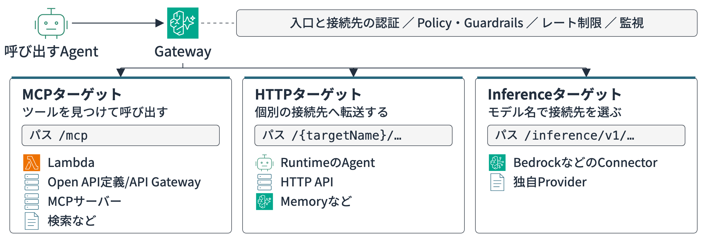


| 接続先の種類         | 呼び出し側が選ぶもの   | 主な接続先                                    | Gatewayがすること           |
| -------------- | ------------ | ---------------------------------------- | ---------------------- |
| MCP            | ツール名         | Lambda、OpenAPI、MCPサーバー、Step Functions    | ツール一覧を集約し、選んだツールを呼ぶ    |
| HTTP           | URLのパス       | AgentCore Runtime、A2Aエージェント、Memory、社内API | HTTPリクエストを指定先へ転送する     |
| Inference（モデル） | リクエスト中のモデルID | Bedrock、OpenAI、Anthropic                 | モデルIDから接続先を選び、推論APIへ送る |


## 生成AIモデルをGateway経由で呼び出す

本編のエージェントはBedrockのモデルを直接呼んでいますが、ここにOpenAIやAnthropicのモデルも使いたいチームが出てくると、エージェントごとに提供元のAPIキーを持たせ、キーを入れ替えるたびに配り直すことになりますよね。

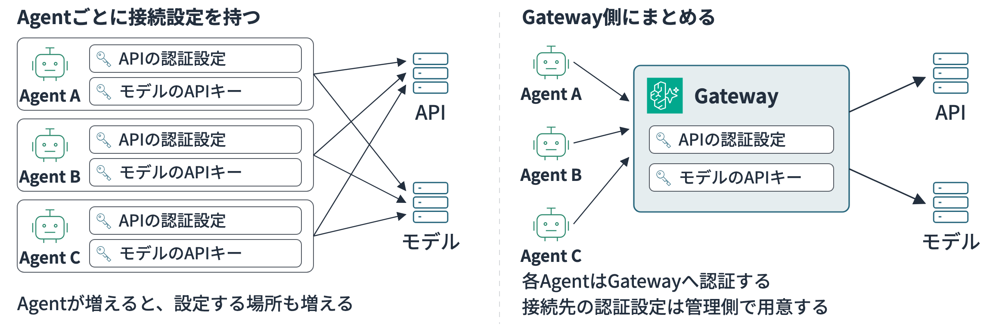

そこでInference接続先にまとめると、提供元への接続とキーはGateway側で管理できます。エージェントは同じ入口のままモデル名を指定でき、新しいモデルの追加は管理する側の作業になります。

同じGatewayにInference接続先を置けば、問い合わせの分類のような軽い処理には料金の安いモデルを使えますし、OpenAIのモデルを使いたいチームも、そのモデル名を指定すれば呼び出せます。チームごとのトークン数の上限も、後述の使用量制限でGatewayに設定できます。

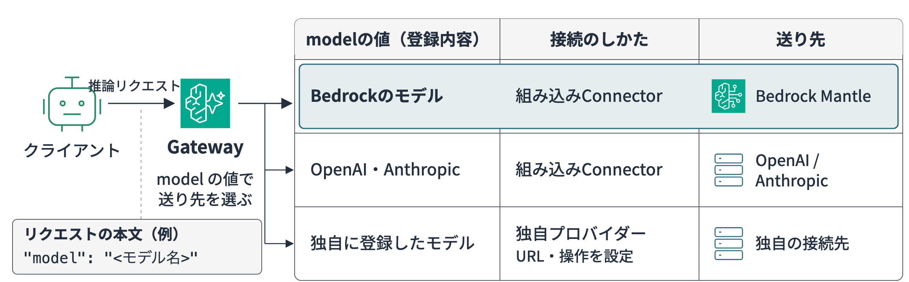

Gatewayは、リクエスト本文の`model`の値で推論の送り先を選びます。まずは試してみましょうか。

サンプルで一時的なIAMロール・Gateway・Bedrock Mantle向けのInference接続先を作り、モデル一覧の取得と1回の推論を行ってみます。

```bash
cd sample-code/04/gateway-extensions
uv sync --frozen
uv run python gateway_inference_demo.py --yes --region us-east-1
```

バージニア北部で実行した結果です。

```text
IAMロール: 作成
Gateway: READY
Inference Target: READY
モデル一覧: 55件
選択モデル: .../deepseek.v3.2
モデル応答: AgentCore Gatewayは、AIエージェントと外部アプリケーション・サービス間の
            安全な通信とデータ連携を管理する統合制御ポイントです。
クリーンアップ: Target、Gateway、IAMロールを削除
```

DeepSeekをGateway経由で呼び出せました。どう設定したか詳細を確認します。

### MCP専用にしないGatewayを作る

第4章のCDKコードでは、Gatewayに`protocolType="MCP"`を指定していました。MCP以外の接続先も同じGatewayへ登録したい場合は、`protocolType`を指定せずにGatewayを作ります。サンプルでは次のように作成しています。

```python
gateway = control.create_gateway(
    name=gateway_name,
    roleArn=gateway_role_arn,
    authorizerType="AWS_IAM",
)
```

ここではHTTP・Inference用のGatewayを新しく作成しています。

### 生成AIモデル向けのBedrock Mantle接続先を登録する

Inference接続先には組み込みのコネクタを指定します。選べるのは`bedrock-mantle`、`bedrock-runtime`、`openai`、`anthropic`の4つです。サンプルではBedrock Mantle向けの`bedrock-mantle`を使います。Bedrock Runtime向けの`bedrock-runtime`は、ネイティブのInvokeModel APIで呼ぶときに選びます。

```python
target = control.create_gateway_target(
    gatewayIdentifier=gateway["gatewayId"],
    name="bedrock-mantle",
    targetConfiguration={
        "inference": {
            "connector": {
                "source": {"connectorId": "bedrock-mantle"}
            }
        }
    },
    credentialProviderConfigurations=[
        {"credentialProviderType": "GATEWAY_IAM_ROLE"}
    ],
)
```

Gatewayの実行ロールには、接続先のモデルを呼び出す権限が必要です。サンプルでは`AmazonBedrockMantleInferenceAccess`を一時ロールへ付与していますが、本番では利用を認めたモデルと操作へ絞った管理ポリシーを検討してください。

モデル一覧や推論のAPIはGatewayエンドポイントの`/inference`配下にあるのでそのエンドポイントを使いましょう。

サンプルではモデルIDで呼び出し先を分けて、ClaudeにはMessages API、それ以外にはChat Completions APIを使っています。

```python
def inference_request(model_id: str) -> tuple[str, dict]:
    body = {
        "model": model_id,
        "messages": [{
            "role": "user",
            "content": "AgentCore Gatewayの役割を日本語で一文で説明してください。",
        }],
        "max_tokens": 100,
    }
    if "/anthropic.claude-" in model_id:
        return "v1/messages", body
    return "v1/chat/completions", {**body, "stream": False}
```

### ClaudeではAPIバージョンも送る

Claude Haiku 4.5でも同じサンプルを動かすと最初はAPIバージョンの指定が足りずに400エラーになりますが、Messages APIへ送るHTTPヘッダーに`anthropic-version: 2023-06-01`を加えると回答が返ってきます。

```bash
uv run --frozen python gateway_inference_demo.py \
  --yes --region us-east-1 --model-contains haiku
```

### モデルを切り替えて継続する

モデル名（`matchModels`）でルートを決め、送り先が5XXエラーや接続失敗、タイムアウトになったときに、次の接続先へ切り替えるフォールバックを設定できます。切り替えが続くときは、サーキットブレーカーが不調な送り先を一時的に飛ばします。1つのルートに置けるフォールバック先は2つまでです。

次の点に注意してください。

- 応答の途中で送り先が止まったストリーミングは、そこで途切れます
- 429（レート制限）と403（ポリシーによる拒否）では、切り替わりません
- 切り替え先の呼び出しにも、Gatewayの料金がかかります
- Converse APIは使えず、InvokeModelの2つだけが対象です
- このコネクタはコンソールではまだ選べません

詳しくは[試してみた記事](https://dev.classmethod.jp/articles/agentcore-gateway-model-fallback/)を参照してください。

## Step Functionsのワークフローをツールにする

Step Functionsのワークフローも、Gatewayのコネクタ（`states`）でツールにできるようになりました。Lambdaを中継したり、呼び出し処理を書かずともステートマシンと連携できます。StandardとExpressのどちらも対象です。

いつ実行するかと何を渡すかはエージェントが決め、どのステップをどの順に動かすかはステートマシンが行うため、ワークフローのように勝手に実行されず必ず順番を守って欲しいものは、判断などはエージェントに任せて固定の処理をこちらで実装するのは良いかなと思います。

実装としてはツールにする操作は`configurations`で選びます。次の例は`StartExecution`を特定のステートマシンに固定し、`DescribeExecution`で状況を調べられるようにする設定です。

```json
{
  "mcp": {
    "connector": {
      "source": { "connectorId": "states" },
      "configurations": [
        { "name": "StartExecution",
          "parameterValues": { "stateMachineArn": "arn:aws:states:us-east-1:<アカウントID>:stateMachine:RefundFlow" } },
        { "name": "DescribeExecution" }
      ]
    }
  }
}
```

ツールにできる操作は次の10個で、連携したいものを`configurations`に記載します。

| 操作 | 固定・指定するもの | 使えるワークフロー | できること |
|---|---|---|---|
| `StartExecution` | `stateMachineArn`を固定 | Standard・Express | ワークフローを開始する |
| `StartSyncExecution` | `stateMachineArn`を固定 | Expressだけ | 実行して、結果をそのまま受け取る |
| `ListExecutions` | `stateMachineArn`を固定 | Standardだけ | 最近の実行を一覧する |
| `DescribeStateMachine` | `stateMachineArn`を固定 | Standard・Express | ステートマシンの情報を調べる |
| `DescribeExecution` | 実行のARNをエージェントが渡す | Standardだけ | 実行の状況を調べる |
| `GetExecutionHistory` | 実行のARNをエージェントが渡す | Standardだけ | どのステップまで進んだかを調べる |
| `StopExecution` | 実行のARNをエージェントが渡す | Standardだけ | 実行を止める |
| `SendTaskSuccess` | タスクトークンをエージェントが渡す | Standard・Express | 待っているタスクを成功で終える |
| `SendTaskFailure` | タスクトークンをエージェントが渡す | Standard・Express | 待っているタスクを失敗で終える |
| `SendTaskHeartbeat` | タスクトークンをエージェントが渡す | Standard・Express | 長いタスクが動いていることを伝える |

`SendTask`で始まる3つは、ワークフローが`.waitForTaskToken`で止まり、エージェントの作業を待つときに使います。このように待つのはStandardだけで使えます。

次の点に注意してください。

- `stateMachineArn`を固定した値は、ツールの引数に出ず、エージェントは変えられません。固定を書き忘れてもターゲットは作れますが、その操作の呼び出しがすべて失敗します
- 固定できない6つの操作は、Gatewayのサービスロールの権限で範囲を決めます。`SendTaskSuccess`などはIAMで実行を絞れないので、タスクトークンは秘密として扱います
- 料金はStep FunctionsとGatewayの通常の料金です

詳しくは[コネクタのドキュメント](https://docs.aws.amazon.com/bedrock-agentcore/latest/devguide/gateway-target-connector-step-functions.html)と[チュートリアル](https://docs.aws.amazon.com/step-functions/latest/dg/tutorial-agentcore-gateway.html)などを参照してください。

## 別のエージェントを1つのサービスとして呼ぶ

問い合わせ対応のエージェントから、SLAのサービスクレジットの計算は請求チームのエージェントに任せたい、という場面を考えます。直接呼び出す構成では、連携先ごとの認証設定を呼び出し側で持つことになり、連携先が増えるほど設定も増えます。Gatewayに登録しておけば認証の設定をGatewayに集められ、ほかの接続先と同じ利用ルールで呼び出せます。

別チームのエージェントは、AgentCore RuntimeをHTTP接続先として登録します。HTTP接続先にはいくつか種類があり、RuntimeはARNで指定します。

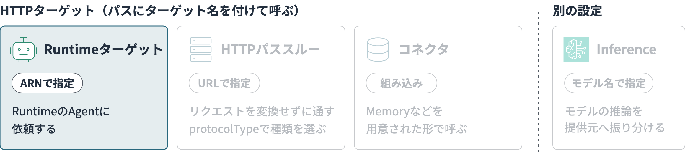

登録時の呼び出しは次の形です。

```python
control.create_gateway_target(
    gatewayIdentifier=gateway_id,
    name="billing-agent",
    targetConfiguration={
        "http": {
            "agentcoreRuntime": {
                "arn": runtime_arn,
                "qualifier": "DEFAULT",
            }
        }
    },
    credentialProviderConfigurations=[
        {"credentialProviderType": "GATEWAY_IAM_ROLE"}
    ],
)
```

呼び出しURLは`https://{gatewayId}.gateway.bedrock-agentcore.{region}.amazonaws.com/billing-agent/invocations`の形になります。このAIエージェントをA2Aで実装していれば、A2AのJSON-RPCをこのパスへ送るため、呼び出す側もA2Aに対応したクライアントを使います。

### 既存の社内APIと連携する

顧客の契約プランを返すREST APIのような既存の社内APIも、同じようにGatewayへ登録できます。HTTPパススルーで登録すると、Gatewayはパスの先頭のターゲット名を外し、接続先のURLの後ろに残りのパスをつないで転送します。たとえば`contract-api`として登録したAPIなら、エージェントが`/contract-api/v1/plans/C-001`へ送った要求は、社内APIの`/v1/plans/C-001`へ届きます。本文もそのまま渡せるので、今の呼び方を変えずにGatewayの認証とログの記録も集約できます。

実際に、受け取った内容をそのまま返すLambda関数URLを`contract-api`として登録して試しました。`/contract-api/v1/plans/C-001?detail=true`へGETとPOSTを送ると、接続先には次のように届きました。


| 項目       | 接続先が受け取った値                    |
| -------- | ----------------------------- |
| パス       | `/v1/plans/C-001`（ターゲット名が外れる） |
| クエリ      | `detail=true`                 |
| 本文（POST） | 送ったJSONがそのまま届く                |
| 独自のヘッダー  | `x-request-id`などもそのまま届く       |


接続先のLambda関数URLはIAM認証にし、GatewayはGateway実行ロールでSigV4の署名を付けて呼びます。試してみて気をつけたい点が3つありました。

1. MCP用として作ったGateway（`protocolType`が`MCP`）には、HTTPの接続先を追加できません。追加しようとすると`HTTP target configuration is not supported for gateways with MCP protocol type`のエラーになります。`protocolType`を指定せずに作れば、`/mcp`とHTTPパススルーを同じGatewayに置けます
2. Policy EngineをENFORCEにしていると、HTTPパススルーも既定で拒否されます。OpenAPIの定義を付けて登録すると、`contract-api___GET:/v1/plans/{planId}`のようにメソッドとパスごとの操作をポリシーに書けるようになります
3. 定義にないパス（たとえば`/contract-api/v1/admin/export`）は403になります。OpenAPIの定義で、エージェントから呼べるAPIの範囲も絞れます

### 必須経路としてGatewayを使う

GatewayでCedarや使用量制限を設定しても、利用者がRuntimeを直接呼び出せるなら、その統制は迂回できてしまいます。Gatewayを必須経路にするには、Runtime側のリソースベースポリシーでGatewayの実行ロールだけを許可します。JWT認証を使うRuntimeでは、許可するワークロードも絞り込みます。Lambdaや後述のMemoryでも、同じように接続先の側でGatewayの実行ロールだけを許可します。

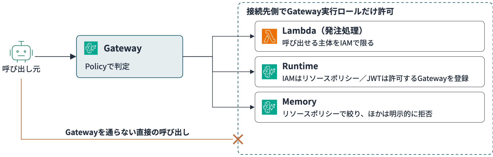

## 会話の記憶を利用者ごとに分ける

前回の問い合わせを覚えておいてほしいときは、AgentCore Memoryに会話を保存します。MemoryはRuntimeのエージェントから使割れるケースが多いです。

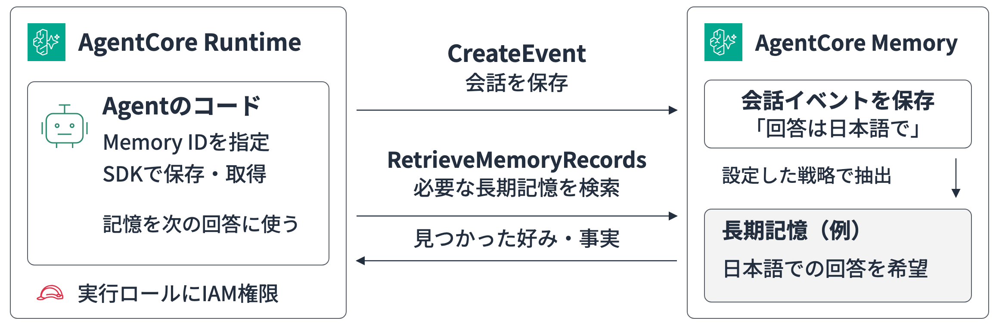

1つのエージェントが自分用のMemoryを使うだけなら、この直接の形で十分です。Gatewayを挟むと設定も増えるので、無理に通す必要はありません。

ただ、Gatewayの仕様を考えたいのは、ほかの人の記憶を読ませない仕組みを外側で保証したいときです。Memoryを共有のIAMロールで直接使うと、どの利用者の記憶を読むかはエージェント側の実装に任されます。複数のエージェントで同じMemoryを使う場合や利用者の境界をエージェントのコードに頼りたくない場合はGatewayを使うのが良いでしょう。利用者のJWTとPolicyで制御可能です。

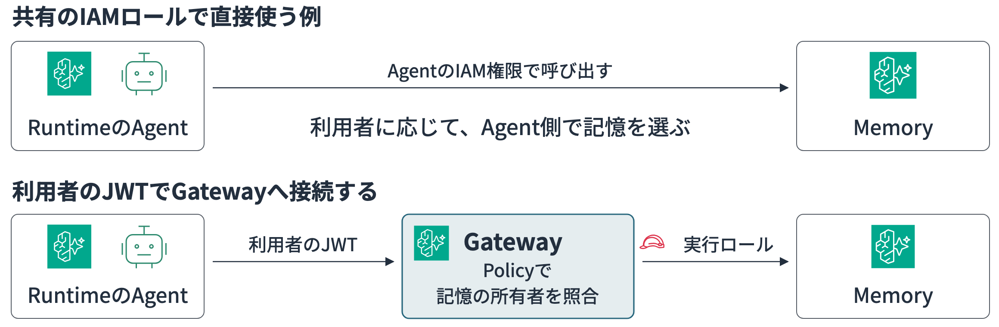

AgentCore Memoryにも組み込みのコネクタが用意されています。これを使うと、Memoryのデータプレーンを呼び出すLambda関数やOpenAPI定義を自前で用意せずに済みます。`memoryId`は接続先側で固定します。

```python
control.create_gateway_target(
    gatewayIdentifier=gateway_id,
    name="support-memory",
    targetConfiguration={
        "http": {
            "connector": {
                "source": {"connectorId": "agentcore-memory"},
                "parameters": {"memoryId": memory_id},
            }
        }
    },
    credentialProviderConfigurations=[
        {"credentialProviderType": "GATEWAY_IAM_ROLE"}
    ],
)
```

利用者ごとの記憶を扱うときは、利用者IDと保存範囲を表すnamespaceの指定に注意してください。呼び出し元でこの値を別の利用者のものに書き換えられると、他人の記憶を読み書きできてしまいます。

利用者ごとのアクセス制御をどこで行うかは、Gatewayの認証方式とMemoryへ渡す資格情報の組み合わせで決まります。


| Gatewayの認証 | Memoryへの資格情報  | 利用者境界を守る場所                           |
| ---------- | ------------- | ------------------------------------ |
| JWT        | Gateway実行ロール  | JWTクレームと`actorId`／namespaceをCedarで照合 |
| IAM        | 呼び出し元のIAM資格情報 | Memory側のIAM・リソースポリシーで呼び出し元を識別        |


Gatewayの実行ロールを使うと、Memory側では元の利用者をIAMで識別できません。JWTの利用者情報と記憶の利用者IDをCedarで照合し、アプリ側でも認証済みのIDを設定します。

Memoryコネクタでは、イベント作成や記憶の検索・取得・削除、抽出ジョブの開始などを呼び出せます。ただし、記憶レコードの一括作成・更新・削除は、Gatewayでの細かな利用者制御に対応してないので注意が必要です。利用者単位のCedar判定が必要な操作では、個別のMemory操作を使います。

## 利用者本人の権限で外部サービスを呼ぶ

ここまでの接続先は、Gatewayの実行ロールやGatewayに預けたキーで呼んでいました。この方法だと、誰がエージェントに依頼しても、接続先には同じGatewayとして届きます。一方で、GitHubやSlackを「依頼した本人のアカウントで」使いたい場面もありますよね。本人のリポジトリだけを見せたい、本人の名前で投稿したい、といったケースです。

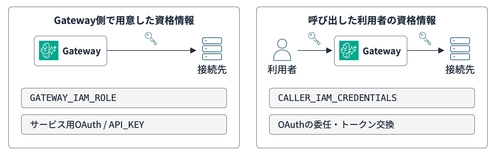

このときに使うのが、ユーザー委任型の認可（3LO）です。利用者が外部サービスに一度ログインして、エージェントによるアクセスを許可します。許可したときのトークンはAgentCore Identityが利用者ごとに保管し、Gatewayはそのトークンで接続先を呼びます。エージェントのコードやフロントエンドに、外部サービスのトークンを持たせずに済みます。

許可の手続きには、AgentCore Identityの同意ポータルが使えます。Gatewayごとに用意される画面で、利用者はここから外部サービスに接続します。以前は、外部サービスでの許可とログイン中の利用者を結び付ける処理を自作する必要がありましたが、この同意ポータルを使うと、その画面と処理をAWSに任せられます。

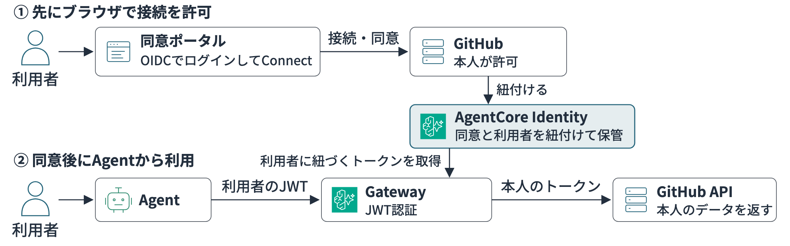

Gatewayのインバウンド認証はJWTにし、同意ポータルと同じOIDCの発行元を使います。ポータルでConnectを押してGitHub側で許可すると、状態がConnectedに変わります。これで、チャットのエージェントが本人のGitHubへアクセスできます。

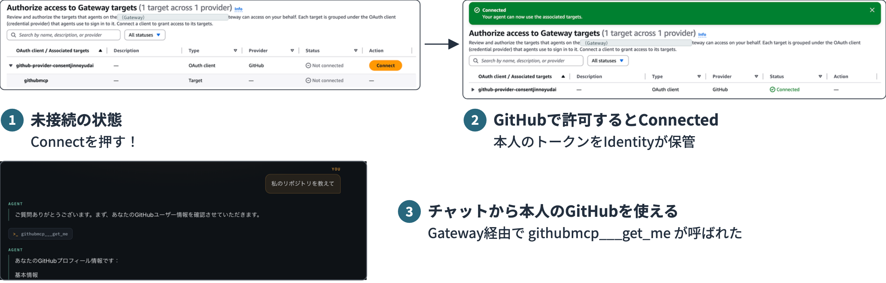

GitHubのOAuthアプリ・IdP・Gatewayのそれぞれに設定するリダイレクトURLが違うなど、つまずきやすいところもあります。手順は筆者のブログで紹介しています。

- [[アップデート] AgentCore Identityに追加された同意ポータルでGitHub連携を試してみた](https://dev.classmethod.jp/articles/agentcore-consent-portal-github/)
- [Amazon Bedrock AgentCore Gatewayでユーザー委任型認可（3LO）を使い、GitHub・Slack・GoogleカレンダーをAIエージェントにつないでみた](https://dev.classmethod.jp/articles/amazon-bedrock-agentcore-gateway-3lo-github-slack-google-calendar/)

## 第6章の統制をどう使い分けるか

接続先を増やすときは、第6章の認証や検査も組み合わせます。防ぎたいことに応じて、次のように使い分けます。


| 防ぎたいこと        | 使う仕組み              | 判断に使う情報               |
| ------------- | ------------------ | --------------------- |
| 未認証の呼び出し      | IAM／JWT認証          | 署名、トークン               |
| 担当外のツール実行     | Cedar              | 利用者、役割、ツール、現在の引数      |
| 確認前の更新・起票     | Dogwood            | 同じセッションで過去に実行した操作     |
| 使い過ぎ・費用急増     | Gatewayの使用量制限      | 利用者、接続先、モデル、回数、トークン数  |
| 大量通信・既知のWeb攻撃 | AWS WAF            | IP、HTTPヘッダー、パス、通信量    |
| 不適切な入力・出力     | Bedrock Guardrails | 入力・出力の文章              |
| 独自の照合・マスキング   | Interceptor        | リクエスト、レスポンス、外部システムの状態 |


## 呼び出し回数とトークン数を制限する

社内にエージェントを公開すると、一部の利用者が大量に呼び出して、ほかの人の分の上限や予算まで使ってしまうことがあります。利用者ごとにモデルの使いすぎを抑えるには、Gatewayの使用量制限を設定します。制限は複数を重ねられ、どれか1つでも上限に達すると要求は拒否されます。

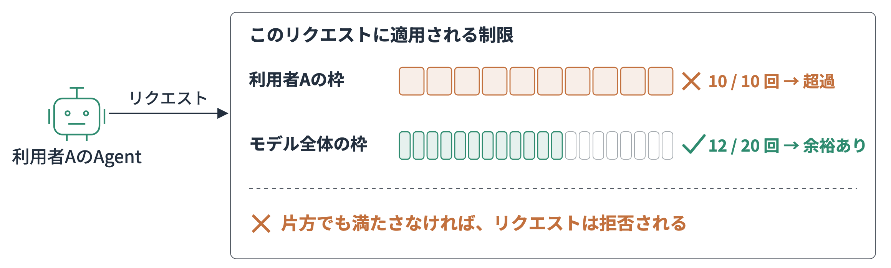

同じ接続先・モデル・利用者の組み合わせに、1分あたりの要求数とトークン数の上限を設ける例を確認してみます。`targetName`には、Inference接続先を登録したときの名前（ここでは`bedrock-mantle`）を書きます。

```python
import boto3

control = boto3.client(
    "bedrock-agentcore-control",
    region_name="us-east-1",
)

response = control.create_gateway_rate_limit(
    gatewayIdentifier=gateway_id,
    dimensionKeys=[
        "targetName",
        "qualifiedModelId",
        "$.context.jwt.sub",
    ],
    description="利用者ごとの推論予算",
    entries=[
        {
            "dimensions": {
                "targetName": "bedrock-mantle",
                "qualifiedModelId": qualified_model_id,
                "$.context.jwt.sub": "*",
            },
            "requests": [{"rate": 30, "period": "minute"}],
            "tokens": [{"rate": 10000, "period": "minute"}],
        }
    ],
)
print(response["rateLimitId"])
```

モデルごとに上限を変えることもできます。たとえば料金の高いOpusは利用者1人あたり少なめに、普段使いのSonnetは多めにする、という配分です。`qualifiedModelId`にモデルを名前で書いたエントリは、`*`のエントリより優先されます。名前を書いていないモデルには、`*`の上限が使われます。

```python
control.create_gateway_rate_limit(
    gatewayIdentifier=gateway_id,
    dimensionKeys=["qualifiedModelId", "$.context.jwt.sub"],
    description="モデルごとの利用者あたりの上限",
    entries=[
        {   # Opusは少なめ
            "dimensions": {"qualifiedModelId": "anthropic.claude-opus-5-5", "$.context.jwt.sub": "*"},
            "tokens": [{"rate": 5000, "period": "minute"}],
        },
        {   # Sonnetは多め
            "dimensions": {"qualifiedModelId": "anthropic.claude-sonnet-5", "$.context.jwt.sub": "*"},
            "tokens": [{"rate": 40000, "period": "minute"}],
        },
        {   # それ以外のモデル
            "dimensions": {"qualifiedModelId": "*", "$.context.jwt.sub": "*"},
            "tokens": [{"rate": 20000, "period": "minute"}],
        },
    ],
)
```

`$.context.jwt.sub`を`*`にすると、利用者ごとに独立した枠が割り当てられます。

`qualifiedModelId`の書き方には注意が必要です。Inference接続先のモデル一覧（`/inference/v1/models`）では、IDが`bedrock-mantle/anthropic.claude-opus-5-5`のようにInference接続先名付きで返ります。`qualifiedModelId`に書くのは、`/`より後ろの`anthropic.claude-opus-5-5`の部分を記載しましょう。

制限に当たると、HTTP 429と次の本文が返ります。`limitKey`は使用量制限のIDで、`metric`はどちらの上限（`requests`か`tokens`）に当たったかを示します。どの制限のどのエントリに当たったかは、アプリケーションログには出ません。トレースのスパンにある`aws.agentcore.gateway.throttle.customer.matched_entry`などの属性で確かめます。

```json
{"error": {"message": "Rate limit exceeded", "type": "rate_limit_error", "code": "429",
           "limitKey": "gwdemo-model-rpm", "metric": "requests", "retryAfter": 30.0}}
```

上限ちょうどで厳密に止まるわけではありません。作成した直後や上限が低い場合は、設定より多めに通ることがありました。トークン数の制限は使ったトークン数をあとから数える仕組みなので、上限を超えてから止まるまでにさらに時間がかかります。上限の値は、利用状況を見ながら余裕を持って決めます。

Gateway側でどれだけ大きな上限を設定していても、Bedrockなどのバックエンドサービス側のクォータが小さければ、そちらの上限が優先されます。推論のストリーミングでは、要求回数だけでなくトークン数と同時接続数も制限し、長時間の接続がほかの利用者を圧迫しないようにします。

### ヘッダーやボディの値で枠を分ける

使用量制限は利用者のIDのほかに、リクエストのヘッダーやJSONボディの値でも枠を分けられるようになりました。`$.context.request.header.<名前>`と`$.context.request.body.<パス>`で指定します。たとえば、ボディの`metadata.user_id`ごとに1分60回、ヘッダーに`X-Workload: batch`が付いたときだけ1分60回、といった使い方です。

検証済みのID（IAMプリンシパルやJWTのクレーム）と組み合わせて枠を作ります。呼び出し側が値を書き換えれば別の枠になるため、信頼できる呼び出し元で使ってください。`/`、`|`、`,`、`*`を含む値は制限の対象から外れます。詳しくは[試してみた記事](https://dev.classmethod.jp/articles/agentcore-gateway-rate-limit-header-body/)を参照してください。

## 操作の順番をDogwoodで守る

エージェントには、問い合わせに応じて使うツールを選んでほしい。一方で、更新や起票の前に必要な確認は確実に済ませてほしいところです。プロンプトで手順を伝えたうえで、確認を飛ばした操作をGatewayでも止められるのが、Dogwoodのよいところだと思います。

Cedarが現在の要求に含まれる利用者や引数を見るのに対し、Dogwoodでは同じセッションで過去に実行した操作も条件にできます。第6章の例では、シニア担当者が30分以内にConfluence検索を完了した場合にJira起票を許可しました。起票権限がある人でも、手順を検索する前の起票は拒否するという使い方です。

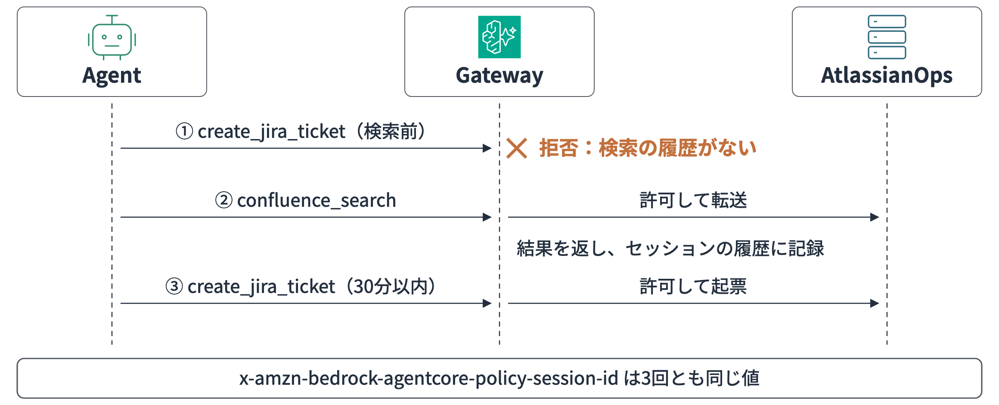

ポリシーは次のとおりです（`sample-code/06/gateway-policy/sequence.dogwood`）。`when`の前半がCedarと同じく今の要求の利用者を見る条件で、`temporal`の中が履歴の条件です。

```cedar
permit(
  principal is AgentCore::OAuthUser,
  action == AgentCore::Action::"AtlassianOps___create_jira_ticket",
  resource == AgentCore::Gateway::"<gateway-arn>"
) when {
  principal.hasTag("role") &&
  principal.getTag("role") == "senior-operator" &&
  temporal {
    formerly within 30m (
      AgentCore::Action::"AtlassianOps___confluence_search"::response{
        eventResource: resource
      }
    )
  }
};
```

`formerly within 30m`は「過去30分以内に」、`::response`は「その操作が応答まで完了した」という意味です。

さらに、前のツールが返した値と次のツールへ渡す値も照合できます。たとえばSLAのサービスクレジットを、対象を確かめるツールで計算してから、適用するツールで反映する流れです。確認で返された顧客ID・対象月・金額と、適用時の指定が一致することを条件にします。確認で4,000円と返されたのに、エージェントが桁を間違えて40,000円で適用しようとしても、この照合で止められます。

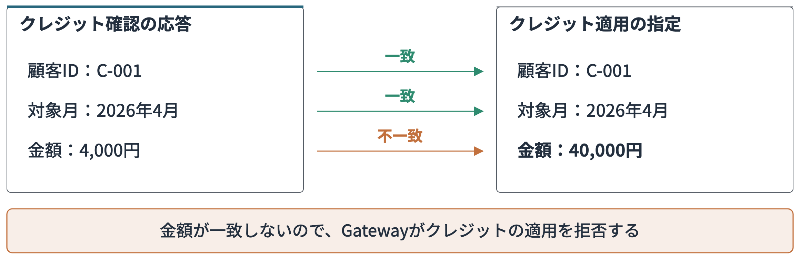

照合は`::response{ }`の中に、前の応答の項目と今の要求の項目を並べて書きます。ツール名と項目名は自分のツールに合わせてください。

```cedar
permit(
  principal,
  action == AgentCore::Action::"BillingTarget___apply_credit",
  resource == AgentCore::Gateway::"<gateway-arn>"
) when {
  temporal {
    formerly within 30m (
      AgentCore::Action::"BillingTarget___check_credit"::response{
        eventResource: resource,
        output.customer_id: context.input.customer_id,
        output.month: context.input.month,
        output.amount: context.input.amount
      }
    )
  }
};
```

一連の操作には、最初の呼び出しから同じポリシーセッションIDを渡します。指定するヘッダーは`x-amzn-bedrock-agentcore-policy-session-id`です。

```python
headers = {
    "x-amzn-bedrock-agentcore-policy-session-id": session_id,  # 問い合わせごとに1つ発行して使い回す
}
```

ヘッダーを付け忘れると、Dogwoodのポリシーがあるだけで検索まで含めてエラーになりました（「呼び出しの記録を残す」の表）。

回数制限にも使えますが、Dogwoodの履歴はセッション単位です。「同じ問い合わせで再検索は3回まで」ならDogwood、セッションをまたいで利用者の呼び出し回数やトークン数を抑えるなら、前節の使用量制限を使います。

## 内容を検査・変換する

### 文章をGuardrailsで検査する

Jiraへ起票する権限があっても、本文に不適切な表現や問い合わせ者の個人情報が入っていたら止めたいですよね。Cedarの判定に使うのは利用者や操作で、文章の中身は判定の対象になりません。入力や出力の文章そのものを検査したい場合は、Bedrock GuardrailsをCedarポリシーへ組み込みます。MCP・HTTP Runtime・Inferenceのどの接続先でも使えます。ポリシーでは、リクエストのどの項目をGuardrailsへ渡すかを指定します。

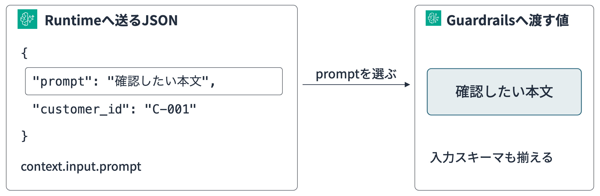

次はHTTP Runtimeへ送る`prompt`に、暴力表現のスコアが0.2を超えて含まれる場合に拒否する例です。

```cedar
forbid (
  principal,
  action == AgentCore::Action::"GuardTarget___POST:/invocations",
  resource == AgentCore::Gateway::"<gateway-arn>"
)
when guardrails {
  BedrockGuardrails::ContentFilter(
    ["VIOLENCE"], [context.input.prompt]
  )["VIOLENCE"].confidenceScore.greaterThan(decimal("0.2"))
};
```

独自のHTTP規約を持つ接続先では、どの項目を検査するかを示すスキーマが必要です。MCPとA2Aには既定のスキーマが用意されています。Gatewayの実行ロールには`bedrock:InvokeGuardrailChecks`を付与します。

しきい値は最初から決め打ちにせず、まずPolicy Engineを`LOG_ONLY`にして、正常な入力と拒否したい入力の判定結果を集めます。業務データからしきい値を決めたら、通常操作を許可する`permit`も用意したうえで`ENFORCE`へ切り替えます。

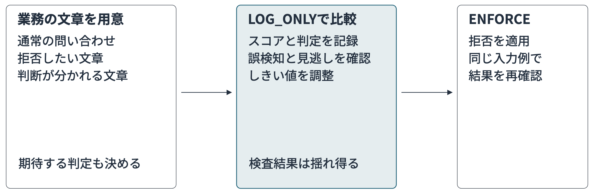

### Interceptorの活用

Interceptorは、Gatewayの要求前または応答後にLambda関数を実行する仕組みです。Cedarでは書けない、業務に合わせた処理を挟めます。

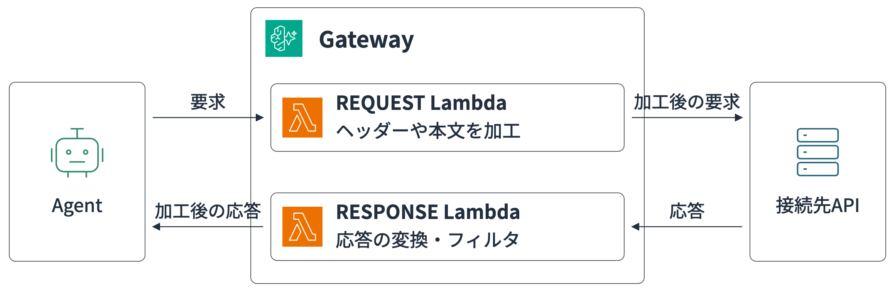

たとえばConfluenceの検索結果に、社外秘のラベルが付いたページが混ざることがあります。応答後のLambdaで検索結果からそのページを除けば、エージェントには社外秘の本文が渡りません。要求前のLambdaでは、Jiraへ起票する前に社内APIで顧客の契約状態を確かめられます。解約済みの顧客なら起票を止める、といった使い方です。

外部照会のタイムアウトや再試行はGatewayの応答時間にも影響します。Interceptorを挟むときは、待てる時間と障害時の動作を決めておきます。

ほかにも、接続先へ渡すヘッダーを付け替えて、下流のサービス用のトークンを渡すことができます。`tools/list`の応答から利用者に見せたくないツールを外したり、ツールを呼ばずにその場で応答を返して呼び出しを止めたりもできます。要求のヘッダーをInterceptorで受け取るには、設定で`passRequestHeaders`を有効にします。トークンが含まれるので、Lambda関数のログに残さないよう気をつけます。

## WAFでの制御

Gatewayを公開すると、想定していない送信元からの要求や大量のアクセスも届く可能性もあります。利用者と操作を判定するPolicyの手前で、想定外の送信元や大量の通信を止めたいときにWAFを使います。

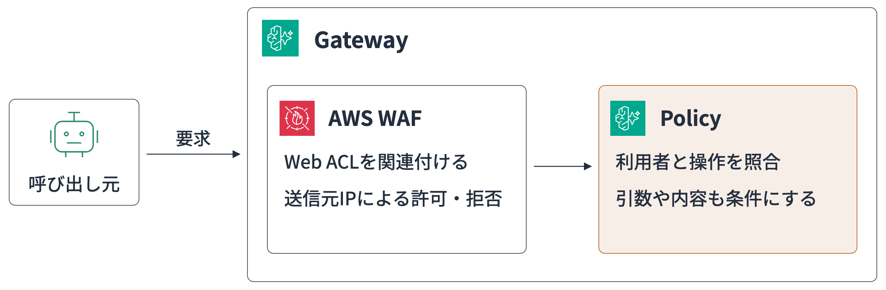

GatewayにはリージョンのWeb ACLを1つ関連付けが可能で、AWS管理ルール・IP制限・通信量に基づくルールをGatewayの手前で評価できます。接続先ごとのURLパスを条件にすれば、更新系のエージェントだけ厳しくするといった使い分けもできます。

## Gatewayをどこまで共通にするか

接続先が増えてきたら、Gatewayをまとめる範囲も考えます。筆者は認証方式に加えて、ポリシーを管理する担当者と障害時に同時停止してよい範囲を考慮する必要があると考えています。社内検索と問い合わせ起票は一緒に扱えても、全社のモデル呼び出しと一部門の更新処理では、予算も止まったときの影響も違うからです。

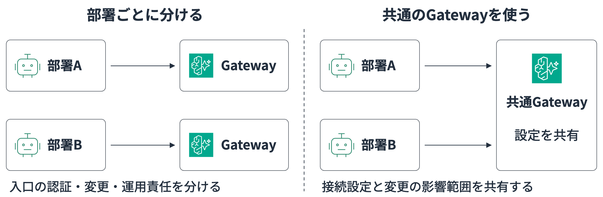

## 呼び出しの記録を残す

Gatewayに各種まとめると、複数のエージェントから複数の接続先への呼び出しが、Gatewayの記録に集まります。エージェントごと・接続先ごとにログを探して回らなくても、通ったリクエストと拒否したリクエストを1か所で追えようになります。

### トレースを有効にする

記録は標準では出ないので、AgentCore GatewayのコンソールでGatewayを開き、「ログの配信とトレース」で設定します。アプリケーションログはCloudWatch Logsへの配信先を追加し、トレースは「編集」から有効にします。トレースを使うには、アカウントでCloudWatchのTransaction Searchも有効にしておきます。

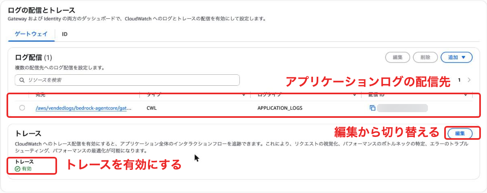

ログを配信していればトレースはなくてもいいのでは、と思うかもしれません。ただ、GenAI ObservabilityのGatewayの画面はトレースのスパンから作られているため、トレースを有効にしないとPolicyの判定数・処理時間の内訳・タイムラインは表示されません。アプリケーションログにも処理の記録は残りますが、どこで時間がかかったかや、どのポリシーがどれだけ通したかを一目で見るにはトレースが要ります。スパンはCloudWatch Logsの`aws/spans`に取り込まれて料金がかかるので、取り込む量も見ながら有効にします。

それぞれの記録に残る内容は次のとおりです。


| 記録                 | 残る場所                                                                   | 分かること                          | 引数と応答の本文 |
| ------------------ | ---------------------------------------------------------------------- | ------------------------------ | -------- |
| トレース               | CloudWatch Logsの`aws/spans`                                            | 認証・Policy・接続先ごとの所要時間、Policyの判定 | 残らない     |
| アプリケーションログ         | CloudWatch Logsの`/aws/vendedlogs/bedrock-agentcore/gateway/<Gateway名>` | 要求の受付・ツールの実行・Policyの判定と理由・エラー  | 平文で残る    |
| CloudTrailのデータイベント | 証跡の保存先（S3など）                                                           | 誰がどのツールを呼んだか                   | 伏せ字になる   |
| CloudTrailの管理イベント  | CloudTrailのイベント履歴（既定で記録）                                               | Gatewayやポリシーの作成・変更             | 対象外      |


アプリケーションログとトレースは、呼び出しから数秒で届きました。CloudTrailのデータイベントは証跡で`AWS::BedrockAgentCore::Gateway`を明示的に有効にする必要があり、S3へは数十秒から5分ほどで届きました。

### GenAI Observabilityで見る

設定ができたら、CloudWatchのGenAI Observabilityを開きます。「Bedrock AgentCore」の「ゲートウェイ」タブに、Gatewayごとの呼び出し数・エラー・平均レイテンシーと、Policyの判定数・拒否率・許可率が並びます。

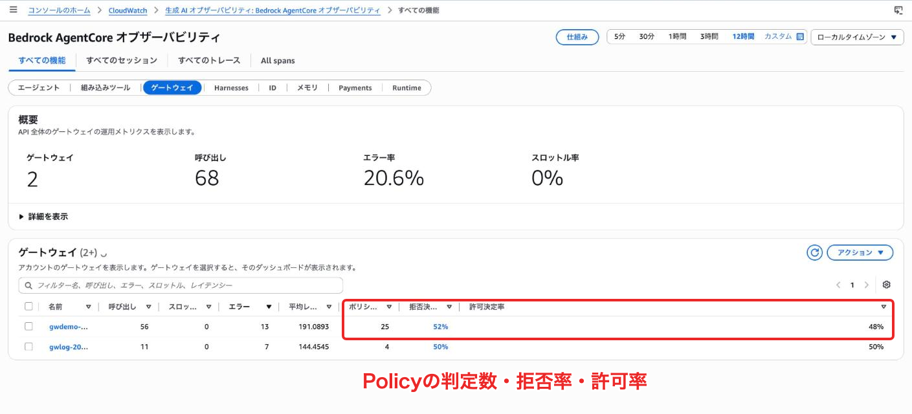

Gatewayを選ぶと、そのGatewayのダッシュボードが開きます。「トレース」タブから1件を選ぶと、1回の呼び出しが入口の認証・Policyの判定・接続先の呼び出しに分かれてタイムラインに並びます。右側には同じトレースのアプリケーションログも出るので、どの処理に時間がかかり、そのとき何が記録されたかを1つの画面で追えます。

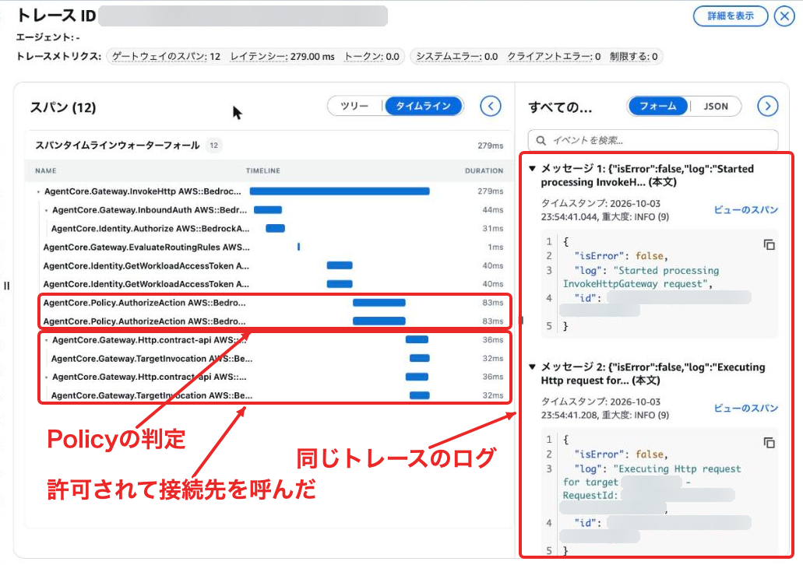

Policyで拒否された呼び出しは、判定のスパンで終わり、接続先の呼び出しが出てきません。判定のスパンを選ぶと「ポリシーの決定: Deny」と表示されます。

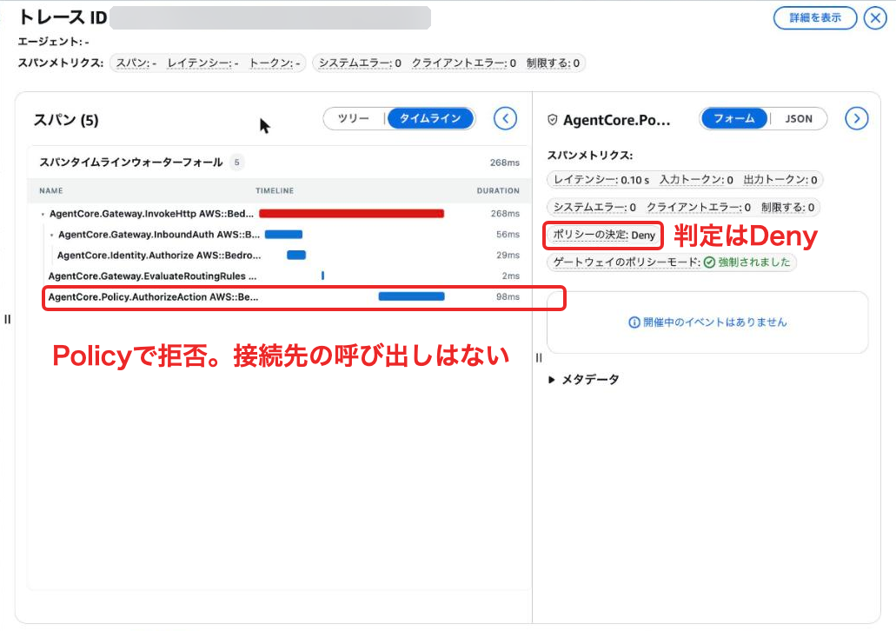

トレースやスパンの一覧は、時間の範囲を12時間にすると読み込みが終わらないことがありました。30分から1時間に絞ると表示されたので、調べたい時刻の前後に範囲を狭めて開くとよいです。

ダッシュボードの「Policies」タブでは、ポリシーごとに許可した件数が分かります。使われていないポリシーや、想定より多く通しているポリシーを見つけるのに使えます。

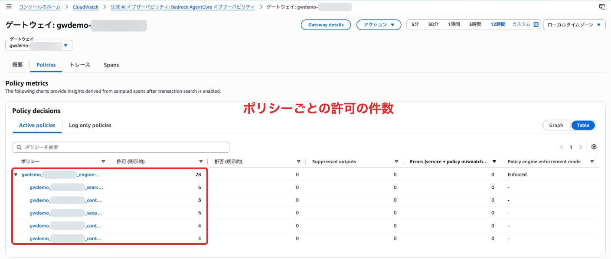

HTTPパススルーの呼び出しは、アプリケーションログにメソッドやパスが残りませんでした。どのパスを呼んだかは、トレースの`AgentCore.Gateway.InvokeHttp`スパンの`url.path`で確認可能でした。

### 期間をまたいで探すときはLogs Insightsで検索する

GenAI Observabilityは、トレースを1件ずつ開いて確かめる画面です。「この1週間の拒否を理由ごとに数えたい」「ある利用者の呼び出しを全部出したい」のように、期間をまたいで集計・検索したいときは、CloudWatch Logs Insightsでアプリケーションログを検索もできます。ロググループに`/aws/vendedlogs/bedrock-agentcore/gateway/<Gateway名>`を選び、次のようなクエリを実行します。

Policyの判定を新しい順に並べるクエリです。

```text
fields @timestamp, body.log, body.policy.decision, body.policy.reason, request_id
| filter ispresent(body.policy.decision)
| sort @timestamp desc
| limit 50
```

許可と拒否が理由つきで並ぶので、拒否が急に増えていないかもすぐ分かります。

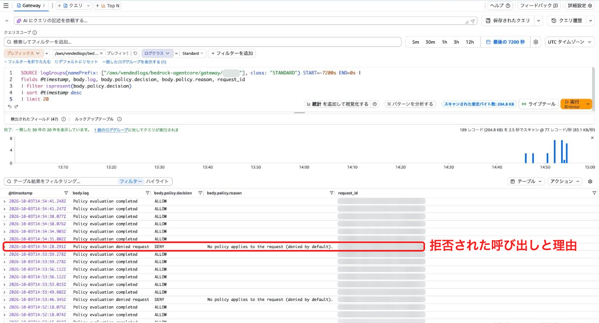

拒否を理由ごと・1時間ごとに数えるなら、次のように集計します。

```text
filter body.policy.decision = "DENY"
| stats count(*) as denied by body.policy.reason, bin(1h)
```

特定の利用者の呼び出しを追うときは、JWTの`sub`で絞ります。トレースで気になった呼び出しは、`request_id`で1回分の記録をまとめて出せます。

```text
filter body.policy.principal.entityId = "<JWTのsub>"
| stats count(*) by body.policy.decision
```

```text
filter request_id = "<request_id>"
| sort @timestamp asc
```

アプリケーションログには、1回のツール呼び出しにつき3〜4件の記録が残ります。内訳は要求の受付（`requestBody`に引数まで入る）・ツールの実行・成功（`responseBody`に応答まで入る）と、Policyを使っていればその判定です。どの記録にも`request_id`が入り、応答ヘッダーの`x-amzn-requestid`と一致します。

Policyで拒否されたときは、判定の記録に理由が残ります。次は検索の前に起票しようとして拒否された例です（一部を省略）。

```json
{
  "body": {
    "isError": true,
    "log": "Policy evaluation denied request",
    "policy": {
      "decision": "DENY",
      "reason": "No policy applies to the request (denied by default).",
      "determiningPolicies": [],
      "principal": {"entityType": "AgentCore::OAuthUser", "entityId": "94388448-..."}
    }
  },
  "request_id": "aea15353-...",
  "severityText": "ERROR"
}
```

許可されたときは`"decision": "ALLOW"`になり、`determiningPolicies`に判断に使用したポリシーのIDが入ります。

### 拒否はHTTPのエラーにならない

少し注意点として、Policyで拒否してもHTTPの状態コードは200だった点で、拒否のメッセージはJSON-RPCのエラー（`-32002 Tool Execution Denied`）として本文に入り、HTTPの4xxだけを監視していると、拒否を見落とします。トークンなしの呼び出しは401、Dogwoodのポリシーがあるのにポリシーセッションのヘッダーを付けない呼び出しは`-32006`のエラーでした。


| 呼び出し                        | HTTP | 応答のエラー                                                            |
| --------------------------- | ----: | ----------------------------------------------------------------- |
| トークンなし                      | 401  | `-32001 Missing Bearer token`                                     |
| Policyで拒否                   | 200  | `-32002 Tool Execution Denied`                                    |
| ポリシーセッションのヘッダーなし（Dogwoodあり） | 200  | `-32006 sessionId is required when temporal policies are enabled` |
| 存在しないツール                    | 200  | `-32602 Unknown tool`                                             |


ポリシーセッションIDは、どのログにも出ませんでした。応答ヘッダーには返ってくるので、エージェント側で`request_id`と一緒に記録しておくと、あとで同じ問い合わせの呼び出しをまとめて追えます。

第6章のAgentCore ObservabilityとCloudWatchでは、エージェントの実行結果を確認し、Gatewayのログで何を通して何を止めたかを同様に確認できました。まずRuntimeのログを見るケースが大半だと思いますが、Gatewayのログも活用したいんとなったらこのようみてみると良いかもしれません。

## 実際にGatewayを使うなら

最初から全部の機能を入れる必要はありません。  
本編のエージェントから広げるなら、次の順で進めるとスモールスタートで良いと思います。

1. 本編のMCPツールをGateway経由で呼び、ログを有効にする。誰が何を呼び、何が拒否されたかが見えるようになる
2. Jira起票のような更新系のツールに、Cedarで役割ごとの許可を付ける。確認を済ませてほしい操作はDogwoodで順番を守らせる
3. 別のチームがモデルや社内API・エージェントを使い始めたら、Inference接続先とHTTP接続先として加える。APIキーと認証設定はGatewayに集める
4. 利用者が増えたら使用量制限、社外から呼ばれるならWAFを加える。文章の中身まで見たいときはGuardrails、業務の状態で判断したいときはInterceptorを使う

エージェントが1つで、つなぐ先も少ないうちは直接呼んでも十分かと思います。チームやエージェントが増え、接続先の認証や利用ルールをそろえたくなったときにGatewayへの統合も検討しても良い印象です。

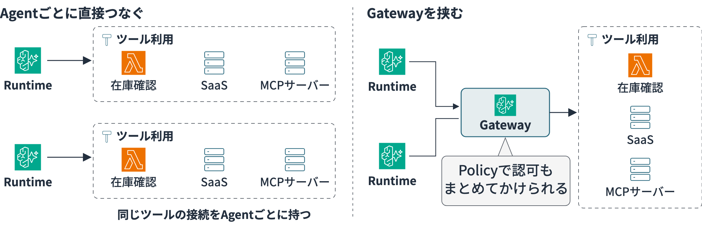

まずは1つのツールをGateway経由に切り替えるところから始めてみましょう。

## 参考資料

- [【登壇資料】DevelopersIO 2026 Osakaで「AgentCore Gatewayを使ってみよう！」というタイトルで登壇しました！](https://dev.classmethod.jp/articles/devio2026-osaka-agentcore-gateway-introduction/)
- [AgentCore Gatewayで利用できる接続先](https://docs.aws.amazon.com/bedrock-agentcore/latest/devguide/gateway-supported-targets.html)
- [生成AIモデル向けのInferenceコネクタ](https://docs.aws.amazon.com/bedrock-agentcore/latest/devguide/gateway-target-inference-connector.html)
- [AgentCore RuntimeをHTTP接続先にする](https://docs.aws.amazon.com/bedrock-agentcore/latest/devguide/gateway-target-http-runtime.html)
- [AgentCore Memoryコネクタ](https://docs.aws.amazon.com/bedrock-agentcore/latest/devguide/memory-gateway-connector.html)
- [Gatewayへ使用量制限を追加する](https://docs.aws.amazon.com/bedrock-agentcore/latest/devguide/gateway-rate-limits.html)
- [使用量制限のAPI例](https://docs.aws.amazon.com/bedrock-agentcore/latest/devguide/gateway-rate-limits-examples.html)
- [Configure rate limits for AI traffic on AgentCore gateway](https://aws.amazon.com/blogs/machine-learning/configure-rate-limits-for-ai-traffic-on-agentcore-gateway/)
- [時間と実行履歴を使うDogwoodポリシー](https://docs.aws.amazon.com/bedrock-agentcore/latest/devguide/policy-temporal.html)
- [Amazon Bedrock AgentCore Policyに追加された「Temporal Policies」を試してみた](https://dev.classmethod.jp/articles/agentcore-gateway-dogwood-temporal-policies/)
- [AWS WAFでGatewayを保護する](https://docs.aws.amazon.com/bedrock-agentcore/latest/devguide/gateway-waf.html)
- [GatewayのCloudTrailデータイベントを有効にする](https://docs.aws.amazon.com/bedrock-agentcore/latest/devguide/enabling-cloudtrail-data-event-logging.html)
- [VPC内の接続先をアカウント間で共有する](https://docs.aws.amazon.com/bedrock-agentcore/latest/devguide/vpc-egress-private-endpoints.html)
- [AgentCore GatewayのHTTPターゲットにconnectorタイプが追加されたのでAgentCore Memoryを繋いでみた](https://dev.classmethod.jp/articles/agentcore-gateway-http-connector-memory/)
- [AgentCore GatewayのAgent Targetを試してみた](https://dev.classmethod.jp/articles/agentcore-gateway-agent-target-a2a/)
- [AgentCore PolicyのCedarポリシーにBedrock Guardrailsを組み込んでGatewayでリクエストをブロックしてみた](https://dev.classmethod.jp/articles/agentcore-policy-guardrails-gateway/)
- [AgentCore GatewayのInference Targetを試してみた](https://dev.classmethod.jp/articles/agentcore-gateway-inference-target/)
- [AgentCore Gatewayの使用量制限をヘッダーとボディの値で分けてみた](https://dev.classmethod.jp/articles/agentcore-gateway-rate-limit-header-body/)
- [AWS Step Functionsをコネクタ接続先にする](https://docs.aws.amazon.com/bedrock-agentcore/latest/devguide/gateway-target-connector-step-functions.html)
- [Step Functionsのワークフローをエージェントのツールとして使う](https://docs.aws.amazon.com/step-functions/latest/dg/tutorial-agentcore-gateway.html)
- [AgentCore Gatewayでモデルのフォールバックとサーキットブレーカーを試してみた](https://dev.classmethod.jp/articles/agentcore-gateway-model-fallback/)

