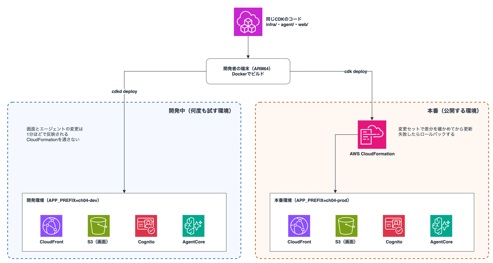
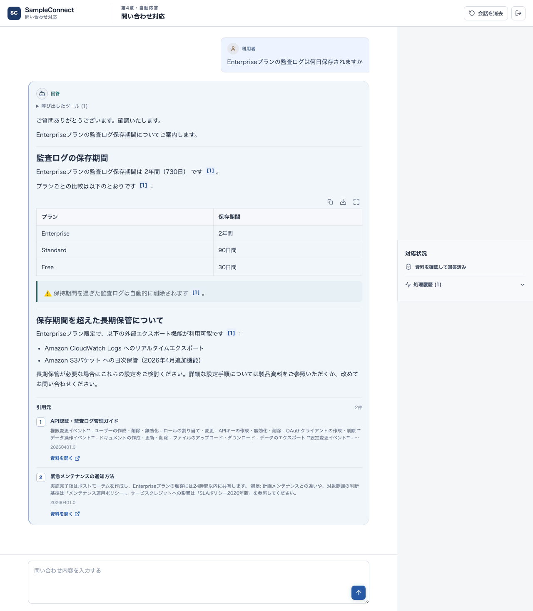
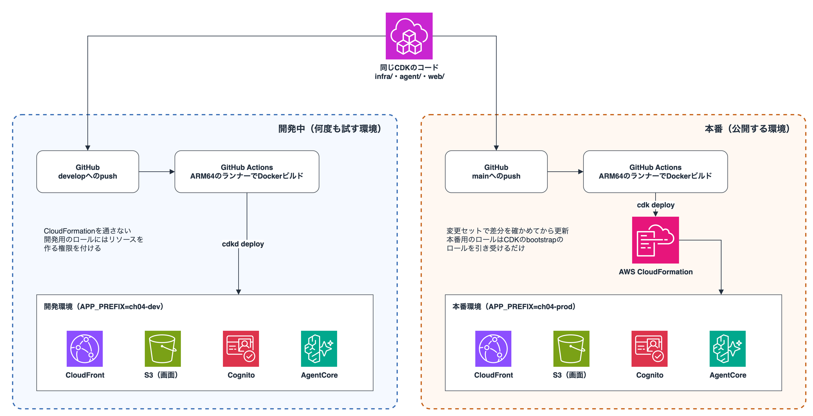

# 第4章のアプリをAmplifyからCDKへ移行する

この本では認証から画面の配信などもろもろとAmplifyをフル活用してデプロイしました！メインで執筆していた時期（4〜6月）は、認証や画面の配信がまとまっているAmplifyが便利でしたが、最近はClaude Codeなどのコーディングエージェントのおかげで、S3 + CloudFrontのような構成もグッと実装しやすくなっています。そうなると実装の難しさよりも、エージェントを少し直すたびにデプロイを待つ時間のほうが気になってきました・・・

そこで今回は画面をS3とCloudFrontへ移し、CDKとローカルのDockerでデプロイする構成を試してみました！Amplifyからの変更点と、デプロイ時間の差を紹介します。サンプルは [`sample-code/supplements/ch04-light-serverless/`](../../sample-code/supplements/ch04-light-serverless/) にあります。

## 前提

本書のハンズオンでは、本を手に取ってすぐにサクッと試せるようにCodespacesを使ってきました。Codespacesはx86_64のマシンなので、第4章ではエージェントのARM64のコンテナをCodeBuildでビルドしていました。

この補足では、自分の端末で本格的に開発していく場面を想定して、Apple SiliconのMacで試しています！エージェントのコンテナもARM64のまま、MacのDockerでビルドします。使った環境は次のとおりです。

| 項目 | 使ったもの |
|---|---|
| 端末 | Apple M1 MaxのMac（macOS 26.6） |
| Docker | Docker 28.4（colima 0.9.1で起動） |
| Node.js・pnpm | Node.js 26.7、pnpm 10.34.5 |
| CDK | AWS CDK CLI 2.1146.1、aws-cdk-lib 2.275.0、cdkd 0.307.0 |
| AWS | 米国東部（バージニア北部） |
| モデルと資料 | Claude Sonnet 4.6（`us.anthropic.claude-sonnet-4-6`）、第2章で作ったKnowledge Base（S3 Vectors） |

この補足のデプロイ時間は上の環境で2026年10月に測った一例です。端末の性能やネットワーク、GitHub Actionsのランナー、AWS側の状況によって変わるので、同じ時間で終わることを保証するものではなく、参考情報として理解ください。

## 先に結果

開発環境はcdkdとローカルのDocker、本番環境は `cdk deploy` を使用する想定で検証してみました。エージェントを変えたときのデプロイはcdkdなら46秒で、Amplify Hostingの約6分（4〜8分とばらつきました）より大幅に短くなりました。GitHub Actionsから実行しても、Amplify Hostingの半分以下で終わります。

同じ第4章のアプリで変更の種類ごとにデプロイの時間を測りました。エージェントのビルドはAmplify側が第4章と同じCodeBuild、CDK側がDocker（MacかGitHub Actionsのランナー）です。ビルドする場所も含めた、開発の流れ全体の比較です。単位は秒で、値は3回の中央値です。

| デプロイの方法 | エージェント（`main.py`） | 画面 |
|---|---|---|
| Amplify Hosting | 354 | 200 |
| Amplify sandbox | 164 | デプロイ不要 |
| 端末から `cdk deploy` | 77 | 78 |
| 端末から `cdkd deploy` | 46 | 54 |
| GitHub Actionsから `cdk deploy` | 105 | 79 |
| GitHub Actionsから `cdkd deploy` | 81 | 74 |

Amplify Hostingはジョブの開始から終了まで、sandboxは `ampx sandbox --once` の実行時間、端末からはビルドからデプロイのコマンドが終わるまで、GitHub Actionsは非公開リポジトリのARM64ランナー（2コア）で、ジョブの開始から終了までを測定時間にしています。測り方が少し違うので単純な比較ではありませんが、Amplify Hostingよりは速くなっていますね！

エージェントを1行直して試すたびに、Amplify Hostingでは約6分、cdkdでは反映まで1分弱待ちます。10回直せば、Hostingでは1時間近く、cdkdでは10分ほどです。開発の始めのうちは何度もデプロイするので、この差は大きいですよね。

cdkdは、AWS Heroの後藤さん（go-to-k）がOSSとして開発しているCDKのCLIです。CloudFormationを通さずにAWSのAPIを直接呼んでリソースを作るので速くデプロイすることを可能にしています！詳細はレポジトリやドキュメントをご参照ください！

[cdkd（GitHub）](https://github.com/go-to-k/cdkd)、[ドキュメント](https://cdkd.dev/)

同じCDKのコードから開発中の環境は `cdkd deploy` で、本番の環境は `cdk deploy` で作ります。環境ごとに `APP_PREFIX` を分けておけば同じアカウントでも同時に使用できます！



## Amplifyからの変更点


第4章でAmplifyに任せていたものと、移行後の置き換え先をまとめました。

| Amplifyでの役割 | 第4章での書き方 | 移行後 |
|---|---|---|
| 画面の配信 | Amplify Hosting | S3とCloudFront |
| ログイン | `defineAuth`（Cognito） | CDKで作るCognito |
| エージェントの呼び出し | 画面から直接（Cognitoのトークン） | 同じく画面から直接 |
| 画面への接続先の受け渡し | `amplify_outputs.json` | デプロイ時にS3へ配置する `config.json` |
| エージェントのビルド | CodeBuild（deploy-time-build） | Docker（`cdk deploy` を実行した環境） |
| Gateway・Memory・ツール用のLambda | `backend.ts` の `aws-cdk-lib` | そのまま流用 |
| 開発中のデプロイ | `ampx sandbox` | `cdkd deploy` |
| 公開用のデプロイ | Amplify Hosting（GitHub連携） | `cdk deploy` |

第4章の `amplify/backend.ts` はGatewayやMemory、Runtimeを `aws-cdk-lib` のコンストラクトで書いています。

Amplifyに固有なのはHosting、ログインの `defineAuth`、接続先を渡す `amplify_outputs.json` の3つで、移すのはおもにここです。画面からエージェントを呼ぶ形は第4章と同じなのでそのまま流用できます！

サーバー側に処理を足したくなったときのために、後半ではLambda Web Functions上のHonoを間に挟む形も紹介します。

具体的に移行のポイントを確認していきましょう。

## 移行のポイント

### 画面をS3とCloudFrontへ移す

画面はViteでビルドした静的ファイルなので、S3に配置してCloudFrontから配信します。Amplify Hostingのビルドの代わりに、CDKの `BucketDeployment` でアップロードします。ハッシュ付きのファイルは長くキャッシュし、`index.html` と `config.json` には `Cache-Control: no-cache` を付けています。

第4章の画面はCognitoのIDとRuntimeのARNを `amplify_outputs.json` から読んでいました。今回はこれらをデプロイ時に `config.json` としてS3へ書き出し、画面は起動時にそれを読み込む作りにしています。

```diff
 // web/src/main.tsx（第4章との差分）
-import outputs from "../amplify_outputs.json"
+import { loadConfig } from "./config"

-Amplify.configure(outputs)
+const config = await loadConfig()   // /config.json を読む
+Amplify.configure({
+  Auth: {
+    Cognito: {
+      userPoolId: config.userPoolId,
+      userPoolClientId: config.userPoolClientId,
+      loginWith: { email: true },
+    },
+  },
+})
```

`Authenticator` や `fetchAuthSession` など画面で使っているAmplifyのライブラリはそのまま使えます。Hostingを使わなくても、Cognitoの値を渡せば動きます。

画面のコードで変えたのはおもにこの読み込み先です。`main.tsx` はCognitoの設定を、`api.ts` はRuntimeのARNを `config.json` から受け取ります。

```diff
 // web/src/api.ts（第4章との差分。抜粋）
-import outputs from "../amplify_outputs.json"
-const REGION = (outputs as Record<string, any>).auth?.aws_region ?? "us-east-1"
-const AGENT_RUNTIME_ARN = (outputs as Record<string, any>).custom?.agentCoreRuntimeArn
+import { loadConfig } from "./config"

-const url = `https://bedrock-agentcore.${REGION}.amazonaws.com/runtimes/${encodeURIComponent(AGENT_RUNTIME_ARN)}/invocations?qualifier=${QUALIFIER}`
+const config = await loadConfig()   // main.tsx と同じ /config.json
+const url = `https://bedrock-agentcore.${config.region}.amazonaws.com/runtimes/${encodeURIComponent(config.agentRuntimeArn)}/invocations?qualifier=${QUALIFIER}`
```

### ログインをCDKのCognitoで作る

`defineAuth` の代わりにCDKでユーザープールとクライアントを作ります。メールアドレスでサインアップする設定は第4章と同じです。

```ts
// infra/lib/support-agent-stack.ts（抜粋）
const userPool = new cognito.UserPool(this, "UserPool", {
  selfSignUpEnabled: true,
  signInAliases: { email: true },
  autoVerify: { email: true },
})
const userPoolClient = userPool.addClient("WebClient", {
  authFlows: { userSrp: true },
})
```

### エージェントのビルド

第4章ではハンズオン用に用意したCodespaces（x86_64）でも動くように、端末がx86_64かARM64かに関係なくビルドできるCodeBuild（deploy-time-build）を使っていました。端末がARM64なら、CDKの `fromAsset` で `cdk deploy` を実行した環境のDockerでビルドできます。x86_64の端末から試すときは、`AGENT_ARTIFACT=codebuild` を付ければ第4章と同じCodeBuildを使えます。

```diff
 // 第4章の amplify/agent/resource.ts との差分（抜粋）
-const image = new ContainerImageBuild(scope, "AgentImage", {
-  directory: path.join(currentDir),
-  platform: Platform.LINUX_ARM64,
-})
 const runtime = new agentcore.Runtime(scope, "Runtime", {
-  agentRuntimeArtifact: agentcore.AgentRuntimeArtifact.fromEcrRepository(image.repository, image.imageTag),
+  agentRuntimeArtifact: agentcore.AgentRuntimeArtifact.fromAsset(path.join(root, "agent"), {
+    platform: Platform.LINUX_ARM64,
+  }),
```

### Gateway・Memoryはそのまま使う

Gateway・Memory・Atlassian用のLambdaは第4章の `backend.ts` のコードをそのまま使います。Knowledge Baseは第2章で作ったものを指定します。

ConfluenceとJiraを設定しなくてもとりあえず動かせるように、Gatewayの先には固定の応答を返すダミーのLambdaをデプロイします。

ツールの名前と応答の形は第4章と同じで、Confluenceの検索では第4章で投入する3ページのどれかが返り、Jiraの起票では実際の課題は作られません。

変更のポイントを押さえたので動作確認してみます！

## 動作確認

動作確認するにあたって準備するものは次のとおりです。

- Node.js 24、pnpm、Docker（x86_64の端末では `AGENT_ARTIFACT=codebuild` を付けてCodeBuildでビルドします）
- 第2章で作り、同期を終えたKnowledge Base
- AWSの認証を済ませたターミナル
- AgentCoreを使えるリージョン。今回は米国東部（バージニア北部）で試しています。ほかのリージョンで作る場合は、`MODEL_ID` もそのリージョンで使える推論プロファイルに変えてください

```bash
cd sample-code/supplements/ch04-light-serverless
pnpm install --frozen-lockfile
export KNOWLEDGE_BASE_ID=YOUR_KNOWLEDGE_BASE_ID
export MODEL_ID=us.anthropic.claude-sonnet-4-6
export KNOWLEDGE_BASE_SOURCE_BUCKET_NAME=YOUR_BUCKET   # 引用元の資料を開く場合
export KNOWLEDGE_BASE_SOURCE_PREFIXES=sample-data
pnpm exec cdk bootstrap   # そのリージョンで初めてCDKを使う場合
pnpm run deploy
```

出力された `AppUrl` を開いてアカウントを作り、第4章で試した質問を送ってみましょう。回答が少しずつ表示され、引用と「資料を開く」も同じように動きます。



cdkdで作る場合も、CDKのコードは変えずに `pnpm run deploy:cdkd` を実行します。

```bash
pnpm exec cdkd bootstrap   # 初回だけ
APP_PREFIX=ch04-cdkd pnpm run deploy:cdkd
```

cdkdはCloudFormationとは別に状態をS3に持ちます。`cdk deploy` とcdkdで同じ名前のスタックを作るとリソースの名前が衝突するので`APP_PREFIX` を分けてください。

## デプロイ時間を比べる

画面とエージェントに入れたバージョン番号を1つずつ上げてデプロイし、コマンドが終わるまでと、新しい番号が画面やエージェントの応答に出るまでの時間を測りました。記録と集計はサンプルの `results/` にあります。

CDK側のエージェントを、第4章と同じCodeBuildでビルドした場合も測りました。`main.py` を変えたときの時間で、単位は秒です。

| エージェントのビルド | `cdk deploy` | `cdkd deploy` |
|---|---|---|
| Docker（「先に結果」の値） | 77 | 46 |
| CodeBuild（第4章と同じ） | 117 | 92 |

ビルド条件を第4章とそろえても、Amplify Hostingの354秒やsandboxの164秒より短く済みました。

### 時間がかかる箇所

Amplify Hostingは画面だけを変えたときもバックエンド全体をCloudFormationで確かめてから画面をビルドします。変更のないコミットを再ビルドしても163秒かかりました。画面を変えたときの200秒のほとんどは、変更の有無にかかわらず毎回かかる時間です。

`cdk deploy` は変更セットを作ってからスタックを更新するので、cdkdより時間がかかります。画面の変更で24秒、エージェントの変更で31秒の差が出ました。

初回の作成は `cdk deploy` で268秒、cdkdで256秒で、Amplify sandboxの286秒とほぼ同じでした。このうち184秒はCloudFrontの作成待ちです。削除は `cdk deploy` とcdkdのどちらも6分台で、Amplify sandboxの543秒より短く済みました。

この数字を見るとAmplifyからの変更は魅力的に思えますね！

## （発展）HonoのAPIを挟む

画面からRuntimeを直接呼ぶ形でもここまでの機能は動くのですが間にAPIを挟みたくなるときがあります。
例えば次のようなときです。

- 画面と同じドメインで呼び、CORSを考えずに済ませたい
- RuntimeのARNを画面に出したくない
- 利用回数の制限や入力のチェック、呼び出しのログなど、サーバー側の処理を足したい

サンプルでは `AGENT_ACCESS=api` を付けてデプロイするとCloudFrontの `/api/*` をLambda Web Functions上のHonoへ渡す形になります。HonoはトークンをCognitoで検証してからIAM認証でRuntimeを呼びます。


```bash
AGENT_ACCESS=api pnpm run deploy
```

### Honoで書くAPI

Lambda Web FunctionsはHTTPのリクエストをそのまま受ける新しいLambdaで、ポートで待ち受けるNode.jsのサーバーをアダプターなしで動かせます！今回はここにWebフレームワークのHonoを載せて、APIサーバーを作ります。

[Lambda Web Functionsの発表](https://aws.amazon.com/about-aws/whats-new/2026/10/aws-lambda-web-functions/)

この形ではRuntimeをIAM認証にして、ブラウザから直接呼べないようにします。Honoは検証したトークンの `sub` を `actor_id` に入れてRuntimeへ渡します。

Web Functionsでは `@hono/node-server` でそのまま起動し、待ち受け先は環境変数 `AWS_LAMBDA_HTTP_ENDPOINT` で渡されます。

```ts
// api/src/server.ts
const [hostname, port] = (process.env.AWS_LAMBDA_HTTP_ENDPOINT ?? "127.0.0.1:8787").split(":")
serve({ fetch: app.fetch, hostname, port: Number(port) })
```

ローカルでも同じファイルが `127.0.0.1:8787` で起動するので、確かめたコードをそのままデプロイできます。

`/api/chat` の中身は次のとおりです。

```ts
// api/src/app.ts（抜粋。入力のチェックと401を返す処理は省略）
app.post("/api/chat", async (c) => {
  const token = (c.req.header("authorization") ?? "").replace(/^Bearer\s+/i, "")
  const user = await deps.verifyToken(token)        // Cognitoのアクセストークンを検証
  const { prompt, session_id } = await c.req.json()
  const result = await deps.invokeAgent({
    prompt,
    sessionId: session_id,
    actorId: user.sub,                              // 記憶の持ち主はトークンのsubで決める
  })
  c.header("Content-Type", result.contentType)
  return stream(c, async (s) => {
    for await (const chunk of result.body) await s.write(chunk)
  })
})
```

Web FunctionsのランタイムにはAWS SDKが入っていないので、esbuildで依存ごと1つの `index.js` にまとめ、`package.json`（`"type": "module"`）と一緒にzipにします。zip直下の `index.js` が起動します。

### Web FunctionsをCDKで定義する

2026年10月時点ではL2のコンストラクトがないので、L1の `CfnWebFunction`、`CfnWebFunctionRevision`、`CfnWebFunctionEndpoint` で書きます。aws-cdk-libは2.273.0以降が必要です（サンプルは2.275.0）。

Web Functionsは3つのリソースでできています。`WebFunction` が関数そのもの、`WebFunctionRevision`（Revision）がコードと設定をまとめた版、`WebFunctionEndpoint` が呼び出し口です。Revisionは作ったあとに変えられないので、コードを変えるたびに新しいRevisionを作り、Endpointの向き先を切り替えます。

```ts
// infra/lib/support-agent-stack.ts（抜粋）
const webFunction = new lambda.CfnWebFunction(this, "ApiFunction", { functionName })
const revision = new lambda.CfnWebFunctionRevision(this, "ApiRevision", {
  functionName,                                     // ARNではなく素の名前
  buildConfig: {
    codeConfig: { s3Object: { bucket, key, versionId } },
    runtimeConfig: { runtime: "nodejs24.x" },
  },
  serviceConfig: { executionRoleArn: apiRole.roleArn, timeoutSeconds: 300, environmentVariables },
})
const endpoint = new lambda.CfnWebFunctionEndpoint(this, "ApiEndpoint", {
  functionName,
  endpointName: "live",
  endpointType: "HomeRegion",
  authType: "IamAuth",                              // CloudFrontのOACで署名したリクエストだけを受ける
  revisionWeights: [{ revisionId: revision.attrRevisionId, weight: 100 }],
})
```

<details>
<summary>Web Functionsの設定の注意点</summary>

- Revisionはバージョンを指定してコードを参照するので、コード置き場のバケットはバージョニングが必要です。サンプルではSSE-S3の専用バケットを作っています。zipは `BucketDeployment` で展開せずに（`extract: false`）配置します
- このバケットにはRevisionから参照できるように `lambda.amazonaws.com` を許可するバケットポリシーを付けます
- Revisionはコードを変えると置き換え（Replacement）になります。CloudFormationが新しいRevisionを作ってトラフィックを移し、古いRevisionを消します。古いRevisionが参照するS3のバージョンを消さないように、`prune: false` にしています
- CloudFrontからはOACで署名して呼びます。OACの種類は `lambda`、署名は `always-amz-auth` にします。署名は専用のヘッダーに入るので、利用者の `Authorization` ヘッダーはそのままHonoへ届きます
- CloudFrontから呼べるように、Web Functionに `lambda:InvokeWebFunctionEndpoint` を許可するリソースポリシーを付けます
- オリジンリクエストポリシーは `AllViewerExceptHostHeader` にします。Hostまで転送するとWeb Functions側で404になります

Web Functionsのエンドポイントを直接呼ぶと403が返り、CloudFrontを通したリクエストだけが届くことも確かめました。

エージェントがツールを実行している間はSSEに何も流れない時間があります。CloudFrontの `readTimeout`（既定は30秒）はこの無通信の時間にもかかるので、クォータを引き上げずに設定できる上限の60秒にしています。

</details>

### APIを変えたときの時間と注意点

Honoのコードを変えたときのデプロイは`cdk deploy` で88秒、cdkdで51秒でした。Web FunctionsのRevisionを作り直すので画面の変更より少し長くかかります。初回の作成もcdkdで313秒と、直接呼ぶ形より1分ほど長くなりました。

## （発展）GitHub Actionsでデプロイする

チームで開発するなら、ブランチへのpushでデプロイできると便利なんですよね。`develop` へのpushで開発環境へ `cdkd deploy`、`main` へのpushで本番環境へ `cdk deploy` するワークフローもGitHub Actionsを活用して試してみました！



サンプルの `github-actions/deploy.yml` をリポジトリの `.github/workflows/` に置き、Knowledge BaseのIDやロールのARNをリポジトリの環境変数に入れて使います。

エージェントはARM64のランナー（`ubuntu-24.04-arm`）でそのままビルドします。

```yaml
# github-actions/deploy.yml（抜粋）
on:
  push:
    branches: [develop, main]
permissions:
  id-token: write   # OIDCでAWSのロールを引き受ける
  contents: read
jobs:
  deploy:
    runs-on: ubuntu-24.04-arm
    steps:
      # checkout、Node.jsとpnpmの準備、ECR Publicへのログインは省略
      - uses: aws-actions/configure-aws-credentials@v6
        with:
          role-to-assume: ${{ github.ref_name == 'main' && vars.PROD_ROLE_ARN || vars.DEV_ROLE_ARN }}
          aws-region: us-east-1
      - if: github.ref_name == 'develop'
        run: pnpm run deploy:cdkd   # 開発環境
      - if: github.ref_name == 'main'
        run: pnpm run deploy        # 本番環境
```

ワークフローを動かす前に、AWS側でIAMを用意しておく必要があります。AWSへはOIDCで認証するので、GitHub ActionsのOIDCプロバイダー（アカウントに1つ）と、環境ごとのロールを事前に作ります。


- 本番用にはCDKのbootstrapのロール（`cdk-hnb659fds-*`）を引き受ける権限と、ECR Publicにログインする権限（`ecr-public:GetAuthorizationToken`、`sts:GetServiceBearerToken`）を付けます
- 開発用にはスタックのリソースを作れる権限を付けます。cdkdはCloudFormationを通さず引き受けたロールで直接リソースを作るからです（[cdkdのドキュメント](https://cdkd.dev/cli-reference-credentials/index.html)）

デプロイ時間は「先に結果」の表のとおりです。ジョブの準備に毎回20秒ほどかかり、エージェントはランナーにDockerのキャッシュがないぶん長くなりますが、それでもAmplify Hostingの半分以下となりました！

個人の端末では環境差分や属人化する可能性があるので、できるだけGitHub ActionsなどのCI/CDツールを活用していきたいですね！

## 片付け

```bash
pnpm run destroy                              # cdk deploy で作った環境
APP_PREFIX=ch04-cdkd pnpm run destroy:cdkd     # cdkd で作った環境
```

このコマンドを実行しても、第2章のKnowledge Baseと資料のバケットは残ります。
