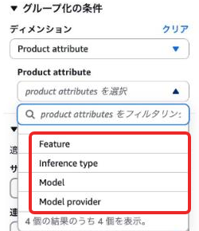
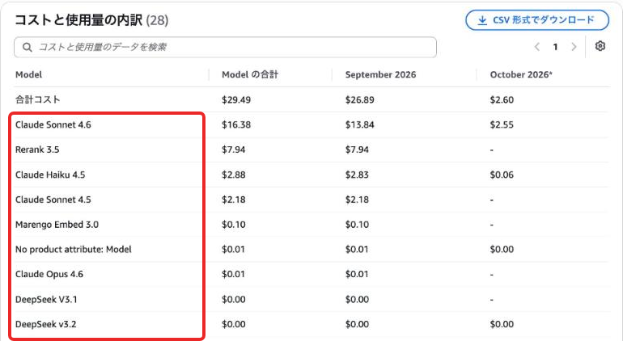
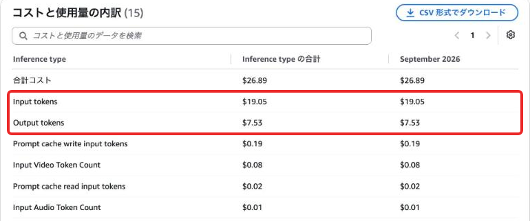
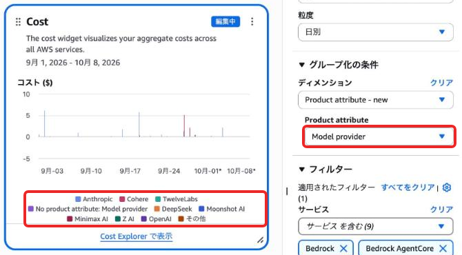
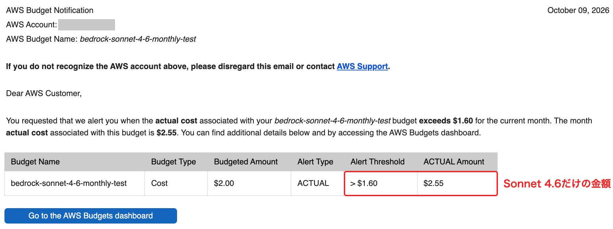

# BedrockのコストをCost Explorerでモデル別に見る

本書の執筆後、AWS Cost ExplorerでAmazon Bedrockのコストをモデル単位で分けられるようになりました！AWS BudgetsとCost Management Dashboardsでも同じ属性を使え、追加料金はかかりません。

[AWSの発表](https://aws.amazon.com/jp/about-aws/whats-new/2026/10/aws-bedrock-attributes-in-cost-explorer/)

第6章の「コスト配分」では、アプリケーション推論プロファイルやIAMプリンシパルのタグを使ってアプリケーションやチームごとにコストを分けました。今回の属性を使うと、どのモデルをどう使ったかでもコストを分析でき、別途タグの設定は不要です。

## 4つの属性で分けられる

Cost Explorerの［グループ化の条件］で［Product attribute］を選ぶと次の4つが表示されます。今のところBedrock専用の項目です。



| 属性 | 分け方の例 |
|---|---|
| Model | Claude Sonnet 4.6、Claude Haiku 4.5、Rerank 3.5など |
| Model provider | Anthropic、Cohereなど |
| Inference type | 入力トークン、出力トークン、プロンプトキャッシュの書き込み・読み取りなど |
| Feature | オンデマンド推論など |

## 自分のアカウントで見てみる

［Product attribute］の［Model］を選ぶと確認のダイアログが出ます。［続行］を押すとサービスのフィルタがBedrock関連の9サービスに自動で置き換わっていました。ぱっと見で利用料が高いモデルがわかりますね。



［Inference type］に切り替えると入力と出力の比率もわかります。9月分は入力トークンが19.05ドル、出力トークンが7.53ドルでした。モデルの中でもInとOutどっちがコストが高いのか、キャッシュはどれぐらい使われているのかもわかりますね。



## APIで取得する

Cost Explorer APIで取得する場合は、`GroupBy`の`Type`に`PRODUCT_ATTRIBUTE`を指定してキーに`model`・`provider`・`inferenceType`・`feature`を渡します。絞り込みには`Filter`の`ProductAttributes`を使います。

```python
import boto3

ce = boto3.client("ce", region_name="us-east-1")
response = ce.get_cost_and_usage(
    TimePeriod={"Start": "2026-09-01", "End": "2026-10-09"},
    Granularity="MONTHLY",
    Metrics=["UnblendedCost"],
    GroupBy=[{"Type": "PRODUCT_ATTRIBUTE", "Key": "model"}],
)
for period in response["ResultsByTime"]:
    for group in period["Groups"]:
        print(period["TimePeriod"]["Start"], group["Keys"][0], group["Metrics"]["UnblendedCost"]["Amount"])
```

## 使い方の一例

たとえば次のような場面で使えます。

- ドキュメントのパース・回答・リランキングやEmbeddingなど、RAGで使っているモデルの費用を比較してどこにコストがかかっているか確認する
- Haiku 5.5のように単価の安いモデルへ切り替えたあと、切り替えた日の前後でモデル別の金額を比べる
- ダッシュボードでプロバイダー別の日次の推移をチームと共有しパッと見で利用料をわかりやすくする

ダッシュボードではウィジェットのグループ化に同じ属性を選べます。Costウィジェットを［Model provider］で日次に分けると、どの日にどのプロバイダーの利用が増えたかがひと目でわかります。



## モデルごとの予算を設定する

第6章では利用量が読みにくい生成AIサービスにはAWS Budgetsで予算を設定するよう勧めました。今回の属性はBudgetsの絞り込みにも使えるので、特定のモデルだけに予算を設定できます。新しいモデルを試し始めたときや、評価のバッチで高いモデルを使うときに設定しておくと安心です。

APIで値を直接指定すると、Claude Sonnet 4.6だけの予算も作れました。

```python
import boto3

account_id = boto3.client("sts").get_caller_identity()["Account"]
budgets = boto3.client("budgets", region_name="us-east-1")
budgets.create_budget(
    AccountId=account_id,
    Budget={
        "BudgetName": "bedrock-sonnet-4-6-monthly",
        "BudgetLimit": {"Amount": "50", "Unit": "USD"},
        "TimeUnit": "MONTHLY",
        "BudgetType": "COST",
        "FilterExpression": {
            "ProductAttributes": {"Key": "model", "Values": ["Claude Sonnet 4.6"], "MatchOptions": ["EQUALS"]}
        },
    },
    NotificationsWithSubscribers=[{
        "Notification": {"NotificationType": "ACTUAL", "ComparisonOperator": "GREATER_THAN",
                         "Threshold": 80, "ThresholdType": "PERCENTAGE"},
        "Subscribers": [{"SubscriptionType": "EMAIL", "Address": "you@example.com"}],
    }],
)
```

下記のようなアラートが届きました。



## コスト配分タグと組み合わせる

タグはアプリケーション単位、今回の属性はモデル単位で分けるのに向いています。両方を組み合わせると、あるアプリケーションの中でどのモデルにいくら使ったかまで見られます。

第6章のCDKでは、アプリケーション推論プロファイルに`App=support`のタグを付けています。このタグをコスト配分タグとして有効にし、タグで絞り込んだうえでモデル別に分けてみました。

```python
response = ce.get_cost_and_usage(
    TimePeriod={"Start": "2026-09-01", "End": "2026-10-11"},
    Granularity="MONTHLY",
    Metrics=["UnblendedCost"],
    Filter={"Tags": {"Key": "App", "Values": ["support"], "MatchOptions": ["EQUALS"]}},
    GroupBy=[{"Type": "PRODUCT_ATTRIBUTE", "Key": "model"}],
)
```

9月分として`model$Claude Sonnet 4.6`の利用料金を取得できて、タグと属性を組み合わせて集計できました。タグで数えられるのは、タグを付けた推論プロファイルを通した呼び出しだけです。システム定義の推論プロファイルを直接使った呼び出しは、タグのないコストとして集計されます。

---

第6章の推論プロファイルやIAMプリンシパルの配分はそのまま使い、モデルごとの内訳を見たいときにこの属性を足すとよいでしょう。

[オンライン補足の一覧に戻る](../README.md)
