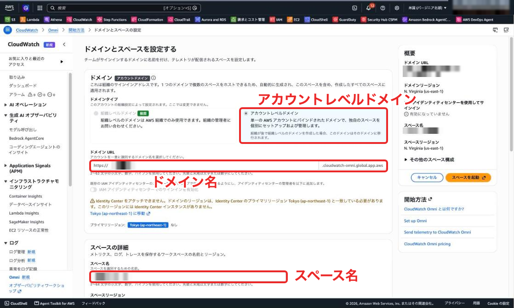
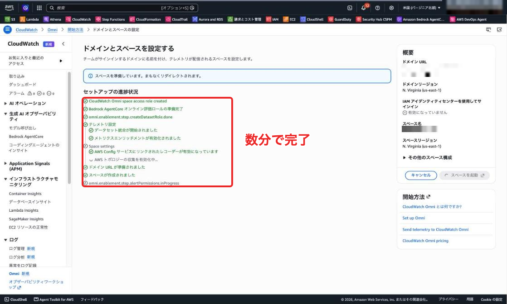
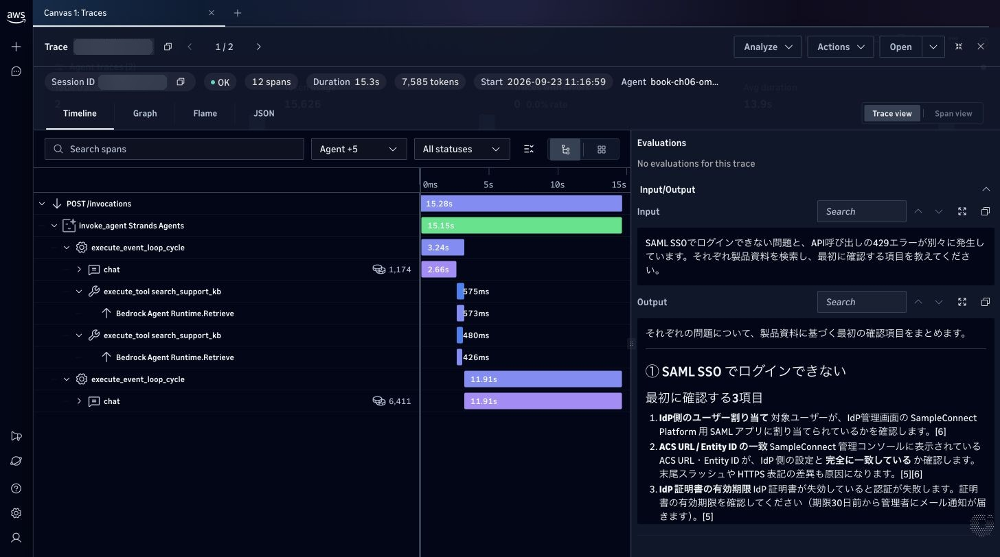
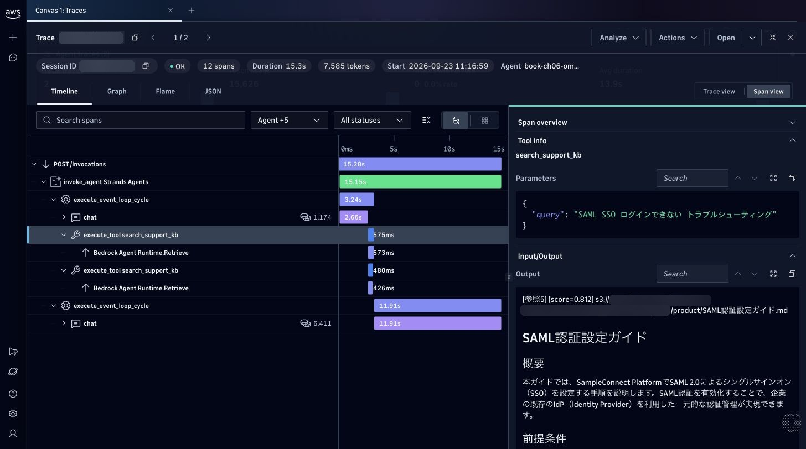
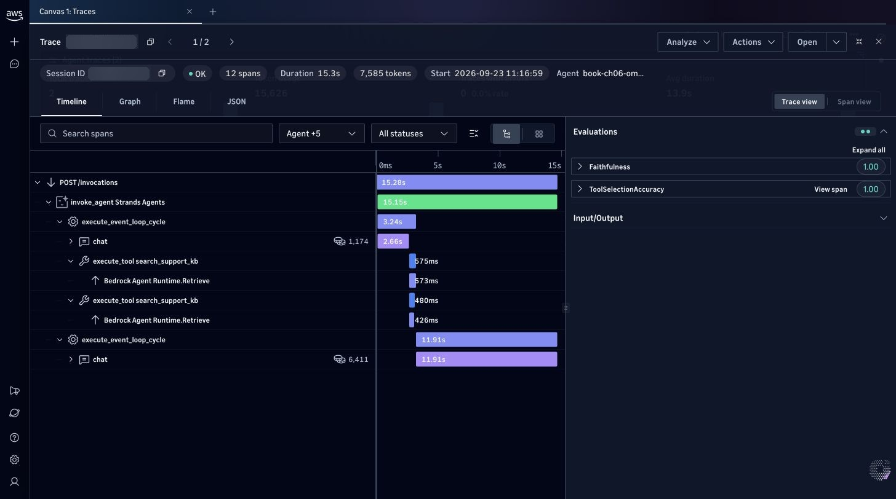
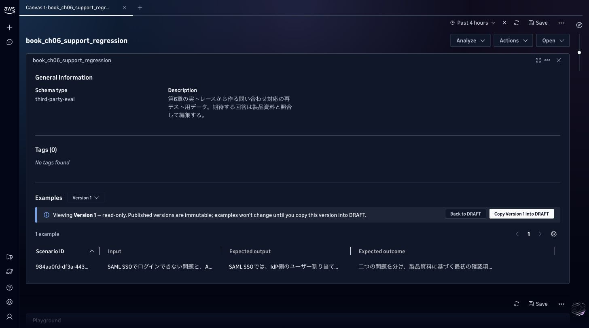
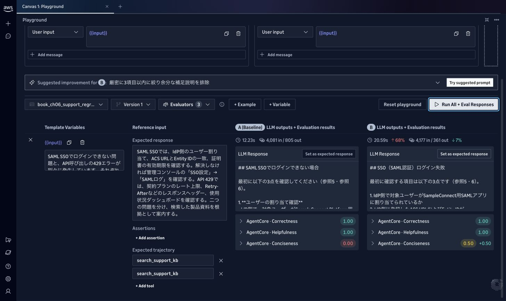

# CloudWatch Omniでエージェントを調べて改善する

本編を書き終えたところで、CloudWatch Omniが登場しました。エージェントのトレースを調べてその実行を評価し、問い合わせをテスト用データに残してプロンプトの比較まで1画面で確認できというものです。アップデートが早いですね。せっかくなので、第4章で作った問い合わせ対応エージェントを題材に試してみました。

## 本編のエージェントをOmniへつなぐ

おさらいですが第4章では、Strandsで問い合わせ対応エージェントを作り、AgentCore Runtimeで実行します。モデルが資料検索のツール呼び出しを返すと、Strandsが`search_support_kb`を実行し、この関数がKnowledge Basesから最大5件を検索し、本文・参照番号・検索スコアをモデルへ返します。モデルはその結果を読んで回答を作り、アプリへ順次送る仕様です。

### 実行内容を記録する設定

エージェントのDockerfileでは、コンテナ起動時に次のコマンドを実行するよう定義されています。

```dockerfile
CMD ["opentelemetry-instrument", "python", "main.py"]
```

この指定で、エージェントの処理とAWS SDKの呼び出しをトレースへ記録できます。Runtimeには次の環境変数を指定しました。第6章の構成を更新する場合は、`sample-code/06/amplify-ui/amplify/agent/resource.ts`の既存の`environmentVariables`へ追加します。

```typescript
AGENT_OBSERVABILITY_ENABLED: "true",
AWS_GENAI_CONTENT_EXTRACTION_OPT_OUT: "true",
OTEL_TRACES_EXPORTER: "otlp",
OTEL_SERVICE_NAME: "book-ch06-omni",
```

サービス名を付けると、Omniでこのアプリの実行を絞り込み可能で、検索語や検索結果も読むため、入出力本文を記録する設定を使っています。`AWS_GENAI_CONTENT_EXTRACTION_OPT_OUT=true`は、モデルやツールの入出力をスパン上に保持するための必要な設定です。

### CloudWatchのデータをスペースへ連携する

CloudWatchコンソールからOmniのセットアップを開き、作業場所となるスペースを作ります。筆者はバージニア北部に検証用スペースを作り、CloudWatchのログ・トレースとのデータ連携を有効にしました。セットアップでは、スペースがAWSへアクセスするロールと、データを連携するロールが作られます。Transaction Searchも有効にしておきます。[単一アカウントでの設定](https://docs.aws.amazon.com/AmazonCloudWatch/latest/monitoring/omni-set-up-omni-for-a-single-account.html)



スペースを起動すると、ロールの作成やデータ連携が順に進み、数分で使えるようになりました。



その後、検証用Runtimeへ質問を送ると、Agent tracesに実行が表示されました。期間を絞り、Serviceに先ほどのサービス名を指定します。以下の画面はこのエージェントから送った実トレースです。

## 二つの検索を実施し回答を待つ時間を調べる

問い合わせに応じて検索語を分ける様子を見るため、二つの問題をまとめて質問しました。

> SAML SSOでログインできない問題と、API呼び出しの429エラーが別々に発生しています。それぞれ製品資料を検索し、最初に確認する項目を教えてください。

トレースを開くと、モデル呼び出し・検索ツール・検索API・最後の回答生成が時系列で表示されています。



エージェントはSSOと429エラーを別々の検索語にして、同じ検索ツールを2回呼び出しました。

検索スパンの下には、Knowledge Basesの検索APIである`Bedrock Agent Runtime.Retrieve`もあります。アプリが選んだツールとその中で呼び出したAWSのAPIを続けて読める形で表示されています。6章で見たトレースとほぼ同じですね。

| 処理 | トレースでの所要時間 |
|---|---:|
| 最初のモデル呼び出し | 2.66秒 |
| SSOの資料検索 | 0.58秒 |
| 429エラーの資料検索 | 0.48秒 |
| 検索結果を読んだ後のモデル呼び出し | 11.91秒 |
| リクエスト全体 | 15.28秒 |

二つの検索は並行して動いているため、表の時間を単純に合計して全体時間にはできません。今回長かったのは検索後の回答生成でした。検索が遅いと思い込んでベクトルストアの設定を変える前に、こうして時間のかかった処理を特定できます。

### 検索語と資料の本文を開く

検索ツールのスパンを選んでTool infoを開くと検索語、Input/Outputを開くと検索結果を確認できます。SSOでは「SAML SSO ログインできない トラブルシューティング」を渡し、SAML認証設定ガイドやログインできない場合の確認項目を取得していました。



回答が期待と違ったときも、この画面から調査可能です。検索語が不適切であればツールへの指示、必要な資料が返っていなければ検索や取り込み、資料があるのに回答へ反映されていなければ回答生成を見直します。

## 回答とツールの使い方を評価する

このトレースを選んでEvaluateから二つの評価を実行しました。

| 評価 | 調べる内容 | 今回の結果 |
|---|---|---:|
| Faithfulness | 検索結果などの根拠に沿って回答したか | 1.00 |
| ToolSelectionAccuracy | その場面で適切なツールを選んだか | 1.00 |



評価結果を開くと点数の理由も確認できます。回答の評価では、SSOの確認項目や429エラーの説明を、取得した資料と照らし合わせていました。ツール選択の評価からView spanを開くと、SSO検索のスパンを確認できました。どの応答・どのツールを採点したかまでたどれるので、低い点数の実行を後から調べるときにも使えます。

## 問い合わせを再テスト用のデータに残す

調べた実行は、Add to datasetから評価用データセットへ追加できます。今回の二つの問い合わせも、一つのテストケースとして保存しました。

ここで自動入力される「期待する回答」は、元の実行が返した回答なため、この内容は資料と照らし合わせて手で直します。筆者は「SSOではユーザー割り当て・URLの一致・証明書を確認する」「429ではプランの上限・レスポンスヘッダー・使用状況を確認する」という期待値に整理しました。

編集後にPublish new versionを選ぶと、内容を固定したVersion 1が作られます。下書きを編集しても、このバージョンのテストケースは変わりません。



## Prompt playgroundで回答の書き方を比べる

今回の回答は、最初の確認項目を知りたい利用者には少し長く感じました。データセットのOpen → Open in playgroundから、回答を短くする指示を試します。

Web版のPrompt playgroundは、モデルへ直接プロンプトを送る機能です。そこで、実トレースで取得した資料を両案のプロンプトへ入れ、同じ質問・同じ検索結果で比較しました。検索ツールの再実行を含むエージェント全体の試験は、IDE拡張側で行うことができます。

[Prompt playgroundの仕様](https://docs.aws.amazon.com/AmazonCloudWatch/latest/monitoring/omni-prompt-playground.html)

基準となるAには、資料を根拠に日本語で回答するよう指定しました。Aを複製したBには次の指示を追加しています。

```text
回答の形式：SSOとAPI 429の見出しに分け、それぞれ最初に確認することを3項目以内で示してください。回答全体は400字以内を目安とし、挨拶、絵文字、長い補足、まだ試していない操作が成功したかのような断定を避けてください。
```

両案ともSonnet 4.6・temperature 0.2・最大出力2,048トークンで実行しました。データセットのVersion 1を指定し、正確さ・有用性・簡潔さの三つを評価します。

| 項目 | A：基準の指示 | B：短くする指示を追加 |
|---|---:|---:|
| 入力トークン | 4,081 | 4,177 |
| 出力トークン | 805 | 361 |
| 画面上の所要時間 | 12.23秒 | 20.59秒 |
| 正確さ（Correctness） | 1.00 | 1.00 |
| 有用性（Helpfulness） | 1.00 | 1.00 |
| 簡潔さ（Conciseness） | 0.00 | 0.50 |



Bは短くなりましたが、400字の目安を超えています。期待値に入れた「契約プランの上限を確認する」も、Bでは明確には案内していません。正確さと有用性が満点でも、このまま採用せず、最初に必要な確認事項が揃うように指示を直します。点数と回答を並べて読めるとこうした判断がしやすくなりますね。

比較後には、Omniから「厳密に3項目以内に絞り余分な補足説明を排除」という改善案も出ました。提案を開くとプロンプトの変更箇所も確認できます。

## 本編の運用へどう加えるか

第5章では、想定Q&A集に質問・期待要点・期待ソースを整理して、回答やツール実行を評価しました。Omniで保存したケースも本編の評価スクリプトで使えます。質問を「質問」列、期待する回答の要点を「期待要点」列、検索結果の資料名を「期待ソース」列へ転記します。第6章の運用で見つけた問い合わせを、第5章のテストへ加えていくこともできます。（どこでQ&amp;A集を管理するのかは悩ましいですが・・・、無理にデータセットを使わなくてもいいかもしれません、活用するならの案です）

日々の確認にはAgent overviewも使えます。全体の利用量や遅延を見てから、気になる実行のトレースもサクッと確認できます。

継続的な品質監視にはOmniにもOnline evaluations（オンライン評価）もあります。対象のエージェント・評価項目・サンプリング割合を設定すると、新しく実行された処理が自動で評価されます。結果はダッシュボードに加えて、CloudWatch Logsとメトリクスにも出るため、品質の低下をアラームで通知することも可能です。

[オンライン評価の仕様](https://docs.aws.amazon.com/AmazonCloudWatch/latest/monitoring/omni-agents-online-evaluations.html)

費用の面では、ログやトレースの取り込み・保存・検索に加えて、評価やplaygroundでのモデル呼び出しの費用も見込みます。オンライン評価の対象とサンプリング割合を絞ることは、採点結果を読み切れる量にするためにも役立ちます。

[Omniの料金](https://aws.amazon.com/cloudwatch/omni/pricing/)

本編で作ったGen AI Obserbavilityやアラートでも十分評価や運用できますが、一元管理する画面も便利なのでまずデモ画面を触って運用イメージが沸いたなら最初からこちらを使うのも良いですね。現時点で運用に困っていなければ急いで乗り換えるようなものでもない気がしますが、便利そうで乗り換えたい！と思った際はぜひ活用ください。

## 参考資料

- [Amazon CloudWatch Omni が一般提供開始](https://dev.classmethod.jp/articles/amazon-cloudwatch-omni-agent-observability/)。経費精算エージェントを使い、トレースの調査からオンライン評価までを試した記事です

[補足一覧に戻る](../README.md)
