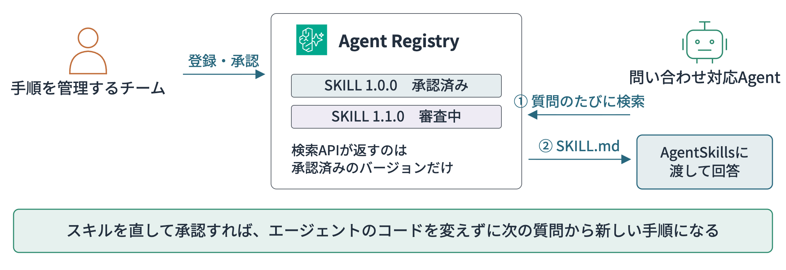
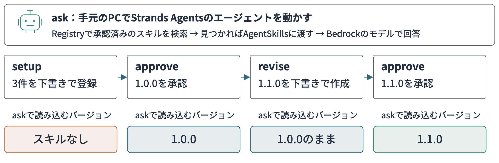
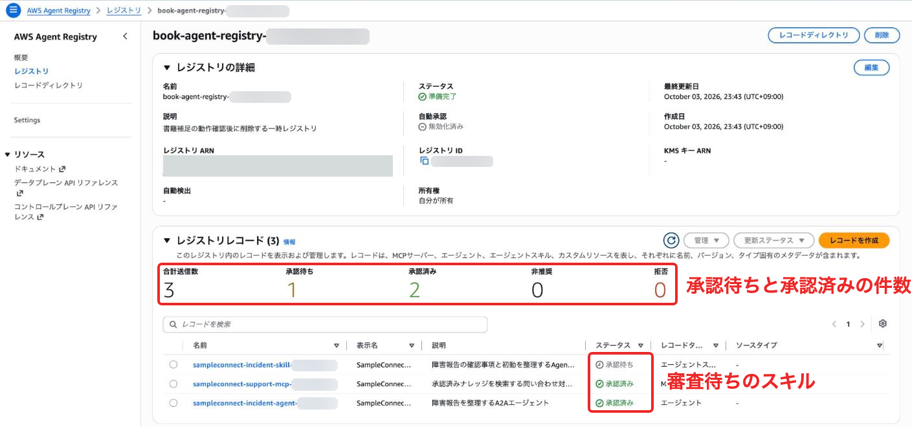
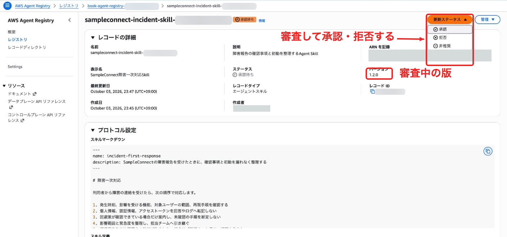
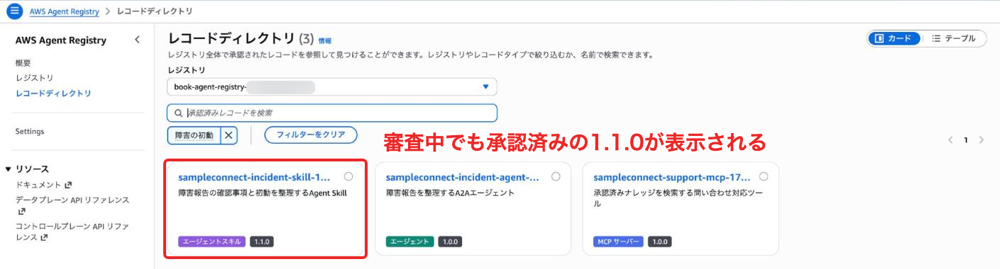
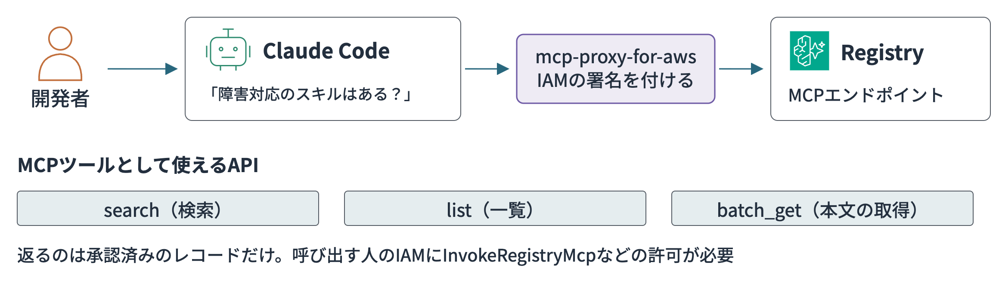
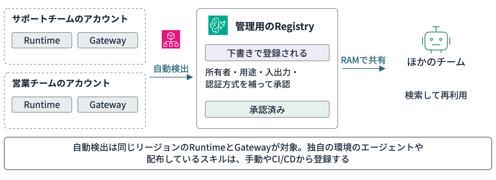
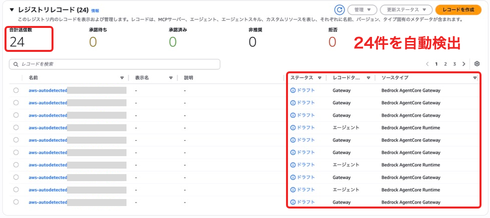
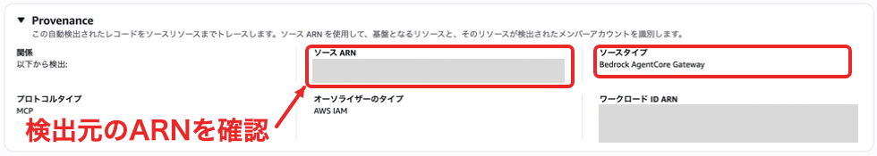

# エージェントとスキルをAWS Agent Registryで組織管理する

第6章のAgentCore Gatewayの節ではコラムで**AWS Agent Registry**を紹介しました。Gatewayがツールを呼び出すときの統制を受け持つのに対し、Registryは組織でどのエージェントやツールを使えるかを管理する役割です。実際にどう使うのか、気になっている方も多いのではないでしょうか。

他のチームが作ったエージェントやスキルを使いたいと思っても、そもそもどこにあるのか、どれが最新のバージョンなのかを探すだけで手間取ってしまいがちです。AWS Agent Registryはエージェント・MCPサーバー・スキルの情報を登録しておき、組織として承認されたものを検索できるようにするサービスです。

せっかく作った問い合わせ対応エージェントや対応手順なら、社内の他チームにも広く使ってもらいたいですよね。筆者がRegistryに期待しているのは、既存のエージェントやスキルを見つけて再利用でき、作ったチームにも相談しやすくなることです。

この補足ではまず障害一次対応の手順をスキルとして登録し、エージェントが実行時にRegistryから読み込む流れを検証します。続けてClaudeなどの手元のAIアシスタントからRegistryを検索する方法と、AWS Organizationsを使って組織全体のエージェントを自動で集める方法を見ていきます。


## エージェントが実行時にスキルを読み込む

スキルの手順をエージェントのコードやシステムプロンプトに直書きしてしまうと、手順を直すたびにエージェントを作り直して配り直す手間が発生します。使うエージェントが増えるほど、どの環境にどのバージョンの手順が入っているのか追いきれなくなってしまいますよね。

そこでエージェントの実行時にRegistryを検索し、承認済みのスキルを読み込む構成にします。手順の更新や承認作業はRegistry側に集約できるので、エージェント側のコードはそのまま維持できます。



Registryからスキルを検索し、Strands Agentsのスキルオブジェクトへ変換するコードは次のとおりです。検索APIからは承認済みのレコードが返ってくるため、下書きや審査中の手順が混ざる心配もありません。

```python
from strands.vended_plugins.skills import Skill

found = registry.search_discoverable_registry_records(
    registryIds=[registry_arn],
    searchQuery="障害一次対応",
    filters={"recordType": {"$eq": "SKILL"}},
)["registryRecords"]

records = registry.batch_get_discoverable_registry_record(
    entries=[{"registryId": registry_id, "recordIds": [r["recordId"] for r in found]}]
)["registryRecords"]

skills = [
    Skill.from_content(
        record["descriptors"]["agentSkillsDefinition"]["additionalData"]["skillMd"]["data"]
    )
    for record in records
]
```

`registry`は検索用の`agent-registry`クライアントです。まず検索APIで候補を探し、一括取得APIを呼び出してSKILL.mdの本文を取り出しています。レコードタイプの絞り込みは、検索ワードに混ぜるよりも`filters`で指定するほうが確実です。

読み込んだスキルは、`AgentSkills`プラグインを使ってエージェントへ渡します。

```python
from strands import Agent
from strands.vended_plugins.skills import AgentSkills

agent = Agent(
    model=BedrockModel(model_id="us.anthropic.claude-haiku-4-5-20251001-v1:0"),
    system_prompt="あなたはSampleConnectのサポート担当エージェントです。",
    plugins=[AgentSkills(skills=skills)],
)
```

この動的な読み込みの流れは、筆者のブログでも実際に検証しています。

- [AWS Agent RegistryからSkillsを動的に読み込んでStrands Agentに注入してみた](https://dev.classmethod.jp/articles/aws-agent-registry-dynamic-skills-strands-agents/)

本編の問い合わせ対応エージェントから派生して使うなら、第4章の`sample-code/04/amplify-ui/amplify/agent/main.py`でエージェントを組み立てる`_build_agent()`に、Registryから読み込んだスキルを`plugins`として渡します。障害の問い合わせが来たら、承認済みの手順に沿って一次対応の案内を作るといった使い方も可能です。

## 1つずつ確かめる

用意したサンプルコードは、ステップごとに順番に実行できます。
途中でマネジメントコンソールを開いて、レコードのステータスが変わっていく様子を確認しながら進めてみてください。

```bash
cd sample-code/06/agent-registry
uv sync --frozen

uv run python register_and_search_registry.py setup     # レジストリとレコードを下書きで作る
uv run python register_and_search_registry.py ask       # 承認前に質問する
uv run python register_and_search_registry.py approve   # 承認する
uv run python register_and_search_registry.py ask       # 承認後に質問する
uv run python register_and_search_registry.py revise    # スキルの次のバージョンを下書きで作る
uv run python register_and_search_registry.py ask       # 次のバージョンの審査中に質問する
uv run python register_and_search_registry.py approve   # 次のバージョンを承認する
uv run python register_and_search_registry.py ask       # 承認後に質問する
uv run python register_and_search_registry.py cleanup   # レコードとレジストリを削除する
```

`ask`は、ローカルでStrands Agentsのエージェントを動かすコマンドです。Registryで「障害一次対応」のスキルを検索し、承認済みのスキルが見つかればエージェントに渡してから、Bedrockのモデル（Claude Haiku 4.5）に質問を送ります。質問は毎回同じ「10:05から複数の利用者がログインできません。影響範囲と原因はまだ調査中です。障害一次対応の案内を作ってください」で、同じ質問で、スキルがないとき・1.0.0のとき・1.1.0のときの回答と、読み込んだバージョンを比べられます。



### 承認前はスキルなしで回答する

最初の`setup`では、`AGENT`・`MCP`・`SKILL`の3レコードを下書きとして登録します。下書きのレコードは検索APIのヒット対象にならないため、この段階で`ask`を実行してもスキルが読み込まれず、素の状態で回答が生成されます。

```text
承認済みのスキルが見つからないため、スキルなしで回答します。
# SampleConnect 障害一次対応のご案内
...
- **発生時刻：** 2024年○月○日 10:05頃
...
- **更新予定：** XX分ごと / 次回更新予定時刻：○○時○○分
```

案内文の体裁は整っているものの、日付や次回の案内予定時刻が空欄（伏せ字）のまま出力されてしまいました。

### 承認するとスキルが使われ始める

続いて`approve`を実行して3件のレコードを承認したあと、再度`ask`で同じ質問を聞いてみます。すると、レジストリからバージョン1.0.0のスキルが動的に読み込まれます。

```text
読み込んだスキル: incident-first-response 1.0.0 (Ubaqi4dBubFo)
## 確認できた事実
- 発生時刻：10:05
- 影響を受ける機能：ログイン
...
## 未確認の事項
...
- **復旧見込み**：確認中

## 次の対応
...
- 次回案内時刻：確認中
```

SKILL.mdで指定した「確認できた事実」「未確認の事項」「次の対応」の3つの見出しに沿って回答が整理されました。入力になかった復旧見込みや次回の案内時刻は、時刻を作らずに「確認中」と書いています。エージェント側のコードには手を加えていません。

### 次のバージョンの審査中は前のバージョンが使われる

`revise`を実行して、引き継ぎのルールを追加した1.1.0を下書きとして作成します。承認済みのレコードを更新すると、同じレコード内に新しい下書きのバージョンが作られます。管理APIからは下書きの1.1.0が返ってきますが、検索APIは承認済みの1.0.0を返し続けます。

```text
SKILL: 1.1.0を下書きで作成（検索APIは承認済みの1.0.0のまま）
読み込んだスキル: incident-first-response 1.0.0 (Ubaqi4dBubFo)
```

コンソールでレジストリを開くと、レコードごとのステータスが一覧で確認できます。



審査中のバージョンをコンソールで開くと、「更新ステータス」から承認・拒否・非推奨を選択できます。



利用者向けの「レコードディレクトリ」画面でも、審査期間中は承認済みのバージョンが表示されます。



### 承認すると次の質問から新しいバージョンになる

1.1.0を承認したあとで質問すると、新しい1.1.0が読み込まれました。

```text
SKILL: APPROVED 1.1.0
読み込んだスキル: incident-first-response 1.1.0 (Ubaqi4dBubFo)
```

承認してから検索APIに反映されるまでには、少しタイムラグがあります。サンプルの`demo`では、検索APIが新しいバージョンを返すのを待ってから質問を実行しています。

今回のサンプルは質問のたびにRegistryを検索していますが、毎回の検索は呼び出しの回数も待ち時間も増えます。実際に使うなら、読み込んだスキルをしばらく手元に置いておく作りが現実的です。AgentCore Runtimeはセッションごとに専用の実行環境を用意します。セッションの開始時に1回読み込んでおけば、セッションの間は同じバージョンを使い続け、次のセッションで新しいバージョンに切り替わります。手順の変更をどれくらいの早さで反映したいかに合わせて、読み込むタイミングを決めるとよいでしょう。

## 登録する情報を使い分ける

AWS Agent Registryに登録可能なレコードの種類は4つあります。


| 種類       | 登録する内容                         | 利用者が分かること         |
| -------- | ------------------------------ | ----------------- |
| `AGENT`  | A2AのAgent CardやHTTPSの接続先、名前、能力 | どのエージェントへ仕事を任せるか  |
| `MCP`    | MCPサーバーとツール定義                  | どの操作をエージェントへ追加するか |
| `SKILL`  | スキル定義と`SKILL.md`               | どの手順・判断基準を適用するか   |
| `CUSTOM` | 独自のJSONメタデータ                   | 社内独自の資産をどう見つけるか   |


後述する組織内の自動検出を使うと、Gatewayを表す`GATEWAY`レコードも作られます。

エージェントもスキルと同じように、実行時に検索して動的に呼び出せます。RegistryでA2Aエージェントを検索し、Agent CardのURLへStrands Agentsからタスクを依頼する構成も可能で実際に試してみました。

- [Agent RegistryにA2Aエージェントを登録してStrands Agentsから動的に呼び出してみた](https://dev.classmethod.jp/articles/aws-agent-registry-dynamic-a2a-strands-agents/)

一般提供（GA）では、A2Aに加えてHTTPSの接続先も登録できるようになっています。レコードの`http`記述子にURLを設定する形です。こちらもRuntime上の計算エージェントを登録し、承認後に取得したURLへ計算を依頼できるところまで検証しました。第4章でAgentCore Runtimeにデプロイした問い合わせ対応エージェントを共有したい場合も、この形式で登録できます。

- [[アップデート]AWS Agent Registryが一般提供開始されました！](https://dev.classmethod.jp/articles/aws-agent-registry-ga-https-autodetection/)

呼び出す側が迷わず連携できるよう、登録時の説明には用途・入出力仕様・認証方式・担当チームなどをしっかり記載しておきましょう。

## ClaudeなどのAIアシスタントから探す

第6章のコラムで、レジストリ自体がMCPのエンドポイントとして動くと紹介しました。Claude CodeやKiroのようなMCPクライアントから接続すれば、「社内に障害対応のスキルはある？」と手元のAIアシスタントに尋ねて検索できます。エンドポイントからは、検索・一覧・一括取得の3つのAPIがMCPツールとして提供されます。



IAM認証のレジストリに接続する際は、`mcp-proxy-for-aws`を経由します。Claude Codeの設定ファイルには次のように記述しました。

```json
{
  "mcpServers": {
    "agent-registry": {
      "type": "stdio",
      "command": "uvx",
      "args": [
        "mcp-proxy-for-aws@latest",
        "https://agent-registry.us-east-1.api.aws/registry/<registry-id>/mcp",
        "--service", "agent-registry",
        "--region", "us-east-1"
      ]
    }
  }
}
```

この設定を行ったうえでClaude Codeに「障害一次対応」の検索と、見つかったスキルの本文にある見出しの抽出を依頼してみました。


| 名前                       | 種類    | バージョン |
| ------------------------ | ----- | ----- |
| SampleConnect障害一次対応Agent | AGENT | 1.0.0 |
| SampleConnect障害一次対応Skill | SKILL | 1.1.0 |
| SampleConnect問い合わせ対応MCP  | MCP   | 1.0.0 |


承認済みの3件がヒットし、SKILLの本文も一括取得ツール経由で読み込んで「確認できた事実」「未確認の事項」「次の対応」という見出しを答えてくれました。

呼び出し元のIAMプリンシパルには`agent-registry:InvokeRegistryMcp`に加えて、利用するツールに応じた`agent-registry:SearchDiscoverableRegistryRecords`などの許可が必要です。OAuthで認証するレジストリの場合は、Claude Codeのクライアント設定から直接接続できます。

## 組織で使う

### 各アカウントのRuntimeとGatewayを自動で集める

1つのアカウント内ならRuntimeやGatewayの一覧から探せますが、チームごとにアカウントが分かれていると、組織全体で何が動いているかを追うのが難しくなってきます。そこで役立つのが、AWS Organizationsと連携した自動検出です。

管理アカウントで信頼されたアクセスを有効化し、管理アカウントまたは委任管理者のRegistryで自動検出を設定します。対象は同じリージョンのメンバーアカウントにあるRuntimeとGatewayで、組織・リージョンごとに1つのRegistryで設定できます。日常の運用向けに、管理用のメンバーアカウントへ委任する構成も選べます。



実際に管理アカウントとメンバーアカウントで試してみたところ、しばらく待つとアカウントに存在するRuntimeやGatewayが一覧に現れました。自動承認を無効にしておいたため、検出されたレコードは下書き状態で登録されます。レコードの検出元情報から、どのアカウントのどのリソースかも辿れました。後から追加されたリソースもきちんと検出され、少し経つと件数が増えていました。



レコードを開くと、検出元のARNとリソースの種類を確かめられます。



接続先の変更や削除にも追従してくれます。独自の環境で動くエージェントや自前で配布しているスキルについては、手動やCI/CDから登録可能です。

### 承認して組織で再利用できる形にする

自動検出で収集できるのはどのアカウントに何のリソースがあるかという情報です。ほかのチームが実際に利用できるようにするには、所有者・用途・入出力・認証方式を補ったうえで承認します。

承認済みのレコードは、ほかのチームのエージェントやAIアシスタントから検索できるようになります。たとえば別のチームが問い合わせ対応エージェントを開発するときにRegistryで障害一次対応のスキルを見つけられれば、手順を一から書かずに済みます。作成元のチームに使い方を聞くきっかけにもなりますね。

### 複数アカウントへAWS RAMで共有する

チームごとに別のAWSアカウントを使っている場合は、Registryを中央の管理アカウントに配置し、AWS Resource Access Manager（AWS RAM）で共有します。利用側のアカウントは、手元のAWS資格情報のまま中央RegistryのARNを指定してAPIを呼び出します。

共有にあたっては、利用側に許可したい操作に合わせて管理権限を選択します。


| AWS RAMの管理権限                                   | 利用する側ができること                       | 想定する役割      |
| ---------------------------------------------- | --------------------------------- | ----------- |
| `AWSRAMDefaultPermissionAgentRegistryReadOnly` | 一覧・検索・取得                          | 監査、棚卸し      |
| `AWSRAMPermissionAgentRegistryForConsumer`     | 承認済みの検索・取得、RegistryのMCPエンドポイントの利用 | エージェント、利用者  |
| `AWSRAMPermissionAgentRegistryForPublisher`    | 登録・更新・審査への提出、検索                   | 開発チーム       |
| `AWSRAMPermissionAgentRegistryForAdmin`        | 登録、承認、却下、廃止、検索                    | 中央の運用、委任管理者 |


中央Registryを利用アカウントへConsumer権限で共有する例です。中央の管理アカウントで次のように実行します。

```bash
aws ram create-resource-share \
  --name central-agent-registry-consumers \
  --resource-arns \
    arn:aws:agent-registry:us-east-1:111122223333:registry/<registry-id> \
  --principals 444455556666 \
  --permission-arns \
    arn:aws:ram::aws:permission/AWSRAMPermissionAgentRegistryForConsumer
```

同じAWS Organizations内でRAMの共有を有効にしていれば、招待の受け入れ操作は不要です。組織外のアカウントへ共有する場合は`--allow-external-principals`を付与し、利用側で招待を受け入れます。

RAMの管理権限に加えて、利用側のIAMロールにも対応する`agent-registry`操作の許可が必要です。`RecordCreatorAccount`や`RecordSourceAccount`の条件キーを活用すると、公開者が更新できるレコードを自身のアカウントに由来するものに絞り込めます。

### 検索できることと実行できることは別

RAMでConsumer権限を付与しても、登録されているA2Aエージェント・MCPサーバー・AgentCore Runtimeの呼び出し権限まで可能になるわけではありません。利用者は検索結果から接続先と認証方式を確認し、接続先を管理するチームが用意したIAM・OAuth・APIキーなどの手続きを別途進めましょう。

呼び出しそのものの統制は、第6章で扱ったAgentCore Gatewayの役割ガチ会員証です。Registryで見つけた接続先もGateway経由で呼ぶようにしておけば、認証・ポリシー・使用量の制限を実施できます。

## 運用で実施すると便利そうなポイント

### 承認待ちをEventBridgeで通知する

レコードが承認待ちになったタイミングを検知するには、EventBridgeを使います。Registryのステータス変更イベントは、所有アカウントのデフォルトイベントバスへ配信される仕組みです。次のようなイベントパターンでルールを作成しておけば、承認待ちのレコードを拾って通知できます。

```json
{
  "source": ["aws.agent-registry"],
  "detail-type": [
    "Registry Record State changed to Pending Approval"
  ]
}
```

通知を受け取ったら、管理APIで対象のバージョンと現在のステータスを取得し、所有者・接続先・扱うデータを確認した上で承認作業を進めます。通知が少し遅れて届くケースもあるので、通知されたバージョンがいま審査中のバージョンかどうかもあわせて確かめましょう。

### 操作と利用したバージョンを記録する

第6章の実行ログにレコードIDとバージョンを残しておくと、エージェントがどの定義に基づいて回答を組み立てたのかを後から追跡しやすくなります。サンプルの`ask`コマンドでも、読み込んだスキルのバージョンとレコードIDを画面に表示するようにしています。

登録や承認、検索といった操作の証跡管理にはCloudTrailを使います。作成・更新・承認といった管理イベントはデフォルトで記録されますが、検索の実行やRegistryのMCPエンドポイントへのアクセスはデータイベント扱いのため、そのままでは記録されません。監査要件があるRegistryでは、証跡のデータイベントに`AWS::AgentRegistry::Registry`を追加しておきましょう。

```bash
aws cloudtrail put-event-selectors \
  --trail-name organization-agent-registry-trail \
  --advanced-event-selectors '[
    {
      "Name": "Agent Registry data events",
      "FieldSelectors": [
        {"Field": "eventCategory", "Equals": ["Data"]},
        {"Field": "resources.type", "Equals": ["AWS::AgentRegistry::Registry"]}
      ]
    }
  ]'
```

管理イベントのログでは、説明文やディスクリプターの自由記述フィールドがCloudTrail側で伏字になります。

### 利用をやめるとき

レコードのステータスを「廃止」に設定することで、そのエージェントの利用を終了したことを利用者に示せます。廃止は復帰できない終端ステータスなので、一時的な取り下げとしっかり使い分けましょう。

注意したいのは、すでに接続先のエンドポイントを取得済みのクライアントです。Registryからレコードを削除したり廃止にしたりしても、クライアント側からの実行自体は止まりません。問題のあるエージェントを緊急停止させたい場合は、接続先側のIAMポリシーやGatewayのポリシーで呼び出しを拒否した上で、必要に応じてRuntime自体も停止してください。

## まとめ

今回は同じ認証情報で登録と承認を行いましたが、実際のチーム運用では権限をしっかり分けておきましょう。あらかじめ審査で確認するポイントを決めておけば、担当者が交代しても判断ができる形になります。


| 確認する人         | 確認ポイント                                     |
| ------------- | ------------------------------------------ |
| 業務の担当者        | 用途と説明が実際の動きと合っているか、入出力の例があるか、似たレコードがすでにないか |
| 基盤・セキュリティの担当者 | 認証方式、扱うデータの範囲、ログと監査の設定、接続先を持つチームと連絡先       |
| 利用する側の代表      | 説明を読んで呼び出し方が分かるか、バージョンを上げたときの変更点が書かれているか   |


エージェントが実行時に別のエージェントやスキルを動的に探して呼び出すような使い方にも、引き続き注目しています。呼び出し先が増えてくると精度や待ち時間の評価も欠かせなくなりますが、それぞれのチームが持ち寄ったエージェントやスキルを組み合わせて動かせるのは面白いところです。

組織内でエージェントを安心して運用していくための仕組みとして、Registryには今後も期待したいですね！

## 参考資料

- [AWS Agent Registryの概要](https://docs.aws.amazon.com/bedrock-agentcore/latest/devguide/registry.html)
- [レコードの状態とバージョンの扱い](https://docs.aws.amazon.com/bedrock-agentcore/latest/devguide/registry-record-lifecycle.html)
- [レコード種別とディスクリプター](https://docs.aws.amazon.com/bedrock-agentcore/latest/devguide/registry-supported-record-types.html)
- [承認済みレコードを検索する](https://docs.aws.amazon.com/bedrock-agentcore/latest/devguide/registry-search-records.html)
- [RegistryのMCPエンドポイント](https://docs.aws.amazon.com/bedrock-agentcore/latest/devguide/registry-mcp-endpoint.html)
- [EventBridgeによる状態変化の通知](https://docs.aws.amazon.com/bedrock-agentcore/latest/devguide/registry-eventbridge.html)
- [AWS RAMによるアカウント間共有](https://docs.aws.amazon.com/bedrock-agentcore/latest/devguide/registry-cross-account-sharing.html)
- [AWS Organizationsと連携した自動検出](https://docs.aws.amazon.com/bedrock-agentcore/latest/devguide/registry-organizations.html)
- [CloudTrailによる監査](https://docs.aws.amazon.com/bedrock-agentcore/latest/devguide/registry-cloudtrail-integration.html)
- [Manage agents, tools and skills at scale with AWS Agent Registry](https://aws.amazon.com/blogs/machine-learning/manage-agents-tools-and-skills-at-scale-with-aws-agent-registry/)
- [[アップデート]AWS Agent Registryが一般提供開始されました！](https://dev.classmethod.jp/articles/aws-agent-registry-ga-https-autodetection/)
- [AWS Agent RegistryからSkillsを動的に読み込んでStrands Agentに注入してみた](https://dev.classmethod.jp/articles/aws-agent-registry-dynamic-skills-strands-agents/)
- [Agent RegistryにA2Aエージェントを登録してStrands Agentsから動的に呼び出してみた](https://dev.classmethod.jp/articles/aws-agent-registry-dynamic-a2a-strands-agents/)

