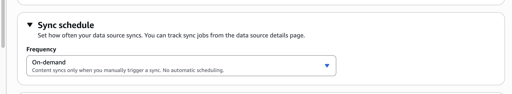
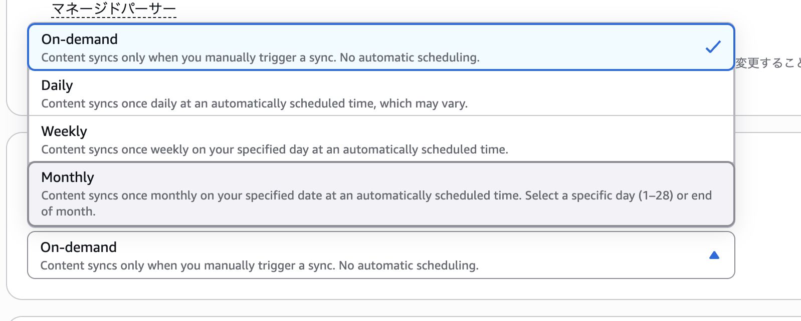

# Managed Knowledge Baseのデータソースを定期同期する

付録「Managed Knowledge Baseで始めるフルマネージドRAG」では、データソースを作成した直後の同期と、文書を更新したあとの再同期を扱いました。本書の校了後、Managed Knowledge Baseのデータソースに定期同期機能が追加され、日次・週次・月次の同期をコンソールまたはAPIから設定できるようになりました。

日次や週次でよければ、同期のたびに手動で操作する手間を省けます。コンソールでの選び方と、APIで設定を切り替えた結果を紹介します。

定期同期の対象は、Managed Knowledge Baseのデータソースコネクタ（Customコネクタを除く）です。

## コンソールから設定する

Amazon BedrockコンソールでManaged Knowledge Baseのデータソース設定を開くと、「Sync schedule」が表示されます。



「Frequency」では次の4つから選べます。



| 選択肢 | 動作 | 指定できる項目 |
|---|---|---|
| On-demand | 自動同期しない | なし |
| Daily | 1日1回同期する | なし |
| Weekly | 週1回同期する | 曜日 |
| Monthly | 月1回同期する | 1〜28日、または月末 |

Dailyの実行時刻はAWSが選ぶオフピーク時間で、利用者は指定できません。WeeklyとMonthlyもコンソールでは実行日を指定し、時刻は自動的に決まります。そのため、「S3へファイルを置いたら数十秒以内に反映する」といった即時性が必要な用途には向きません。

## boto3から設定する

APIでも日次・週次・月次から選べます。[データソースの作成](https://boto3.amazonaws.com/v1/documentation/api/latest/reference/services/bedrock-agent/client/create_data_source.html)と[更新](https://boto3.amazonaws.com/v1/documentation/api/latest/reference/services/bedrock-agent/client/update_data_source.html)の設定項目を使います。

既存データソースを毎週水曜日に同期する場合は、次のように設定します。

```python
import boto3

REGION = "us-east-1"
KNOWLEDGE_BASE_ID = "<Managed Knowledge BaseのID>"
DATA_SOURCE_ID = "<データソースID>"

client = boto3.client("bedrock-agent", region_name=REGION)
data_source = client.get_data_source(
    knowledgeBaseId=KNOWLEDGE_BASE_ID,
    dataSourceId=DATA_SOURCE_ID,
)["dataSource"]

configuration = data_source["dataSourceConfiguration"]
managed_configuration = configuration[
    "managedKnowledgeBaseConnectorConfiguration"
]
managed_configuration["syncSchedule"] = {
    "weekly": {"dayOfWeek": "WEDNESDAY"}
}

request = {
    "knowledgeBaseId": KNOWLEDGE_BASE_ID,
    "dataSourceId": DATA_SOURCE_ID,
    "name": data_source["name"],
    "dataSourceConfiguration": configuration,
    "dataDeletionPolicy": data_source["dataDeletionPolicy"],
}
for key in (
    "description",
    "serverSideEncryptionConfiguration",
    "vectorIngestionConfiguration",
):
    if key in data_source:
        request[key] = data_source[key]

client.update_data_source(**request)
```

更新APIにはデータソースの設定全体を渡す必要があります。そのため、現在の設定を取得してから同期頻度を書き換えています。

ほかの頻度へ切り替える場合は、`syncSchedule`を次の値へ変更します。

```python
# 日次
{"daily": {}}

# 毎週水曜日
{"weekly": {"dayOfWeek": "WEDNESDAY"}}

# 毎月28日
{"monthly": {"dayOfMonth": {"dayNumber": 28}}}

# 毎月末日
{"monthly": {"dayOfMonth": {"lastDayOfMonth": {}}}}
```

自動同期を止めるには、次のようにスケジュールを取り除いてから、更新APIへ設定を渡します。

```python
managed_configuration.pop("syncSchedule", None)
```

## 第6章の更新パイプラインとの使い分け

第6章ではCustomer-managed Knowledge Baseを対象に、EventBridge・Lambda・AgentCore Runtimeを使ったイベント駆動の更新パイプラインを構築していて、この構成ではS3に文書を置いたタイミングで同期し、評価結果によって承認や差し戻しを判断します。

定期的に資料を取り込みたいなら、今回の機能で同期の起動処理を省けるのですが、文書を置いた直後の反映や、同期後の回答評価による承認・差し戻しが必要なら、第6章のパイプラインを使ってください。
