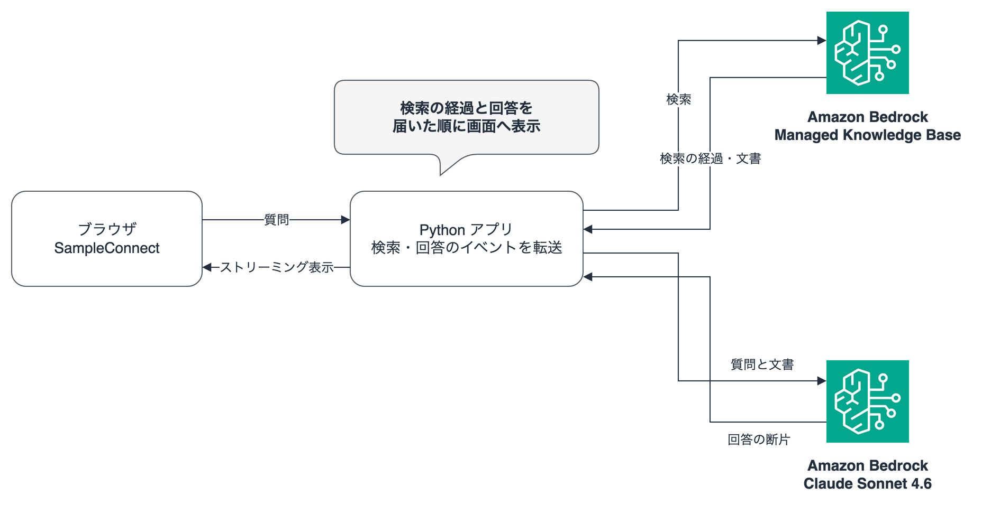
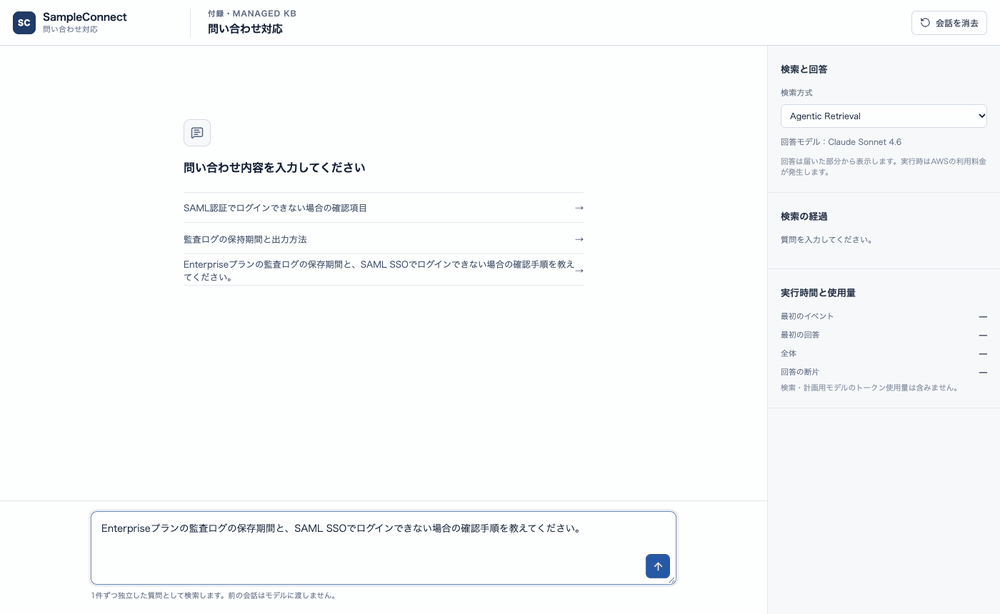
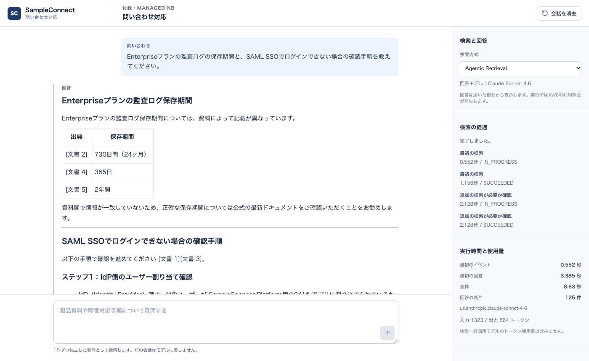

# Managed Knowledge Baseをアプリに組み込んでストリーミングする

付録でManaged Knowledge Base（以下、Managed KB）を作成し、取り込んだ資料を検索できるようになりました。今回はこの検索を本編のSampleConnectの画面から呼び出してみます。問い合わせを送ると検索の進捗がリアルタイムに表示され、回答も生成されたテキストから順次追記されます。回答の下では、実際に検索で取得した資料の本文も確認できるように作っています。

本編と同じUIデザインのローカルアプリを用意しました。回答モデルも本編に合わせてClaude Sonnet 4.6を使っています。今回は検索から回答生成までをAgentic Retrievalに丸ごと任せる方式も用意して、挙動を比べてみました。

## 検索と回答生成の組み合わせを選ぶ

第2章のRAGと同様に、検索結果の資料を生成モデルへ渡す構成を取れば、Managed KBでもアプリ側で自由に回答を組み立てられます。ここで注意したいのが、Managed KBでは`RetrieveAndGenerate`や`RetrieveAndGenerateStream`を呼び出せない点です。検索処理には`Retrieve`または`AgenticRetrieveStream`を使います。この制約は[RetrieveAndGenerateStreamのAPIリファレンス](https://docs.aws.amazon.com/bedrock/latest/APIReference/API_agent-runtime_RetrieveAndGenerateStream.html)にも記載があります。

今回のサンプルアプリでは、次の3つの方式を画面から切り替えられるようにしました。

| 画面の検索方式 | 検索の処理 | 回答生成 | 画面へ送るもの |
|---|---|---|---|
| Agentic Retrieval（既定） | 必要に応じて追加検索 | 検索結果をSonnetへ渡す | 検索の経過、回答の断片、取得した文書 |
| 通常検索（Retrieve） | 質問に合う資料を検索 | 検索結果をSonnetへ渡す | 取得した文書、回答の断片 |
| Agentic Retrieval・回答もAWSに任せる | 必要に応じて追加検索 | AWSが選ぶモデル | 検索の経過、回答の断片、文書と引用情報 |

[Agentic Retrieval](https://docs.aws.amazon.com/bedrock/latest/userguide/kb-test-agentic-retrieve.html)を使うと、追加の検索が必要かどうかをモデルが判定します。サンプルアプリでは反復回数の上限を3回に設定していますが、必要な資料が早い段階で揃えばその時点で検索を切り上げます。

既定の方式ではAgentic Retrievalに検索ステップまでを担当させ、回答の生成モデルやプロンプトのトーンはアプリ側で制御します。構成の流れは次の図のとおりです。検索結果を受け取った後、アプリからSonnetを呼び出してストリーミングで回答を生成します。Agentic Retrievalの内部で検索計画を立てるモデルはAWS側が選定します。



もうひとつの「回答もAWSに任せる」を選んだ場合は、`AgenticRetrieveStream`から返ってきた回答テキストをそのまま画面へストリーミング送信します。

## 本編と同じ画面で質問する

付録で作成したManaged KBにSampleConnectの資料を取り込み、同期を完了させておきます。コマンドで設定する`MANAGED_KB_ID`には、このManaged KBのIDを指定します。

AWSの認証を済ませたターミナルを用意し、リポジトリのルートから次のコマンドを実行します。

```bash
cd sample-code/supplements/managed-kb-app
uv sync --frozen
cd ui
pnpm install --frozen-lockfile
pnpm build
cd ..
export MANAGED_KB_ID=YOUR_MANAGED_KB_ID
uv run --frozen python app.py
```

ブラウザで`http://127.0.0.1:8767`を開き、問い合わせを入力して送信します。  
デフォルトの回答モデルは`us.anthropic.claude-sonnet-4-6`、Knowledge Baseとモデルの接続先リージョンは`us-east-1`です。

画面右側で検索方式を切り替えられるので、同じ質問を別の方式で投げ分けて挙動を比較できます。



アプリを終了するときはターミナルでCtrl+Cを押します。ローカルのプロセスを停止してもKnowledge Baseと取り込んだデータは残るため、一連の検証が終わったら削除手順に沿ってリソースを片付けておきましょう。

## Agentic Retrievalのイベントを画面へ送る

Agentic Retrievalをストリーミングで呼び出すと、検索の経過・回答テキストの断片・最終結果がそれぞれ別のイベントとして順次届きます。  
検索から回答生成までをAWS側に任せるリクエストは次のようになります。

```python
response = runtime.agentic_retrieve_stream(
    messages=[{"role": "user", "content": {"text": question}}],
    retrievers=[{
        "description": "SampleConnectのサポート文書、FAQ、運用手順",
        "configuration": {"knowledgeBase": {
            "knowledgeBaseId": kb_id,
            "retrievalOverrides": {"maxNumberOfResults": 5},
        }},
    }],
    agenticRetrieveConfiguration={
        "foundationModelType": "MANAGED",
        "rerankingModelType": "MANAGED",
        "maxAgentIteration": 3,
    },
    generateResponse=True,
)
```

自前のプロンプトやモデルで回答を生成する場合は、`generateResponse=False`を指定して最終結果の文書一覧を受け取り、後続の処理へ渡します。詳しい仕様は[APIリファレンス](https://docs.aws.amazon.com/bedrock/latest/APIReference/API_agent-runtime_AgenticRetrieveStream.html)も確認してみてください。

| AWSから届くイベント | サンプルでの扱い |
|---|---|
| traceEvent | 処理名、開始・成功などの状態、検索クエリが含まれていればその内容を表示 |
| responseEvent | textを回答欄に追記 |
| result | 文書一覧と引用情報を受け取り、generatedResponse.answerで回答全文を置き換える |
| エラーのイベント | 処理の中断を表示し、途中の回答を完成した回答として扱わない |

最終結果のイベント（result）で回答全文を置き換えているのは、途中の断片と同じように末尾へ追記すると回答が二重に表示されてしまうためです。

Pythonのバックエンドで受信したイベントは、1行ずつのJSON形式に変換してブラウザへ送っています。ブラウザ側は届いた行から順次画面へ反映しますが、通信の途中でマルチバイト文字やJSONの区切りがパケットをまたいで分割されても問題ないよう、バッファで完全な1行を復元してから処理しています。

Sonnetを使って自前で回答を生成する場合も、受け取ったテキストストリームを同じイベント形式へ揃えて画面に送っています。ストリームの終了理由やトークン使用量もあわせて確認し、出力上限に達して回答が途切れてしまった場合は、画面にも中断した旨を表示するようにしています。

## 引用と検索結果を区別する

画面では検索で見つかった候補を「取得した文書」として一覧表示します。タイトルをクリックすると本文を確認できるので、回答中に振られた参照番号と見比べてみてください。検索で取得した文書のすべてが、最終的な回答の根拠として使われるわけではありません。

AWSのマネージド機能が返す引用番号は、最終結果に含まれる文書配列の位置（インデックス）に対応しています。画面では分かりやすいよう1始まりの番号に変換して表示しますが、本文が空のデータや画像を取り除いて配列を詰めてしまうとインデックスが狂ってしまうため、元の並び順を崩さないように扱っています。

`retrieval.py`では、検索結果を画面用の文書に変換するときに元の位置を`index`として残しています。本文が空の項目も除きません。

```python
def documents(items):
    # 空の本文や画像も除かない。除くとresultIndexと位置がずれる
    return [
        {"index": index, "text": item.get("content", {}).get("text", ""), ...}
        for index, item in enumerate(items)
    ]
```

画面の`App.tsx`では、AWSの引用情報の`resultIndex`に1を足して「文書 1」のように表示しています。

```typescript
const ids = (e.citations || []).flatMap((c) =>
  (c.references || []).map((r) => r.resultIndex + 1),
)
```

一方、Sonnetに検索結果を渡して回答させる構成では、システムプロンプト側で`[文書 1]`のような番号を付けるよう指示しています。この番号はモデルが出力した文字列であり、AWSのAPIが構造化データとして返してくる引用情報とは性質が異なります。回答に番号が振られていても、指定された文書に本当にその記述があるかどうかは確認が必要です。

今回のサンプルはテキスト中心の資料を想定しています。回答モデルへ渡すプロンプトのサイズを抑えるため、文書1件あたり4,000文字・合計で最大24,000文字までに制限しています。制限を超えて本文を切り詰めた場合は、その旨を画面にも表示します。

```python
remaining = 24000
for d in docs:
    selected = d["text"][:min(4000, remaining)]  # 1件4,000文字、残りの枠まで
    truncated |= len(selected) < len(d["text"])
    remaining -= len(selected)
    if selected:
        excerpts.append(f"[文書 {d['index'] + 1}]\n{selected}")
yield event("context", truncated=truncated, characters=24000 - remaining)
```

モデルへ渡す本文にも`[文書 1]`のように元の位置で番号を振っているので、画面の「取得した文書」と同じ番号になります。切り詰めたかどうかは`context`イベントで画面へ送ります。

検索結果に`nextToken`が含まれている場合でも、今回は最初のページの文書と引用を表示する設計にしています。大量の文書を全件取得したり、PDFや画像を直接扱ったりするアプリケーションへ拡張する場合は、この周辺の処理をカスタマイズしてみてください。

## 時間計測

SampleConnectの架空の資料に対して、次の質問を各方式で1回ずつ実行してみました。

> Enterpriseプランの監査ログの保存期間と、SAML SSOでログインできない場合の確認手順を教えてください。

| 実行した方式 | 最初の検索イベント・結果 | 最初の回答 | 全体の時間 | 回答の断片 |
|---|---:|---:|---:|---:|
| Agentic Retrievalに検索と回答を任せる | 1.282秒 | 14.294秒 | 14.519秒 | 191件 |
| Agentic Retrievalで検索し、Sonnet 4.6で回答 | 1.321秒 | 4.816秒 | 12.431秒 | 178件 |
| Retrieveで検索し、Sonnet 4.6で回答 | 1.445秒 | 3.245秒 | 9.733秒 | 152件 |

時間はサーバー側で計測しています。「最初の検索イベント・結果」は、Agentic Retrievalなら処理経過のイベント、通常検索なら検索結果が返ってきた時点のタイムスタンプです。



Sonnet 4.6で回答する2つの方式は、検索結果が届いてから数秒で回答が表示され始めました。一方、Agentic Retrievalに回答まで任せる方式は、最初の回答まで約14秒かかり、その後の0.2秒ほどで回答がまとめて届きました。同じ質問をもう1回実行したときは、資料どうしの食い違いを確かめる追加の検索が走り、約17秒かかっています。

回答を待つ時間が長い方式ほど、「最初の検索」「追加の検索が必要か確認」のように、今どの処理をしているかを画面に表示しておくと利用者が待ちやすくなりそうですね。
