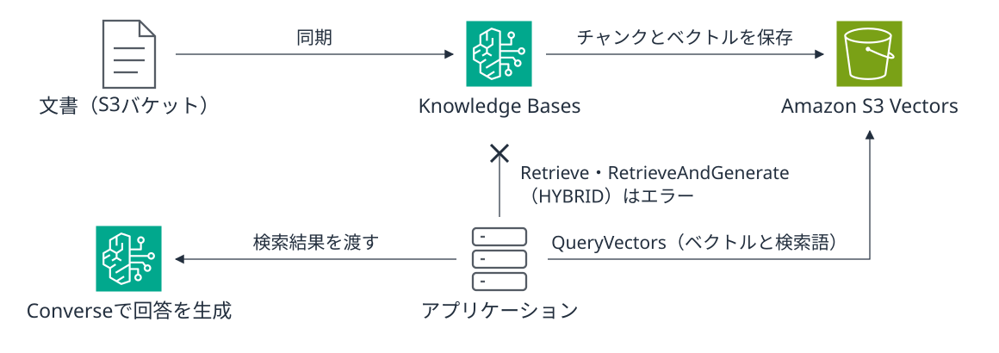
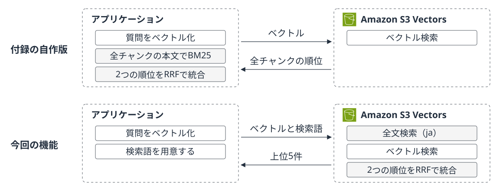

# S3 Vectorsがハイブリッド検索に対応

本書の執筆後、S3 Vectorsがハイブリッド検索に対応しました！

[Amazon S3 Vectors now supports hybrid search combining vector and full text for more relevant search results](https://aws.amazon.com/jp/about-aws/whats-new/2026/11/s3-vectors-hybrid-search/)

> [!NOTE]
> 発表を受けて速報で書きました！検証や日々触って内容を書き足すこともあります！

付録「Amazon S3 Vectorsによる小規模RAG向けベクトルストアの活用」では、S3 Vectorsにキーワード検索がなかったので文字3-gramのBM25をPythonで自作し、その順位とベクトル検索の順位をRRFで統合する簡易的なハイブリッド検索をやっていました。付録のコードA-2がその処理で、全体は[`sample-code/appendix/s3_vectors_standalone.py`](../../sample-code/appendix/s3_vectors_standalone.py)にあります。

それが今回のアップデートでこの自作部分はS3 Vectorsに任せればよくなりました！！とても嬉しいですね！！！

`QueryVectors`に質問のベクトルと検索語を一緒に渡すと、統合済みの順位が返ってきます。

日本語のアナライザーがあり使わない間の処理容量の料金もかかりません。
ハイブリッド検索を試したいなら、OpenSearchの前にまずS3 Vectorsで始めてみるのが良さそうです！運用コストもとても安いですからね。

## Knowledge Bases経由ではまだ使えない

残念ながらKnowledge Bases経由ではまだ使えませんでした。

付録の`setup-s3vectors.sh`で作ったKnowledge Baseで`overrideSearchType`に`HYBRID`を指定すると、次のエラーになりました。後述の全文検索を有効にした後も同じです。

```text
ValidationException: HYBRID search type is not supported for search operation on index <Knowledge Base ID>. Retry your request with a different search type.
```

サンプルの`kb-hybrid`で同じ結果を確かめられます（[実行記録](../../sample-code/supplements/s3vectors-hybrid/results/20261117T015823Z-kb-hybrid.json)）。

[S3 Vectorsのドキュメント](https://docs.aws.amazon.com/AmazonS3/latest/userguide/s3-vectors-bedrock-kb.html)でもKnowledge Basesとの連携は「Semantic search only」のままです（2026年11月17日時点）。そこで取り込みはKnowledge Basesに任せ、検索だけアプリケーションから`QueryVectors`を呼び出します。



## 既存のインデックスに全文検索を追加する

Knowledge Basesはチャンクの本文を`AMAZON_BEDROCK_TEXT`というメタデータに保存しているので、このキーを全文検索の対象に加えます。boto3は2026年11月16日に公開された1.44.4以降が必要です。

```python
s3v.update_metadata_configuration(
    vectorBucketName=BUCKET,
    indexName=INDEX,
    add={"textSearchConfigurations": [
        {"metadataKey": "AMAZON_BEDROCK_TEXT", "language": "ja"}
    ]},
)
```

`language`を省くと標準のアナライザーになります。アナライザーは後から変えられないので、日本語の文書なら`ja`を指定しておきましょう。

これから作るインデックスなら、`create_index`で最初から指定できます。
比較用に標準のアナライザーで作った`copy-standard`は次の呼び出し方法で作成しています。

```python
s3v.create_index(
    vectorBucketName=BUCKET,
    indexName="ch02-kbsv-index-standard",
    dataType="float32",
    dimension=1024,
    distanceMetric="cosine",
    metadataConfiguration={
        "nonFilterableMetadataKeys": ["AMAZON_BEDROCK_TEXT", "AMAZON_BEDROCK_METADATA"],
        "textSearchConfigurations": [{"metadataKey": "AMAZON_BEDROCK_TEXT"}],
    },
)
```

全文検索は`ENHANCED`のインデックスだけで使用可能です。2026年9月30日より前に作ったインデックスは`CLASSIC`のままなので、[事前フィルタリングの補足](S3-Vectorsのメタデータフィルタが事前フィルタリングに対応.md)の手順で先に切り替えてください。

既存のインデックスに追加するとすでに入っているデータの取り込みが始まります。状態は`GetIndex`で確認可能です。
`BUILDING`から`ACTIVE`に変わりました。

```python
index = s3v.get_index(vectorBucketName=BUCKET, indexName=INDEX)["index"]
print(index["metadataConfiguration"]["textSearchConfigurations"])
# [{'metadataKey': 'AMAZON_BEDROCK_TEXT', 'language': 'ja', 'status': 'ACTIVE'}]
```

今回の126チャンクでは15秒ほどで`ACTIVE`になりました（[実行記録](../../sample-code/supplements/s3vectors-hybrid/results/20261117T001547Z-enable.log)）。追加した後もKnowledge Basesの同期とセマンティック検索はそのまま使え、同期した文書はすぐに全文検索の対象になります。

ここまでの手順と後半の比較は`sample-code/supplements/s3vectors-hybrid/s3vectors_hybrid.py`にまとめています。付録の環境を作ってから実行します。実行記録は[`results/`](../../sample-code/supplements/s3vectors-hybrid/results/)に保存しています。

```bash
AWS_REGION=us-east-1 bash sample-code/02/infra/setup-s3vectors.sh
cd sample-code/supplements/s3vectors-hybrid
uv run s3vectors_hybrid.py kb-hybrid       # Knowledge BasesのRetrieveでHYBRIDを試す
uv run s3vectors_hybrid.py enable          # 全文検索を追加してACTIVEまで待つ
uv run s3vectors_hybrid.py copy-standard   # 比較用に標準アナライザーのインデックスを作る
uv run s3vectors_hybrid.py keywords        # キーワードのヒット件数を比べる
uv run s3vectors_hybrid.py evaluate        # 23問で採点する
```

各サブコマンドが呼び出すAPIは次のとおりです。

| サブコマンド | 呼び出すAPI |
|---|---|
| `kb-hybrid` | `Retrieve` |
| `enable` | `GetIndex`・`UpdateMetadataConfiguration` |
| `copy-standard` | `CreateIndex`・`ListVectors`・`PutVectors`・`GetIndex` |
| `search` | `QueryVectors`（ハイブリッドとベクトル検索では`InvokeModel`も） |
| `keywords` | `ListVectors`・`QueryVectors` |
| `evaluate` | `InvokeModel`・`Converse`・`QueryVectors`・`ListVectors`・`Retrieve` |
| `cleanup` | `DeleteIndex` |

## 質問のベクトルと検索語を一緒に渡す

検索では`queryVector`と`queryTexts`を両方指定します。

```python
response = s3v.query_vectors(
    vectorBucketName=BUCKET,
    indexName=INDEX,
    topK=5,
    queryVector={"float32": embed(question)},
    queryTexts=[{"text": keywords, "metadataKey": "AMAZON_BEDROCK_TEXT"}],
    returnMetadata=True,
    returnScores=True,
)
```

S3 Vectorsが全文検索とベクトル検索を行い、RRFで統合した上位5件を返します。付録のコードA-2で使った`keyword_search`と`reciprocal_rank_fusion`は要らず、全チャンクの本文をアプリケーションに持つ必要もなくなりました。



`keywords`には質問から抜き出した検索語を入れます。今回はClaude Haiku 4.5に抜き出してもらいました。

```python
res = bedrock.converse(
    modelId="us.anthropic.claude-haiku-4-5-20251001-v1:0",
    messages=[{"role": "user", "content": [{"text": KEYWORD_PROMPT + question}]}],
    inferenceConfig={"maxTokens": 100, "temperature": 0},
)
keywords = res["output"]["message"]["content"][0]["text"].strip()
```

`KEYWORD_PROMPT`には「検索語として有効な名詞・固有名詞・数字・記号だけをスペース区切りで出力してください」という指示を入れています。

「EnterpriseプランでIPアドレス制限機能を有効化する手順を教えてください」なら「Enterprise プラン IP アドレス 制限 機能 手順」が抽出されました。

質問のベクトルは取り込みと同じTitan Text Embeddings V2で作ります。出典のS3パスは`AMAZON_BEDROCK_METADATA`に入っているJSON文字列の`source.sourceLocation`にあります。

レスポンスも確認しておきましょう。`--mode hybrid`では検索語をそのままベクトルにもして検索できます。

```bash
uv run s3vectors_hybrid.py search --text "Retry-After" --mode hybrid
```

レスポンスは次のとおりです（抜粋）。全体は[実行記録](../../sample-code/supplements/s3vectors-hybrid/results/20261117T014225Z-search-hybrid.json)にあります。

```json
{
  "vectors": [
    {
      "scores": {
        "fused": 0.03333333507180214,
        "bm25Scores": [
          { "metadataKey": "AMAZON_BEDROCK_TEXT", "score": 7.78154993057251 }
        ],
        "vectorDistance": 0.7843024730682373
      },
      "key": "e8680b8c-15c1-4c78-8bd3-9ea5e948ddd8",
      "metadata": {
        "AMAZON_BEDROCK_TEXT": "# APIレート制限に達した場合の挙動 質問: APIレート制限に達した場合、ど…",
        "document_type": "faq",
        "topic_id": "api_rate_limit"
      }
    },
    {
      "scores": {
        "fused": 0.016393441706895828,
        "vectorDistance": 0.7915218472480774
      },
      "key": "3fa69f77-6625-4701-a60d-efef44ef5d61",
      "metadata": {
        "AMAZON_BEDROCK_TEXT": "**対応内容**: 実施した復旧作業の詳細を記載します。 4. **再発防止策*…",
        "document_type": "manual"
      }
    }
  ],
  "distanceMetric": "cosine"
}
```

`fused`がRRFで統合した点数でこの値の大きい順に並んでいます。

1件目は全文検索とベクトル検索の両方で1位だったので、`bm25Scores`と`vectorDistance`が両方付いて、`fused`も2つ分の0.0333となっています。2件目はベクトル検索だけで拾われたので`vectorDistance`だけが付き、`fused`もベクトル検索の順位1つ分の点数です。

## 全文検索だけでも使える

`queryVector`を省いて`queryTexts`だけを渡すと、BM25だけで順位を付ける全文検索になります。ベクトルを作らないので埋め込みモデルの呼び出しも要りません。

```python
response = s3v.query_vectors(
    vectorBucketName=BUCKET,
    indexName=INDEX,
    topK=3,
    queryTexts=[{"text": "730日", "metadataKey": "AMAZON_BEDROCK_TEXT"}],
    returnMetadata=True,
    returnScores=True,
)
```

サンプルの`search`はこの呼び出しを行い、送ったリクエストとレスポンスを表示します。

```bash
uv run s3vectors_hybrid.py search --text "730日"
```

レスポンスは次のとおりです（抜粋）。`scores`にBM25の点数が入り、`metadata`にはKnowledge Basesが保存した本文と文書のメタデータが返ります。全体は[実行記録](../../sample-code/supplements/s3vectors-hybrid/results/20261117T013050Z-search-text.json)にあります。

```json
{
  "vectors": [
    {
      "scores": {
        "bm25Scores": [
          { "metadataKey": "AMAZON_BEDROCK_TEXT", "score": 7.026947021484375 }
        ]
      },
      "key": "a6293725-6481-44cd-9986-e9d039378101",
      "metadata": {
        "AMAZON_BEDROCK_TEXT": "## エクスポートと長期保管 EnterpriseプランはAmazon Kine…",
        "AMAZON_BEDROCK_METADATA": "{\"text\":null,\"author\":null,\"createDate\":…",
        "document_type": "policy",
        "topic_id": "audit_log",
        "effective_date": 20260401.0
      }
    }
  ],
  "distanceMetric": "cosine"
}
```

いくつかの検索語でヒットした件数と1位の文書をベクトル検索と比べました。ベクトル検索は`search`に`--mode vector`を付けて実行しています。

| 検索語 | 含むチャンク | ヒット | 全文検索の1位 | ベクトル検索の1位 | 実行記録 |
|---|---:|---:|---|---|---|
| 730日 | 3 | 33 | 監査ログ保存ポリシー2026年版 | 障害情報の確認方法 | [全文検索](../../sample-code/supplements/s3vectors-hybrid/results/20261117T013050Z-search-text.json)・[ベクトル検索](../../sample-code/supplements/s3vectors-hybrid/results/20261117T013241Z-search-vector.json) |
| Retry-After | 1 | 1 | APIレート制限に達した場合の挙動 | APIレート制限に達した場合の挙動 | [全文検索](../../sample-code/supplements/s3vectors-hybrid/results/20261117T013220Z-search-text.json)・[ベクトル検索](../../sample-code/supplements/s3vectors-hybrid/results/20261117T013244Z-search-vector.json) |
| AccessDenied | 0 | 0 | なし | APIキー誤公開時の対応 | [全文検索](../../sample-code/supplements/s3vectors-hybrid/results/20261117T013103Z-search-text.json)・[ベクトル検索](../../sample-code/supplements/s3vectors-hybrid/results/20261117T013248Z-search-vector.json) |

「730日」は「730」と「日」に分かれ、どちらかに一致したチャンクが返るので33件になりました。それでも上位3件はすべて「730日」を含むチャンクで、ベクトル検索では上位3件に入らなかった2026年版のポリシーが1位です。数値やヘッダー名のような文字列で探すなら全文検索が向いています。

一致する語がなければ「AccessDenied」のように空の`vectors`が返ります。ベクトル検索は似ていない文書でも`topK`の件数だけ返すので、エラーコードが文書にあるかを確かめる用途でも全文検索の方が扱いやすいです。

## 日本語は`ja`のアナライザーを指定する

`ja`を指定すれば日本語の文書でもキーワードを含むチャンクを上位に並べられます！

[Auroraの補足](../chapter02/AuroraでKnowledge-Basesの検索を検証する.md)の7語に「申請」を加えた8語で、`ja`と標準のアナライザーを比べました（[実行記録](../../sample-code/supplements/s3vectors-hybrid/results/20261117T001713Z-keywords.json)）。

```bash
uv run s3vectors_hybrid.py keywords
```

`keywords`は次の順に数えています。

1. `ListVectors`で126チャンクの本文を取り出し、キーワードを文字列として含むチャンクを数える（表の「含むチャンク」）
2. `ja`を設定したインデックスと`copy-standard`で作った標準のインデックスに、キーワードだけを`queryTexts`に入れた`QueryVectors`を送る
3. 「含むチャンク」と同じ件数だけ上位を取り、実際にキーワードを含んでいた件数を数える（表の`ja`と標準）

| キーワード | 含むチャンク | `ja` | 標準 |
|---|---:|---:|---:|
| 監査ログ | 30 | 29 | 29 |
| 保持期間 | 12 | 12 | 11 |
| エスカレーション | 14 | 14 | 14 |
| サービスクレジット | 18 | 18 | 18 |
| IPアドレス制限 | 7 | 6 | 6 |
| 一次対応 | 9 | 8 | 7 |
| 請求書払い | 4 | 4 | 4 |
| 申請 | 13 | 13 | 9 |

Auroraの補足では「エスカレーション」や「一次対応」が全文検索で0件でしたが、S3 Vectorsはどちらのアナライザーでもキーワードを含むチャンクをすべてヒットさせました。標準は漢字を1文字ずつに分けるようで、「申請」などで関係の薄いチャンクが上位に混ざったのが今回の傾向でした。

## OpenSearchの代わりにまず試せる

付録と同じ23問で取得した5チャンクに期待文書が入った割合を比べました。

```bash
uv run s3vectors_hybrid.py evaluate
```

`evaluate`は質問ごとに次の処理を行います。

1. 質問をTitan Text Embeddings V2でベクトルにし、Claude Haiku 4.5で検索語を抜き出す
2. ベクトル検索のみ・質問文をそのまま渡すハイブリッド検索・検索語を渡すハイブリッド検索などの方式で`QueryVectors`を呼び、上位5チャンクを取る
3. チャンクの出典を期待文書と照らし、期待文書のうち取得できた割合を出す

表の取得率はこの割合を23問で平均した値です。23問は第3章の`questions.jsonl`の18問と付録の比較で加えた5問で、採点には付録の比較と同じ関数を使っています。

| 構成 | 期待文書の取得率 | 使わない間の処理容量の料金 |
|---|---:|---|
| S3 Vectors（ハイブリッド検索・検索語） | 77.5% | なし |
| S3 Vectors（ベクトル検索のみ） | 75.4% | なし |
| OpenSearch Serverless Classic（ハイブリッド検索） | 76.1% | 2 OCUで1時間0.48ドル |
| Managed KB（ハイブリッド検索＋リランキング） | 84.1% | なし |

S3 Vectorsは2回実行して同じ結果でした（[1回目](../../sample-code/supplements/s3vectors-hybrid/results/20261117T002723Z-evaluate.json)・[2回目](../../sample-code/supplements/s3vectors-hybrid/results/20261117T002951Z-evaluate.json)）。OpenSearchとManaged KBは付録の保存済みログを採点し直した値で、同じ実行記録に入っています。

S3 Vectorsのハイブリッド検索はOpenSearchのハイブリッド検索と同じくらいの取得率で、検索時間もベクトル検索のみと同じ400ミリ秒台でした。固定費をかけずにハイブリッド検索まで試せるので、まずS3 Vectorsで始めて足りなければOpenSearchやManaged KBを検討する進め方で良さそうです！

ポイントは`queryTexts`に質問文ではなく検索語を渡すことです。質問文のままだと「有効化」のようにほかの文書にも出てくる語に引っ張られ、取得率は73.2%に下がりました。

付録の自作版は81.2%でしたが、全チャンクの本文をアプリケーションに持つ小さなデータ向けの実装なので、参考値といったところで・・・

あくまで今回の33文書・23問での結果なので、ぜひご自身のデータでも試してみてください！

## 付録の記述との違い

| 付録の箇所 | 今回の確認結果 |
|---|---|
| 表A-3の「ハイブリッド検索」 | S3 Vectorsは`QueryVectors`を直接呼べば使える |
| 表A-4の「ハイブリッド検索」 | Knowledge Bases経由は引き続き使えない（`HYBRID`はエラー） |
| コードA-2のキーワード検索 | `queryTexts`に置き換えられる |
| 表A-9の「キーワード完全一致や版指定が重要」 | 検索をアプリケーションから呼べるなら、まずS3 Vectorsのハイブリッド検索を試せる |

## 検証リソースを削除する

```bash
uv run s3vectors_hybrid.py cleanup
cd ../../..
bash sample-code/02/infra/teardown-s3vectors.sh
```

`cleanup`は比較用に作った標準アナライザーのインデックスを削除します。インデックスが残るとベクトルバケットを削除できないので、`teardown-s3vectors.sh`より先に実行してください。Knowledge Base・S3バケット・ベクトルバケット・サービスロールは`teardown-s3vectors.sh`が削除します。

[オンライン補足の一覧に戻る](../README.md)
