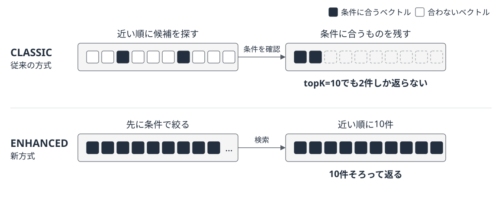

# S3 Vectorsのメタデータフィルタが事前フィルタリングに対応

本書の執筆後、S3 Vectorsのメタデータフィルタに事前フィルタリング方式が導入されました！

[AWSの発表](https://aws.amazon.com/jp/about-aws/whats-new/2026/09/s3-vectors-introduces-metadata-pre-filtering/)

付録「Amazon S3 Vectorsによる小規模RAG向けベクトルストアの活用」では、Knowledge Basesと組み合わせたメタデータフィルタリングを紹介しました。この手順はそのまま使えるのですが、変わった点はS3 Vectors内部でフィルタ条件を評価する順番です。

## 従来の方式との違い

従来の方式では、類似度の高い候補を探しながら、各候補がフィルタ条件に合うかを同時に検索していました。そのため条件に合うベクトルがごく一部しかないと、`topK`に指定した件数より少ない結果しか返らないことがあります。

それが新方式では、メタデータ条件に合うベクトルを先に特定し、その中で類似度検索を行います。そのため条件に合うベクトルが少なくても、件数が欠けにくくなります。[公式ドキュメント](https://docs.aws.amazon.com/AmazonS3/latest/userguide/s3-vectors-metadata-filtering.html)では従来方式を`CLASSIC`、新方式を`ENHANCED`というインデックスモード名で区別しています。`PutVectors`や`QueryVectors`の呼び出し方は従来と変わらず、追加料金もかかりません。



## 9月30日より前に作ったインデックスは従来の方式のまま

2026年9月30日以降に作成したベクトルバケットでは、インデックスが自動で`ENHANCED`になり、それ以前に作成したバケットのインデックスは`CLASSIC`のままです。付録の手順に沿ってKnowledge Basesのクイック作成を使った場合も、裏側のインデックスは同じ扱いです。

自分のアカウントで2026年5月と9月に作成したKnowledge Bases用のインデックス4件を`GetIndex`で確認したところ、いずれも`"indexMode": "CLASSIC"`でした。

既存のインデックスは、データを取り込み直さずに`ENHANCED`へ切り替えられます。AWSも切り替えを推奨しているので、基本は切り替えておきましょう。S3コンソールのベクトルバケット画面で対象のインデックスを開き、［Enable enhanced index mode］を選択します。AWS CLIを使う場合は次のコマンドを実行します。[インデックスモードの変更手順](https://docs.aws.amazon.com/AmazonS3/latest/userguide/s3-vectors-index-mode.html)

```bash
aws s3vectors update-index-mode \
  --vector-bucket-name <ベクトルバケット名> \
  --index-name <インデックス名> \
  --index-mode ENHANCED
```

## `$startsWith`はKnowledge Bases経由では使えない

S3 Vectorsのフィルタに前方一致の`$startsWith`が追加されました。`ENHANCED`のインデックスであれば、付録の`s3_vectors_standalone.py`のように`QueryVectors`を直接呼び出す構成で`{"source_path": {"$startsWith": "/legal/"}}`のようにパス単位で絞り込めます。`CLASSIC`のインデックスでは`queryMode`に`ENHANCED`を指定しないと`$startsWith filter operator is supported only in ENHANCED queries`というエラーになります。

一方、Knowledge Basesの`Retrieve` APIで指定する`startsWith`は[APIリファレンス](https://docs.aws.amazon.com/bedrock/latest/APIReference/API_agent-runtime_RetrievalFilter.html)のとおり引き続きOpenSearch Serverless専用です。第3章の表3-2の記述も変わりません。

## フィルタの条件数は100まで

`ENHANCED`のインデックスでは、1回のクエリに含められるフィルタ条件は100個までです。`$in`に並べた値も1つずつ条件として数えます。本書で扱うフィルタは数個の条件にとどまるため、この制限は受けません。顧客IDや文書IDを大量に並べて絞り込むような運用では、移行前に条件数を確認してください。

[オンライン補足の一覧に戻る](../README.md)
